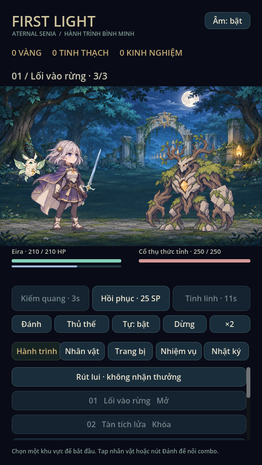

# Aternal Senia — First Light · 0.20

## Hồ sơ tạo hình cho phiên chat tiếp theo

Đọc [phong cách và canon nhân vật](docs/CHARACTER_BIBLE.md) cùng [quy trình tạo ảnh, tích hợp và kiểm tra](docs/CHARACTER_CREATION_GUIDE.md) trước khi làm nhân vật. Hồ sơ phân biệt thiết kế riêng với tham khảo Eternal Senia, Ryn hiện tại với Lyra và các raw đã loại bỏ.


## Nhiệm vụ & VIP EXP · 0.20

Ba tab Hằng ngày / Hằng tuần / Tiến trình. Có điểm hoạt động0–100, năm rương
mốc, nhiệm vụ theo thao tác chơi thật và VIP EXP khi nhận quà. Tiến trình cũ
được giữ; VIP EXP được lưu nhưng mốc lên VIP1–10 chờ cấu hình.
[Xem nhiệm vụ, phần thưởng và reset](docs/MISSIONS.md).

## Ryn đồng bộ phong cách · 0.19

Vẽ lại Ryn theo phong cách Eira/Mira/Lyra: giáp ngà, áo choàng đỏ rượu, tóc ngang vai có bím nhỏ. Bộ mới có chân dung/layer tóc–vải và 16 pose chiến đấu, thương rời đổi hình theo trang bị. Giữ tương tác và tiến trình Ryn; đã xóa 7 file raw/metadata cũ cùng 28 SVG mẫu khỏi bản hiện tại.

[Xem Ryn mới, GIF và toàn bộ pose](docs/RYN_ART.md).

## Triệu hồi · 0.17

Banner trái, ba loại Thường/Cao cấp/Sự kiện bên phải; nút x1 và x10, thanh mở
lịch sử riêng. Thường dùng120 vàng/lượt, x10 là1200 vàng trong một giao dịch.
Bộ đếm chỉ hiện ở Cao cấp/Sự kiện, hai bộ đếm độc lập; mốc/phần thưởng chưa
cấu hình và hai banner này chưa mở. [Chi tiết và ảnh](docs/SUMMON_SCREEN.md).

## Đồ họa đồng bộ & Lyra · 0.16

Giữ nguyên Ryn trưởng thành, ảnh/layer và tương tác của 0.13. Nhân vật tóc nâu áo choàng đỏ mới là **Lyra**, thương thủ hoàng hôn 24 tuổi, mở sau chương 3 hoặc triệu hồi. Mira và Lyra có 16 pose PNG mỗi người; các vùng và boss còn lại đã có tranh, vũ khí rời mới, đủ 14 biểu tượng trang bị. Giao diện giữ Shop/Nhân vật/Hành trình/Phó bản/Túi đồ cùng các tính năng mới, bổ sung nền, thẻ tranh, ảnh item và huy hiệu chiến thắng.

- [Video giao diện và trận ba boss](docs/previews/visual-showcase.mp4)
- [Ảnh, phạm vi và bằng chứng kiểm tra](docs/GRAPHICS_COMPLETE.md)

## Hồ sơ & VIP · 0.15

Góc trên trái có avatar tròn, tên người chơi và trạng thái VIP. Chạm để đổi tên,
chọn avatar nhân vật đã sở hữu, hoặc xem VIP1–10. VIP theo nạp tiền; hiện chỉ
có giao diện, chưa có thanh toán, điểm nạp hoặc quyền lợi được kích hoạt.
[Xem giao diện và phạm vi](docs/PLAYER_VIP.md).

## Ryn · Hỏa vũ trưởng thành · 0.14

Ryn có tạo hình nữ trưởng thành 27 tuổi, giáp đỏ–đen và thương lửa mới. Chân
dung tách thân/vũ khí, tóc và tà áo. Tóc/vải uốn phần ngọn độc lập, có độ trễ khi kéo và nhún
rõ hơn khi chạm. Có nút **Xem Ryn phóng lớn** trong màn Nhân vật.

Trong trận đã thay SVG bằng 12 pose PNG cho bảy trạng thái. Giữ stats, skill,
save và mốc gây sát thương. [Xem ảnh động và chi tiết](docs/RYN_ART.md).

## Shop, độ hiếm & nhân vật · 0.12

- Nhân vật có thêm hai mục **Kỹ năng** (cây nhánh ngay trong khung phải) và
  **Trang phục** (xem trước/áp dụng phối màu, không đổi chỉ số).
- **5★ là độ hiếm gốc**, không phải điều kiện nâng sao để mở tương tác. Ba hero
  chơi hiện tại là mẫu 5★; đối thủ 1–4★ được phân loại riêng. Chân dung 5★ có
  chạm/kéo/nhún; Ryn có tóc/vải tách lớp (0.14), Eira/Mira còn nhún toàn sprite.
- Trang bị đủ **7 bậc**; Tinh linh dùng **SR/SSR/UR** riêng (Lumi SR, Ash SSR;
  chưa thêm mẫu UR). Kho có bộ lọc tương ứng.
- Shop có sáu mục cuộn ngang: **Vàng, Kim cương, Triệu hồi, Sự kiện, Gói ưu đãi,
  Quảng cáo thưởng**. Vàng và Triệu hồi hoạt động; bốn dịch vụ còn lại hiện là
  giao diện chờ cấu hình, không có SDK quảng cáo/thanh toán thật.
- Save v5 đọc v2/v3/v4, giữ ví, vật phẩm, sao mở rộng và pending snapshot.

[Ảnh, công thức và kiểm chứng](docs/SHOP_RARITY_CHARACTER.md).

## Mục Nhân vật ba cột · 0.11

Theo phác thảo người dùng: cột ảnh chân dung chọn hero ở trái, năm mục ở giữa,
khung nội dung cuộn riêng ở phải. **Thông tin · Trang bị · Cường hóa (LV) ·
Mở rộng (mảnh tăng sao) · Tiến hóa**. Có thể xem và nâng một hero mà không đổi
người đang ra trận; chọn ra trận là thao tác riêng.

Tiến hóa nhân vật có ba bậc, điều kiện LV/sao và phí vàng/tinh thạch/lõi hiển thị
trước khi nâng; tách biệt tăng sao. Giữ tiến trình tăng sao cũ và save v4.
[Ảnh và quy tắc](docs/CHARACTER_SCREEN.md).

## Giao diện mobile & Túi đồ · 0.10

Thanh dưới cố định: **Shop · Nhân vật · Hành trình · Phó bản · Túi đồ**.
Hành trình ở giữa, mở mặc định; nhiệm vụ/nhật ký/cài đặt ở menu ≡ góc trên.
Ngoài trận chỉ hiện đội hình, nút vào ải và ba lối tắt; điều khiển chiến đấu chỉ
hiện khi có trận. Bản đồ và phụ bản có màn riêng.

Túi đồ chia kho Trang bị, Tinh linh, Nguyên liệu và Lò rèn. Trang bị dạng lưới,
lọc loại/độ hiếm, chi tiết và thao tác ở màn riêng. Giữ UID, giới hạn 40 món và
save v4 hiện có. [Ảnh và kiểm chứng](docs/MOBILE_INVENTORY.md).

## Tính năng 0.9 · Kỹ năng, nâng cấp & triệu hồi

- **Hai cây kỹ năng riêng**: nhân vật có Kiếm quang/Hồi phục và bốn nhánh;
  Lumi/Ash có cấp chủ động riêng, hai tầng với bốn nhánh Tinh linh.
- **Nâng cấp & Thức tỉnh**: xem chỉ số trước/sau, tăng 1 hoặc tối đa 5 cấp,
  thức tỉnh ba bậc bằng mảnh nhân vật trùng. Khóa build khi còn trận đang dở.
- **Triệu hồi** ở Hành trình: 120 vàng/lượt; Thường 70%, Hiếm 25%, Sử thi 5%;
  tối đa 20 lượt bảo đảm Sử thi. Có nhân vật, tinh linh và trang bị, xử lý bản
  sao, lịch sử và Giáp tinh vân Sử thi mới. Không cần trả tiền hoặc kết nối mạng.
- **Hiệu ứng kỹ năng**: vòng niệm phép, chém giao nhau, dải hồi phục và vụ nổ
  Tinh linh; nhóm nút và nơi thi triển phân biệt nhân vật/Tinh linh.

[Quy tắc, migration và ảnh trong game](docs/PROGRESSION_09.md).

## Icon giao diện · 0.8.1

16 icon PNG alpha mới, phong cách ngà/vàng/ngọc lam: điều hướng, ba kỹ năng,
thủ thế, thuộc tính, cây kỹ năng, đồng hành, boss, rèn và tài nguyên. Đã gắn vào
nút trong game, giữ nhãn chữ, trạng thái khóa và thao tác cũ.
[Xem bộ icon và ảnh trong game](docs/UI_ICONS.md).

## Tính năng 0.8 · Rèn luyện & Sổ tay boss

- **Nhân vật → Điểm thuộc tính**: mỗi cấp sau cấp 1 cho 2 điểm riêng; mỗi điểm
  cộng 10 HP, 1,5 ATK hoặc 0,75 phòng thủ. Cộng/bớt và hoàn điểm miễn phí ngoài
  trận. Nhân vật từ save cũ nhận đủ điểm theo cấp hiện tại.
- **Nhật ký → Sổ tay boss**: thông tin năm boss chính mở theo chương; xem chỉ
  số, nguyên tố khắc chế, gợi ý thủ/phá khiên/phản đòn và loot có thể rơi.

Giữ save v3 và toàn bộ nội dung/mỹ thuật 0.7. [Quy tắc và kiểm chứng](docs/TRAINING.md).

## Mỹ thuật tiếp nối · Phế tích, Hồ gương & Ash

Hai vùng `ruins` và `lake` đã thay nền SVG bằng tranh PNG tạo riêng. Ash có
sprite phượng hồ lửa trong suốt thay hình tròn tạm. Lumi/Ash có chuyển động
bay, nghiêng nhẹ và phản ứng khi trợ chiến; các vùng có hai lớp hạt sáng,
phế tích/tháp dùng tàn lửa. Chuyển động lấy thời gian trận, dừng khi pause,
không dùng RNG chiến đấu hoặc tạo thêm node mỗi frame.

Đây là animation bằng transform của sprite, chưa phải bộ frame vỗ cánh mới.
Ryn/Mira, nền núi/tháp và một số quái vẫn dùng SVG; chưa kiểm điện thoại thật.
Xem [ghi chú mỹ thuật](docs/ENVIRONMENT_ART.md) và ảnh trong đó.

Game Godot 4 màn hình dọc, chiến đấu một nhân vật chính + một trợ chiến.
Tham khảo cấu trúc Eternal Senia 2; nội dung, công thức và hình ảnh trong game
được tạo riêng. Đây là bản chơi hoàn chỉnh nhỏ với các hệ thống chính, chưa phải
bản thương mại hoặc bản phục hồi toàn bộ nội dung game gốc.

## Chơi

Mở `project.godot` bằng **Godot 4.6.x**, đợi import rồi nhấn **F5**.
Hoặc `godot --path .` sau khi import. Chọn Hành trình → Vào ải → Tiến vào.

- Tự đánh hoặc tap nhân vật / nút Đánh để nối combo ba nhịp.
- Ba kỹ năng dùng SP: đòn mạnh, hồi phục, tinh linh phá khiên. SP tự hồi.
- Bấm Thủ thế ngay trước khi vòng cảnh báo đầy: giảm 80% sát thương trong 0,7s.
- Boss có đòn nặng, khiên hoặc phản đòn. Ngưng kỹ năng lúc phản đòn.
- Dừng/tiếp tục, tốc độ ×1/×2/×3 và bật/tắt âm. Nút ♫ mở mức hiệu ứng/tiếng rừng và nghe thử.
- Các trang quản lý chiếm toàn màn hình; mở chúng trong trận sẽ tạm dừng trận.

## Nội dung hiện có

| Hệ thống | Nội dung chơi được |
|---|---|
| Nhân vật | Eira, Ryn, Mira; nội tại và chỉ số riêng; mở sau ải 1/2 |
| Trợ chiến | Lumi hồi máu, Ash tấn công; tăng cấp riêng |
| Vũ khí | 6 mẫu kiếm/thương/trượng; 6 nội tại riêng tác động chiến đấu; đổi hình khi trang bị |
| Trang bị | 4 món giáp; UID riêng; cường hóa +10, tiến bậc 3, rèn, phân giải; Giáp tinh vân chỉ triệu hồi |
| Kỹ năng | 2 kỹ năng nhân vật + 1 Tinh linh, 10 cấp; hai cây riêng, tổng 8 lựa chọn nhánh |
| Bản đồ | 5 chương chính + 10 màn truyện nhánh; 3 phụ bản gồm săn boss, 6 đợt và 3 boss liên tiếp |
| Phần thưởng | Vàng, XP, tinh thạch, loot; thưởng lần đầu; túi 40 ô, đổi loot dư |
| Mục tiêu | 5 nhiệm vụ + 6 thành tựu; bộ sưu tập trang bị/boss/đồng hành; 30 đoạn truyện trước/sau màn chính và nhánh |
| Tiếp tế | Tích theo thời gian thực, kể cả khi đóng game; trần 2 giờ |
| Trình bày | Eira 32 pose PNG / 7 trạng thái, boss cây 8 pose, 16 mẫu VFX, kiếm Dawnveil, Lumi, rừng đêm và quái rừng mới; Ryn/Mira và các vùng khác còn SVG; 38 SFX ElevenLabs + loop tiếng rừng ElevenLabs |

Tăng cấp nhân vật dùng vàng + XP. Nâng kỹ năng/trợ chiến dùng vàng. Nâng trang
bị dùng vàng + tinh thạch. Vũ khí bậc hiếm giảm hồi chiêu 8%; hệ khắc chế tăng
20% sát thương (quy tắc mới, xem tài liệu hệ thống).

## Lưu tiến trình

Save mới: `user://first_light_v2.json`; tự chuyển vàng và cấp Eira từ v1, giữ
nguyên file cũ. Schema hiện tại v4, đọc save v2/v3 tại cùng đường dẫn; lần ghi đầu giữ backup file cũ. Ghi qua file tạm, kiểm dữ liệu, tạo `.bak` rồi thay file chính.
Save lỗi được giữ lại; nếu backup hợp lệ sẽ phục hồi. Save của phiên bản mới hơn
bị khóa ghi. Lỗi nâng cấp/nhận thưởng không đổi ví trong RAM; có thể thử lại.

Thoát giữa trận: lần sau được chạy lại trận từ snapshot đã lưu, cùng seed. Rút
lui không thưởng. Thưởng theo run ID, nhiệm vụ và tiếp tế không nhận trùng.
Đây là game offline: đồng hồ máy ảnh hưởng tiếp tế, không có chống chỉnh giờ.

Biến `FIRST_LIGHT_SAVE_DIR` chọn thư mục save riêng để thử mà không chạm profile
người chơi. Không đổi tên project nếu muốn giữ đúng vị trí `user://`.

## Kiểm tra

```sh
godot --headless --path . --editor --quit
godot --headless --path . --script tests/regression.gd
godot --headless --path . --script tests/mechanics.gd
godot --headless --path . --script tests/campaign.gd
# Cần màn hình hoặc Xvfb; ảnh mặc định tại user://first_light_previews:
godot --path . --script tests/ui_flow.gd
godot --path . --script tests/animation_gallery.gd
```

Tests dùng profile riêng. Có thể đặt `FIRST_LIGHT_CAPTURE_DIR` để chọn nơi lưu
ảnh. `tests/smoke.gd` vẫn chạy được và chuyển sang bộ regression mới.

Đã kiểm trên Godot 4.6.3 / Linux: 81 assertions hồi quy, cơ chế boss, 54 tổ hợp
nhân vật/ải, chiến dịch đủ 5 ải từ profile mới chỉ dùng thưởng kiếm được; kiểm UI
render thực với X11/Mesa và xem ảnh. Chưa thử Android/iOS, touch thật hoặc đo
FPS/nhiệt. Audio đã được ghi từ mixer thật qua AudioEffectRecord với driver Dummy, kiểm PCM và clipping; chưa nghe qua loa thật.

## Tài liệu và công cụ

- [Đối chiếu repo tham khảo](docs/REFERENCE_MAP.md): nguồn, bằng chứng, giới hạn.
- [Kiến trúc và công thức](docs/SYSTEMS.md).
- [Pipeline frame / vũ khí](docs/ART_PIPELINE.md).
- `tools/build_catalog.py`, `tools/build_art.py`: tái tạo nội dung mẫu. Bộ âm hiện tại được nhập bằng `tools/import_elevenlabs_audio.py`; `tools/build_audio.py` cũ từ chối ghi đè ElevenLabs. `tools/build_combat_manifest.py` tái tạo toàn bộ metadata PNG hiện tại (gọi builder nền trước).

## Tạo hình 0.3 · Eira và rừng đầu tiên



Eira có tóc bạc, áo choàng xanh tím, giáp ngà và tinh thể bình minh. Atlas có
16 pose vẽ riêng; kiếm Dawnveil gắn theo socket từng pose, có lớp bàn tay che
cán. Lumi, slime, sói và boss cổ thụ có artwork mới, boss đổi pose khi tụ lực.
Nền rừng đã thay bằng tranh đêm xanh sâu với phế tích và ánh vàng ấm.

- [Concept Eira](docs/concepts/eira-design.png)
- [Đủ 16 pose trong renderer](docs/previews/eira-poses.png)
- Mở `tools/pose_lab.tscn`, nhấn F6: phát/dừng, tiến/lùi frame, seek,
  ×0.25/×0.5/×1/×2/×3, đổi hai kiếm, hiện điểm neo.
- `tests/painted_art.gd` kiểm manifest/sockets/seek; `tests/painted_gallery.gd`
  chụp toàn bộ pose. PNG gốc và provenance nằm ở `art/painted/`.

Đây là lượt mỹ thuật đầu cho Eira và khu rừng. Ryn, Mira, Ash và các khu vực
khác vẫn dùng hình mẫu SVG, cần làm tiếp cùng phong cách. Animation Eira hiện
có 4 pose chạy và 4 pose đánh chính, chưa phải animation nhiều frame đã tinh
chỉnh hoàn toàn; có khác biệt nhỏ về nếp áo/chi tiết giữa các pose tạo hình.
Chưa có APK, nhạc nền dài hoặc nội dung dài hàng trăm ải. Không kèm tài nguyên gốc
trích từ archive nghiên cứu.

## Âm thanh 0.5 · ElevenLabs

Toàn bộ 38 SFX và một ambience rừng đã được tạo qua **ElevenLabs Text to Sound v2**, dùng GitHub Secret tại repo Live-Youtube-American. Khóa không được đưa vào game.

Bộ SFX khớp marker: tiếng vung/trúng theo vũ khí, chí mạng, kỹ năng,
trợ chiến, thủ thế, khiên, boss và UI. Có 38 WAV / 34 cue và loop rừng stereo,
pool voice và limiter chống âm dồn. Mute tức thì; pause dừng âm combat, UI vẫn
nghe được. Volume độc lập, preview/áp dụng/hủy, tương thích save cũ.

[Xem cách áp dụng quy tắc từ repo tham khảo](docs/AUDIO.md) ·
[Nghe đoạn ghi trong game](docs/audio/combat-preview.wav) ·
[Ảnh bảng chỉnh âm](docs/previews/audio-settings.png).

Kiểm thêm: `godot --headless --path . --script tests/audio.gd` (93 checks) và
`python3 tests/validate_audio.py`. 39 yêu cầu tạo âm đều trả HTTP 200; có MP3 gốc, SHA256 và biên nhận trong `art/audio/elevenlabs/`. Python chỉ dùng căn onset/độ dài, chuẩn hóa và đổi định dạng sau khi tạo. Không dùng lại bộ âm tổng hợp bằng code hoặc audio từ game tham khảo.

## Cảm giác chiến đấu 0.6

Thêm vệt kiếm, va chạm, hồi phục, khiên/vỡ khiên, cảnh báo đòn boss và rung nhẹ trong khung trận. Eira có thêm pose chuyển tiếp, lướt tới mục tiêu rồi thu kiếm; boss cây có chuỗi tụ lực–giáng đòn–hồi thế. Marker sát thương vẫn do BattleModel quyết định, dùng chung thời điểm với âm ElevenLabs.

- [Video một trận đầy đủ có âm thanh](docs/previews/combat-demo.mp4)
- [Ảnh hiệu ứng trong game](docs/previews/combat-impact.png)
- [Chi tiết và cách kiểm tra](docs/COMBAT_FEEL.md)

## Tính năng 0.7 · Ký ức & Đồng hành

- **Nhân vật → Cây kỹ năng**: ba tầng mở ở cấp 2/3/4, mỗi tầng chọn một nhánh; đã học thì đổi miễn phí ngoài trận.
- **Nhân vật → Tiến hóa đồng hành**: ba bậc; nâng cấp đồng hành và kiếm lõi tinh linh để mở nội tại mới.
- **Hành trình → Chương truyện & phụ bản**: 10 màn nhánh nối từ 5 chương chính; Săn cổ thụ, Tháp sáu đợt, Tam vệ bình minh. Có kỷ lục điểm/thời gian và thưởng lõi.
- **Trang bị**: xem sáu nội tại vũ khí, có tác dụng thực ở marker chiến đấu.
- **Nhiệm vụ → Bộ sưu tập & thành tựu**: ghi nhớ đồ đã tìm, boss đã hạ, bậc đồng hành; nhận sáu mốc thưởng một lần.

[Hướng dẫn, công thức và bằng chứng kiểm tra](docs/EXPANSION.md). Nội dung mới dùng artwork/âm hiện có; đây là mở rộng hệ thống, chưa bổ sung tranh riêng cho từng màn.
