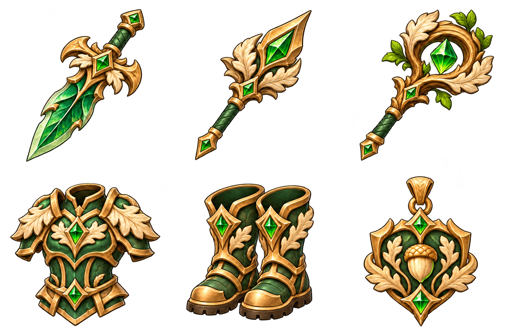
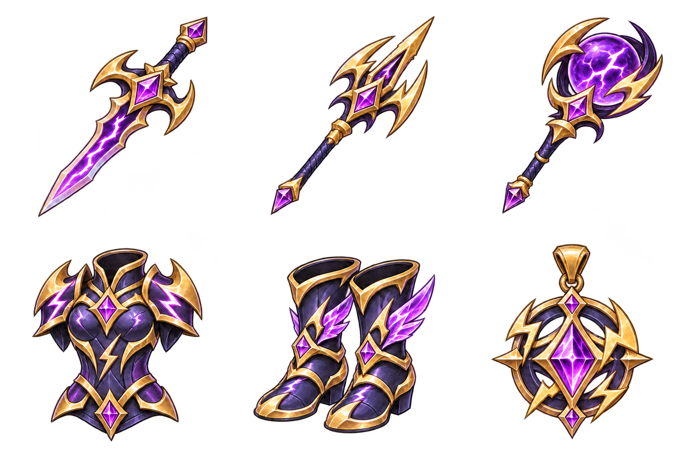
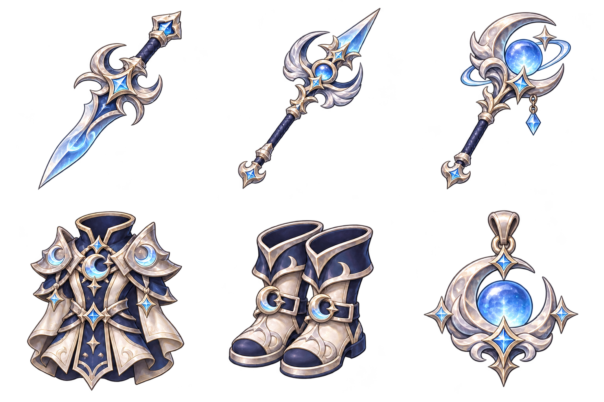
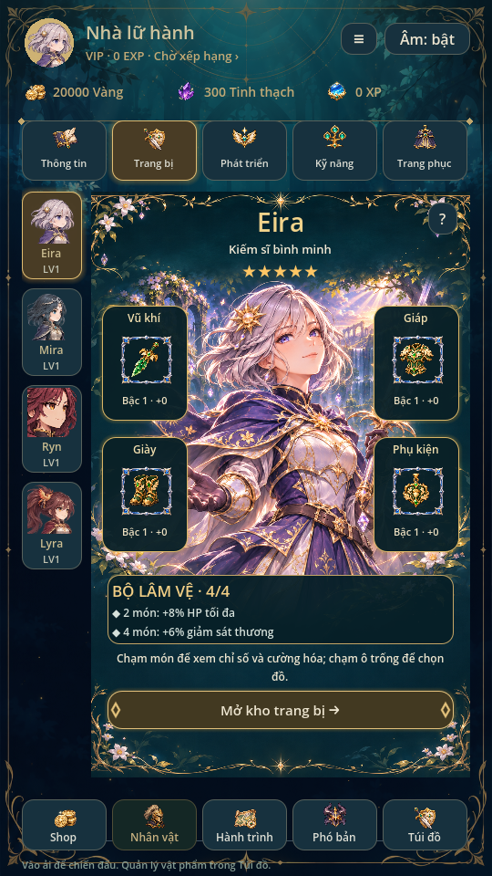
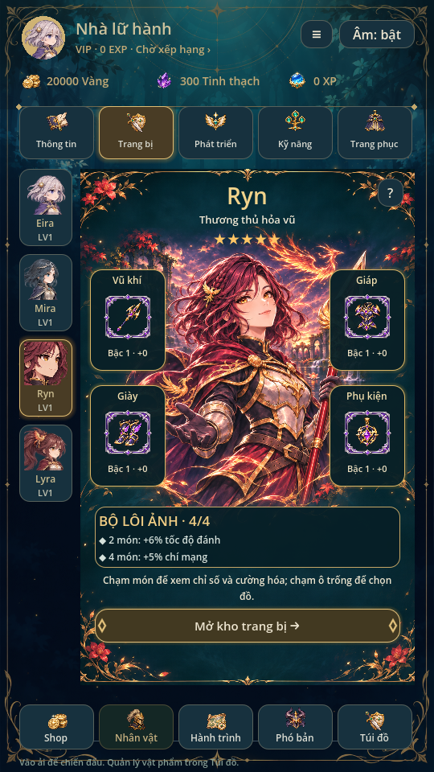
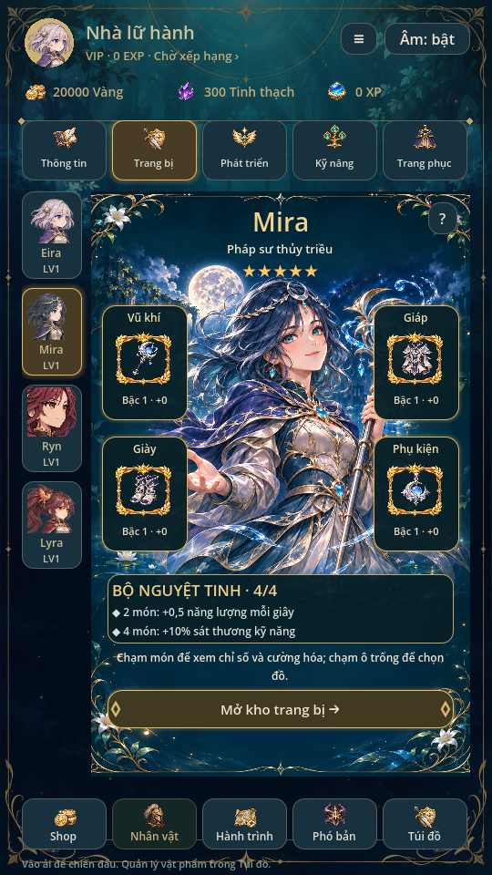

> Trạng thái chuẩn: [GAME_STATE](GAME_STATE.md), [mục lục](INDEX.md). Các phần ghi phiên bản cũ là lịch sử; ưu tiên yêu cầu mới và quy tắc hiện hành.

# Ba bộ trang bị mới · 0.35

Thêm **18 món, ba bộ**, mỗi bộ gồm kiếm/thương/trượng/giáp/giày/phụ kiện.
Một hero dùng một vũ khí đúng lớp và ba phòng cụ dùng chung; đủ bốn ô để
kích hoạt bộ4 món. Tổng catalogue44 món/sáu bộ, registry98 icon. Giữ nguyên
26 món và ba bộ trước, không tự phát đồ mới vào save người chơi.

## Vai trò, độ hiếm và cách nhận

| Bộ | Độ hiếm | Hai món | Bốn món | Nhận ở đâu |
| --- | --- | --- | --- | --- |
| Lâm Vệ (`grove`) | Hiếm | +8% HP | +6% giảm sát thương | Lò rèn65 vàng +3 tinh thạch/món; nhóm Nâng cao của triệu hồi Thường |
| Lôi Ảnh (`storm`) | Sử thi | +6% tốc độ đánh | +5 điểm phần trăm chí mạng | Nhóm Cao cấp của triệu hồi Thường |
| Nguyệt Tinh (`moon`) | Huyền thoại | +0,5 năng lượng/giây | +10% sát thương kỹ năng | Nhóm Cao cấp của triệu hồi Thường |

Thưởng mốc2 và4 cộng theo hệ thống đang có, không tính đồ nằm trong túi hoặc
trang phục. Năng lượng là nộ trong TeamBattle, SP trong model trận cũ; không
tự tăng nộ tinh linh hoặc hiệu quả hồi máu. Bộ Nguyệt Tinh tăng **sát thương**
kỹ năng, không tuyên bố tăng trị liệu nếu model chưa hỗ trợ công thức đó.

Các nhóm quay vẫn70/25/5%, giá120 vàng, pity20 nhóm cuối và x10 atomic giữ
nguyên. Thêm vật phẩm làm thay đổi xác suất mỗi mục trong pool, không duy trì
nguyên tỷ lệ riêng từng hero. Màn Tỷ lệ & quy tắc tính từ catalogue/trọng số
thật và phản ánh các món mới. Không mở banner Cao cấp/Sự kiện đang khóa.

## Tạo hình

- **Lâm Vệ:** ngọc lục bảo, đồng ấm, lá sồi và gỗ ngà; dáng giáp chắc chắn.
- **Lôi Ảnh:** tím chàm, vàng và tinh thể sét; vũ khí sắc, bốt gọn có cánh sét.
- **Nguyệt Tinh:** bạc ngọc trai, xanh băng, trăng lưỡi liềm và đá mặt trăng.

Ba atlas mới1536×1024 chia **3 cột ×2 hàng**: kiếm/thương/trượng ở hàng trên,
giáp/giày/phụ kiện ở hàng dưới. Sáu ô512×512, nền alpha trong suốt, không chữ
hay khung độ hiếm vẽ liền. Các vòng trắng/vàng là chi tiết vật phẩm, khung
Hiếm/Sử thi/Huyền thoại do EquipmentArt hiện có vẽ theo dữ liệu.

Ảnh được tạo mới qua image generation, lấy gear.png của dự án làm mẫu nét;
đã làm sạch nền bằng image generation rồi copy nguyên byte nguồn duyệt.
Không sửa pixel/chroma-key bằng script. Hash ở art/icons/provenance.json;
build_icon_manifest.py chia grid theo sheet và build_complete_art.py đăng ký
vào FrameLibrary/UIIcons. Không dùng asset trích xuất từ game tham khảo.

Icon trang bị có hình mới trong kho, rèn, chi tiết và ô mặc. **Vũ khí cầm trong
trận dùng alias sprite đúng lớp hiện có**, chưa có chín atlas battle vũ khí
riêng; giáp không thay bộ tranh trang phục/nhân vật. Không đổi sprite hero,
khung độ hiếm hoặc rig vì thêm item.

## Cân bằng và giao dịch

| Chỉ số +0/bậc1 | Lâm Vệ | Lôi Ảnh | Nguyệt Tinh |
| --- | --- | --- | --- |
| ATK vũ khí | 9 | 15, +2% crit | 17, +0,25 năng lượng/giây |
| HP/thủ giáp | 55 /3 | 90 /4 | 110 /6, giảm sát thương2% |
| HP/thủ/tốc đánh giày | 10 /1 /2% | 15 /1 /4% | 20 /2 /3% |
| HP/phụ kiện | 50 | 70, +2% crit | 90, +0,25 năng lượng/giây |

Cooldown scale vũ khí lần lượt0,98/0,96/0,94. Lâm Vệ dễ nhận, đánh yếu hơn
vũ khí12ATK cũ để đổi khả năng sống sót. Lôi Ảnh là nhánh tốc đánh thay cho
ATK Hỏa Vũ; Nguyệt Tinh không có proc hoàn năng lượng khi heal như Trượng
thủy triều. Giữ cap crit75%, tốc đánh30%, giảm sát thương25%, hồi thêm3/s,
cường hóa+15 và rank1–3. Không thêm proc/RNG renderer hoặc tỷ lệ hiệu ứng mới.

Rèn, nâng cấp, hợp thành, phân giải và nhiều bản cùng tên dùng transaction
hiện có: mỗi UID nâng độc lập, túi40 món, khóa pending/read-only. Chỉ rèn bộ
Lâm Vệ; hai bộ kia summon_only. Xem đồ không ghi profile hoặc đổi hero ra trận.

## Save v11

Đọc v2–v10. Với v9/v10, kiểm map26 ID cũ trước; v7/v8 kiểm14 ID cũ. Sau kiểm
hợp lệ mới thêm18 key mảnh với0; giữ lượng mảnh đã có, ví, UID, next_uid,
enhance/rank, nhiều bản cùng base, cấu hình hero, bag_rewards, cài đặt/nhiệm
vụ và pending snapshot nguyên dữ liệu. Không tính lại build trận đang dở.

Không sửa savev11 thiếu key thành save mới. V10 sai/thiếu key cũ vẫn read-only;
lỗi ghi giữ RAM/file trước giao dịch; lần ghi thành công giữ backup byte gốc.
Không đổi đường dẫn save hoặc xóa đồ để vừa catalogue mới.

## Nguồn sửa và kiểm chứng

Nguồn catalogue: tools/build_equipment.py, được build_catalog.py gọi.
Nguồn registry/alias: build_icon_manifest.py và build_complete_art.py. Sau khi
thay dữ liệu/art, chạy hai builder catalogue/complete_art; giữ PNG nguồn.

additional_equipment kiểm ngưỡng1/2/3/4 món trên cả ba lớp, stats thật, snapshot
3vN, rèn/pool, v10 có đồ trùng đã đầu tư và loot chờ, giữ pending/backup,
rollback và từ chối map hỏng. additional_equipment_ui render ba bộ mặc4/4,
chi tiết, kho/rèn; kiểm18 ô icon có padding trong suốt và duyệt không ghi save.

Regression87, mechanics72, campaign5, equipment_sets, bag_inventory,
recruitment, summon_batch, rarity_system, unique_collection, Lyra, team_battle/
matrix/campaign/flow và UI kho/nhân vật/trang bị/triệu hồi/battle/icon gallery/
ui_flow/animation_gallery/swipe_scroll đạt. Các fixture cũ không cố nhét44 món
vào túi40; kiểm mở hero dùng lượt quay đích thật, không lệ thuộc seed của pool
cũ. Test riêng, Godot4.6.3 Linux/X11/Mesa; chưa kiểm trên điện thoại thật.

