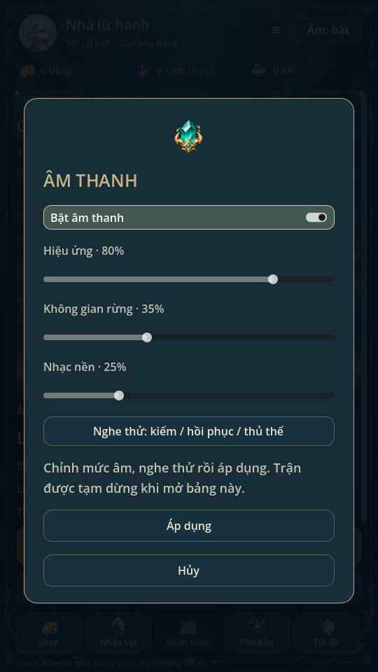

# Nhạc nền chill & hiệu ứng giao diện · 0.32

[Nghe nhạc Moonlit Rest](../art/audio/moonlit_rest.ogg) ·
[Nghe bản thu mixer trong game](audio/music-combat-preview.ogg)

## Nội dung mới

Một bản **Moonlit Rest** không lời, yêu cầu60 giây: piano felt ấm, harp thưa,
celesta và lớp dây nhẹ, nhịp chill68 BPM, không trống hoặc cao trào lớn. Tạo bằng
**ElevenLabs Music `music_v1`**, đặt `force_instrumental=true`; không dùng SFX
giả làm nhạc. Nguồn MP3 giữ nguyên. Bản phát stereo44100Hz Vorbis dùng nối
chéo equal-power3 giây đầu/cuối, dài khoảng57,08 giây và lặp bằng engine.
Hậu kỳ loudnorm mục tiêu−20 LUFS/true peak−3dB; không tự tổng hợp nhạc bằng code.

Tám SFX mới từ ElevenLabs `eleven_text_to_sound_v2`:

| Cue | Thao tác |
| --- | --- |
| menu_open | Đổi trang/tab, mở Túi đồ |
| menu_back | Nút đóng/hủy hộp thoại |
| quest_claim | Nhận thưởng nhiệm vụ hoặc rương hoạt động thành công |
| summon_reveal | Kết quả triệu hồi thông thường |
| rarity_reveal | Kết quả có gear Huyền thoại+ / hero5★ / spirit SSR+ |
| equipment_fuse | Hợp thành trang bị thành công |
| dismantle | Phân giải một hoặc nhiều món thành công |
| spirit_select | Đổi tinh linh đồng hành thành công |

Tổng runtime46 file SFX/42 cue, một ambience rừng và một nhạc nền. Mỗi lượt
triệu hồi chỉ phát một reveal cho cả batch; mở lịch sử không phát lại. Các
âm thưởng/hợp thành/phân giải chỉ phát sau commit thành công. Điều hướng không
phát thêm ui_click chồng lên menu_open/menu_back. Timing chiến đấu và RNG giữ nguyên.

## Mức âm và vòng đời

Bus `FirstLightMusic` riêng, một AudioStreamPlayer cố định, không dùng pool12
SFX. Mức mặc định nhạc35%; SFX80%, rừng35% như cũ. Nhạc nhỏ dần khi bắt đầu,
duy trì vị trí qua đổi tab; trong trận ở màn Hành trình hạ thêm9dB, ra menu
trở lại mức nền qua chuyển tiếp15dB/giây. Tốc độ trận không đổi pitch nhạc.
Tạm dừng trận/menu vẫn nghe nhạc; chuyển app Android ra nền pause các nguồn,
quay lại tiếp tục. Master off hoặc mức nhạc0 dừng nhạc ngay; thoát game clear stream.

Bảng Âm thanh có ba thanh riêng: Hiệu ứng / Không gian rừng / Nhạc nền.
Preview không ghi save; Áp dụng ghi cùng transaction, Hủy khôi phục mức đã lưu.
`settings.music_volume` là field tùy chọn của savev10: save cũ thiếu dùng35%,
không reset/chuyển vị trí save; lời gọi audio_settings ba tham số cũ giữ mức
nhạc đang lưu. Không có request mạng/API khi chơi.



## Nguồn và lượt tạo

Secret vẫn dùng tại chỗ trong repo Live-Youtube-American, chỉ trên nhánh
`codex/aternal-elevenlabs-audio-v2`; không sửa main hoặc xuất key.

- [Batch8 SFX](https://github.com/tai23082004l02-svg/Live-Youtube-American/actions/runs/42381344499):
  8 HTTP200; request Music ban đầu HTTP401 missing_permissions. Receipt giữ đúng
  trạng thái stopped, không sửa thành hoàn tất hoặc chạy lại batch tính phí.
- Người dùng bật quyền Music và xác nhận trong chat. [Batch nhạc riêng](https://github.com/tai23082004l02-svg/Live-Youtube-American/actions/runs/42381654487):
  đúng một request Music, HTTP200; không tạo lại8 SFX. Tổng10 request,9 thành công,
  một lỗi quyền; không retry tự động.

Raw/request/receipt ở `art/audio/elevenlabs/v2` và `music-v1`; hash và hậu kỳ
trong `art/audio/provenance.json`. Hai importer mới chỉ xử lý file đã tạo,
không đọc key/gọi API. Receipt v1 cũ và raw39 file giữ nguyên. Khi tái nhập,
chạy import_additional_audio.py trước import_chill_music.py và giữ run-url thật.

## Kiểm tra

`audio`, `additional_audio`, `music`: timing/mute/RNG/pool, chỉ phát khi commit,
âm lượng nhạc riêng/save cũ/preview/hủy/ghi lỗi/reload, ducking, pause nền app,
phát vòng thật và giới hạn khung cài đặt. `validate_audio.py`:46 SFX PCM, onset,
DC/fade/headroom, nguồn/receipt, Music stereo và biên nối.

Đã chạy regression/mechanics/campaign/team_battle/team_matrix, bag_inventory,
missions/summon_batch; các UI missions/bag/summon/swipe_scroll/ui_flow và
animation_gallery. AudioEffectRecord ghi qua mixer Godot4.6.3/Dummy/Xvfb:
trận/boss/kết quả,5 voice tối đa, peak khoảng−8,99dBFS, không clipping.
[Số đo vòng nhạc](audio/music-verification.json). Kiểm PCM/mixer không thay thế
nghe trên loa; chưa kiểm nghe hoặc cảm ứng trực tiếp trên điện thoại thật.

Cập nhật theo cách repo nằm trong bộ nhớ riêng Termux rồi xuất sang Godot:

```bash
cd ~/aternal-senia-termux
git pull --ff-only
git archive HEAD | tar -x -C /storage/emulated/0/Download/GodotProjects/aternal-senia-moi
```

Đóng project trước khi cập nhật; chỉ xuất đè vào bản game không có sửa riêng.
