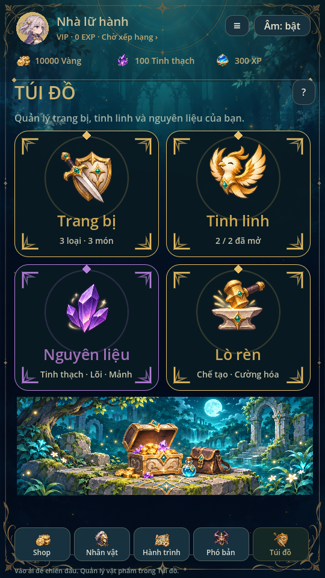
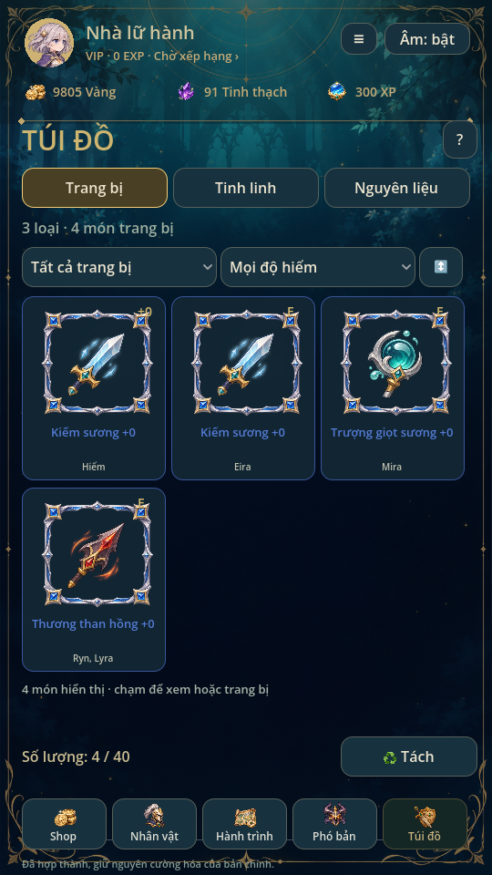
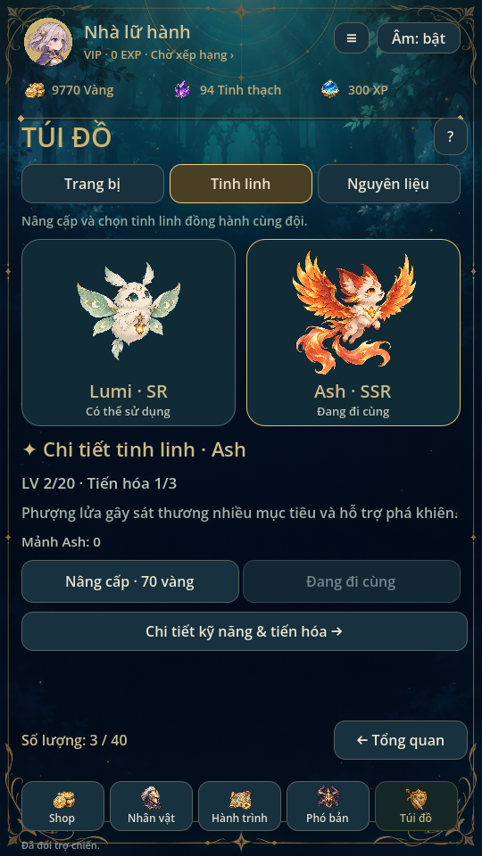
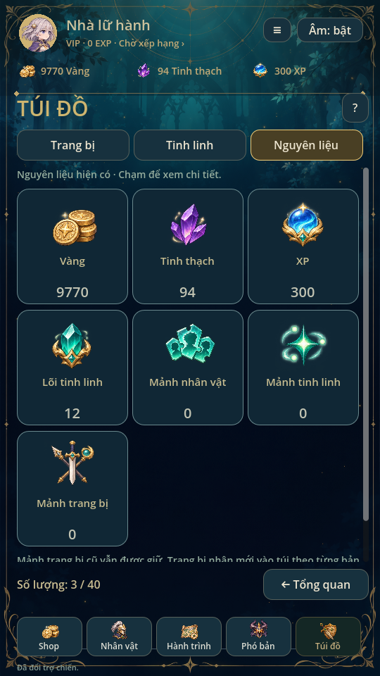
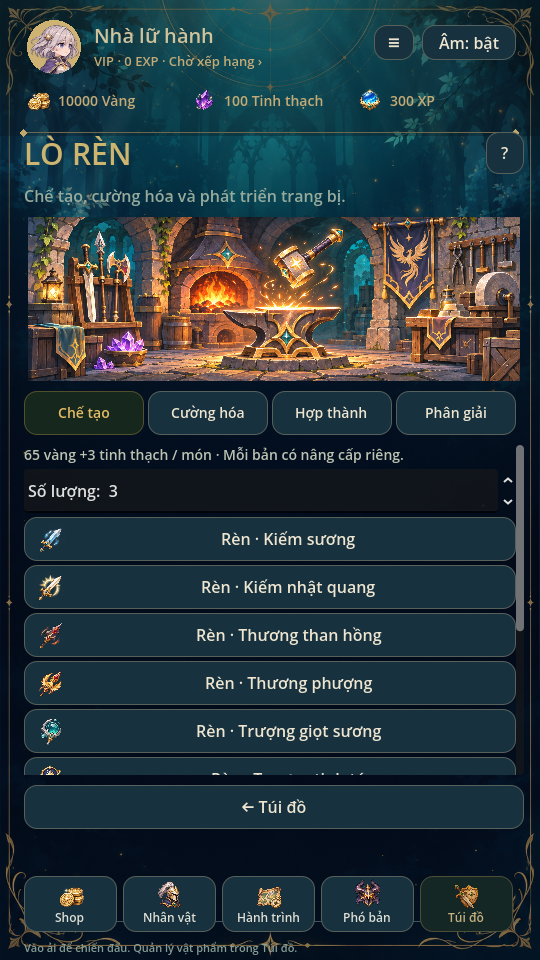

> Từ0.35 có tab Vật phẩm với ledger cộng dồn riêng; savev11 giữ nhiều bản gear và40 ô như cũ. Xem [SUPPLIES.md](SUPPLIES.md).

# Túi đồ & Lò rèn · 0.30

Theo ảnh tham khảo và yêu cầu mới nhất: **trang bị có thể sở hữu nhiều bản cùng
tên**. Quy tắc mỗi item ID một món của0.23 được thay thế từ bản này.

## Giao diện

- Tổng quan bốn thẻ Trang bị / Tinh linh / Nguyên liệu / Lò rèn, tranh rương
  rừng riêng và các góc trang trí vàng. Số loại và số món lấy từ save thật.
- Kho trang bị ba cột; lọc loại/bậc hiếm, sắp theo độ hiếm/cường hóa/mới nhận.
  E là món đang được ít nhất một hero dùng. Chọn thẻ để xem đúng UID.
  Tách mở chế độ chọn nhiều món, có xác nhận liệt kê từng bản và lượng thu hồi.
- Tinh linh dùng art canon Lumi/Ash hiện có. Ash vẫn là phượng lửa. Chọn thẻ
  chỉ đổi đối tượng đang xem; Nâng cấp tác động đúng tinh linh đó, không đổi
  tinh linh đang đi cùng. Chọn đi cùng là thao tác riêng. LV/tiến hóa/mảnh thật;
  không sao chép chỉ số, sao hoặc kỹ năng minh họa trong ảnh mẫu.
- Nguyên liệu hiển thị bảy nhóm đang có: vàng, tinh thạch, XP, lõi tinh linh,
  mảnh nhân vật, mảnh tinh linh, mảnh trang bị cũ. Chạm để xem số dư từng ID.
  Không thêm đá/vé hoặc tiền tệ mới chỉ vì xuất hiện trong hình tham khảo.
- Lò rèn có tranh riêng, bốn tab chế tạo/cường hóa/hợp thành/phân giải.
  Thanh điều hướng chính luôn có ở dưới, nội dung dài cuộn trong màn.

## Quy tắc sở hữu và chi phí

- Túi có40 **món vật lý**, kể cả những món trùng tên. Mỗi món có UID duy nhất,
  base catalogue, enhance và rank độc lập. Năm độ hiếm, bốn slot, hiệu ứng/bộ
  trang bị0.27 giữ nguyên. Rank1–3 khác với năm bậc hiếm3–7.
- Cấu hình cũ cho phép nhiều hero phù hợp tham chiếu cùng một UID vẫn hợp lệ;
  có thể dùng các bản khác nhau để đầu tư riêng. Không tự tháo/chuyển đồ của ai.
- Chế tạo1–10 món/lượt, mỗi món65 vàng +3 tinh thạch. Chỉ các công thức đã mở
  trong catalogue, không rèn đồ summon_only. Thiếu ô/tiền hoặc ghi save thất bại
  thì cả lượt thất bại; không trừ một phần.
- Hợp thành: giữ một bản, dùng **hai bản +0 không đang trang bị, cùng base và
  cùng rank**, tăng bản chính một rank, tối đa3. Giữ UID và enhance bản chính;
  hai UID nguyên liệu bị xóa. Không tốn thêm tiền. Xác nhận ghi rõ UID tiêu thụ;
  kiểm lại đúng danh sách khi thực thi, không tự ăn đồ đã cường hóa.
- Phân giải nhận1+rank tinh thạch/món; không hoàn trả vàng đã nâng. Món đang
  được bất kỳ hero nào dùng được bảo vệ. Tách nhiều món là một transaction.
- Tinh linh nâng LV tốn LV hiện tại ×35 vàng, trần20. Hero/tinh linh trùng
  khi triệu hồi vẫn chuyển10 mảnh đúng ID. Trang bị nhận mới không chuyển mảnh.
- Quay×1/×10 có candidate riêng: nếu bất kỳ phần thưởng trang bị nào vượt40 ô,
  hoàn tác cả lượt gồm vàng, RNG count, pity, history và các phần thưởng trước đó.

## Túi đầy và giữ save

Chiến thắng vẫn trả phần thưởng tiền/tiến trình một lần. Món rơi khi túi đầy
vào hàng chờ **chiến lợi phẩm thật** `bag_rewards`, giữ nguyên base đã quay ra.
Nút nhận chuyển số món vừa chỗ trống vào túi, cấp UID mới và bỏ khỏi hàng chờ
trong cùng commit. Không phát thư/quà giả hoặc đổi thành mảnh. Hàng chờ tối đa128;
đạt ngưỡng thì chưa cho bắt đầu trận mới cho đến khi giải phóng chỗ và nhận đồ.

Save **v10 đọc v2–v9**. Giữ các UID, cường hóa, rank, ví, roster, nhiệm vụ và
pending snapshot. Save v2–v6 có nhiều bản cũ được giữ từng bản; không chạy bước
gộp singleton trước đây. Save v7–v9 giữ nguyên số dư mảnh trang bị từng ID và thêm
hàng chờ rỗng. Không tự quy đổi ngược mảnh thành đồ vì không có lịch sử nâng cấp
để phục hồi chính xác. Bản sao raw trước migration được giữ theo cơ chế backup
cũ. Save lỗi không được âm thầm thay bằng profile mới.

Các mutation mới khóa khi pending/read-only và chỉ thay RAM sau khi ghi thành
công. Hủy xác nhận, xem thẻ, lọc/sắp xếp và xem nguyên liệu không sửa save.

## Asset và kiểm tra

`art/bag/scenes.png` là PNG tạo mới theo phong cách game, hai cảnh1536×512 trên
một ảnh1536×1024. Không lấy pixel từ ảnh mẫu; không sửa pixel nguồn bằng code.
`BagScreen.scene_texture` dùng AtlasTexture với vùng top/bottom. Nguồn giữ nguyên
byte; `tools/build_bag_art.py` kiểm kích thước và ghi SHA256/provenance, cũng được
gọi bởi builder art đầy đủ. Các icon/khung trang bị tiếp tục dùng registry chung.

Kiểm thử chính: `bag_inventory.gd` (nhiều bản, nguyên tử, hết chỗ, loot chờ,
migration), `bag_ui.gd` (các trang và thao tác/xác nhận), `mobile_inventory.gd`,
`unique_collection.gd`, `unique_collection_ui.gd`, `summon_batch.gd`,
`recruitment.gd`, `equipment_sets.gd`, `equipment_ui.gd`.
Đã chạy thêm regression/mechanics/campaign, rarity_system, team_battle/matrix/
campaign/flow, missions/audio/player_profile/complete_art và character_design/
character_ui/ui_flow/animation_gallery. Ảnh chụp từ Godot trên Xvfb540×960;
chưa kiểm trên điện thoại thật. Không thay âm thanh trong bản này.
