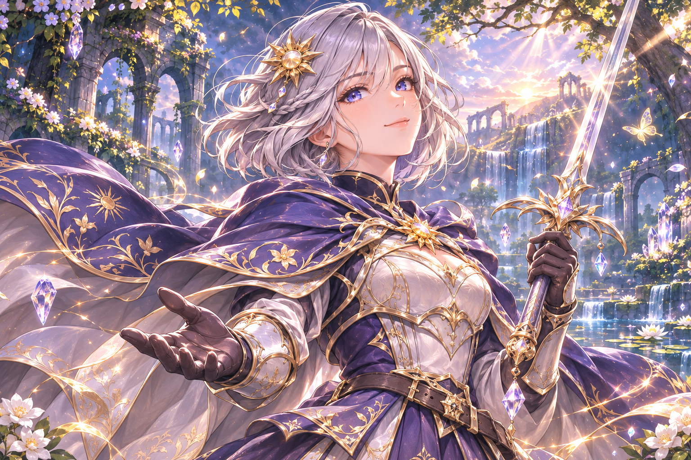
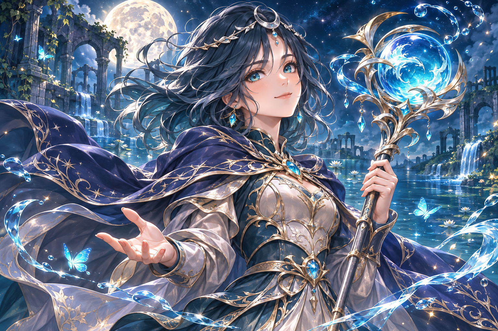
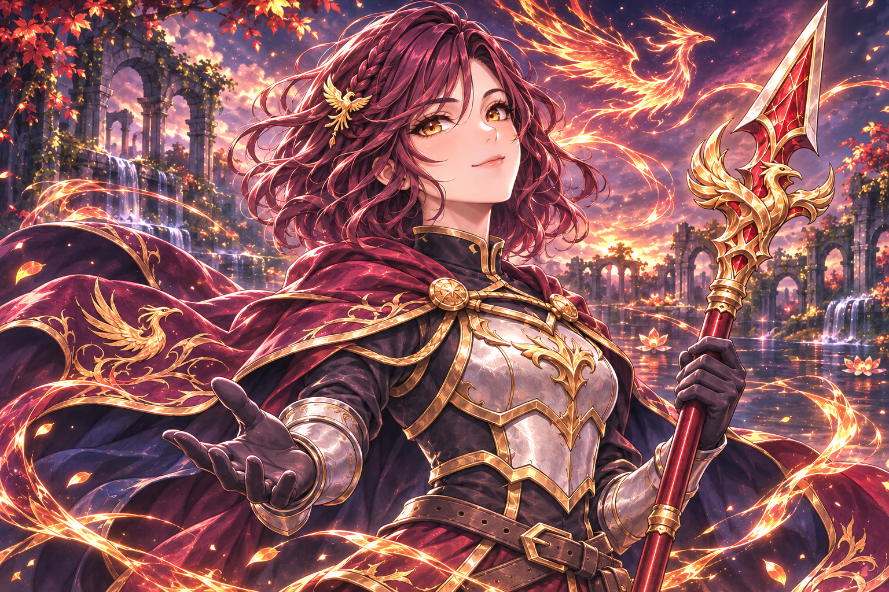
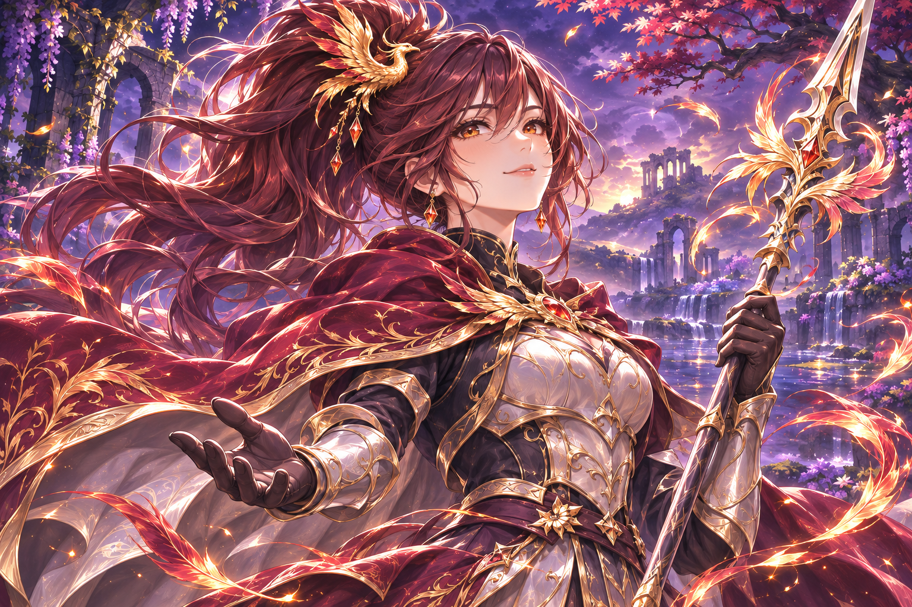

# Bốn banner nhân vật · 0.29

Tranh mới theo yêu cầu thay hình chibi trong màn Nhân vật, lấy bố cục banner
Mira người dùng gửi làm tham khảo. Bốn ảnh gốc1536×1024, phong cách anime
fantasy vẽ tay chi tiết, nửa người, nền có ánh phép riêng. Không nhập pixel
từ hình tham khảo hoặc repo game gốc. Không đổi roster, tuổi/lore, chỉ số,
độ hiếm, trang bị, kinh tế hoặc save.

| Hero | Nhận diện và nền |
| --- | --- |
| Eira | Bob bạc, mắt xanh tím, kẹp mặt trời, kiếm; rừng bình minh và tinh thể ánh sáng |
| Mira | Tóc teal ngang vai, vòng trăng, trượng thủy cầu; hồ phế tích dưới trăng, dải nước và bướm xanh |
| Ryn | Tóc đỏ rượu ngang vai, bím nhỏ, kẹp phượng, thương; phượng lửa và tàn than |
| Lyra | Đuôi ngựa cao dài nâu đỏ, thương; hoàng hôn tím vàng và lông phượng |

## Runtime

HeroBanner kế thừa input/spring của HeroPortrait để giữ chạm/kéo, trạng thái
sở hữu và tương thích kiểm tra cũ. Vẽ một texture có cache, giữ tỷ lệ phủ
khung và clip phần tràn, viền vàng; chuyển động chỉ là pan toàn tranh rất nhẹ
(12% motion hiện có), không phải rig/tóc/vải độc lập. Không dựng mesh Ryn
cho banner. Không có RNG, damage, âm thanh hoặc ghi save trong renderer.

Thông tin/Trang bị/Trang phục dùng banner. Bốn ô trang bị đặt trên mép ảnh,
giữ vùng mặt ở giữa; xem chi tiết và khóa build không đổi. Trang phục vẫn là
ba tint miễn phí, banner xem trước/áp dụng dùng cùng tint và không đổi stats.
Năm tab Nhân vật vẫn ở trên, điều hướng chính ở dưới. Avatar, sprite chibi
chiến đấu, nguồn pose và cửa sổ tương tác Ryn phóng lớn giữ bộ hiện có.

## Nguồn và tái tạo

Ảnh trong art/banners được copy nguyên byte từ image generation. Mira dùng
sheet Mira làm identity; ba ảnh sau dùng sheet/portrait đúng hero cùng banner
Mira để đồng bộ nét. Không chỉnh pixel nguồn bằng script. Hash SHA256 và
tham chiếu trong `art/banners/provenance.json`. Chạy
`python tools/build_banner_manifest.py` để kiểm kích thước và tái tạo metadata;
builder này độc lập atlas chiến đấu nên các builder cũ không ghi đè tranh mới.

## Kiểm tra

character_design render đủ bốn banner theo hero, ba mục có tranh và mọi tab,
kiểm texture1536×1024, chọn đúng hero và không ghi save khi duyệt. character_ui
kiểm tương tác5★/chưa sở hữu, nâng cấp và pending lock. equipment_ui kiểm ô,
chi tiết và chi phí; ui_flow/animation_gallery kiểm chuyển màn/chiến đấu.
portrait_touch và ryn_art kiểm nguồn tương tác cũ. Test bằng profile riêng,
Godot4.6.3 Linux/X11/Mesa; chưa kiểm cảm ứng hoặc FPS trên điện thoại thật.
