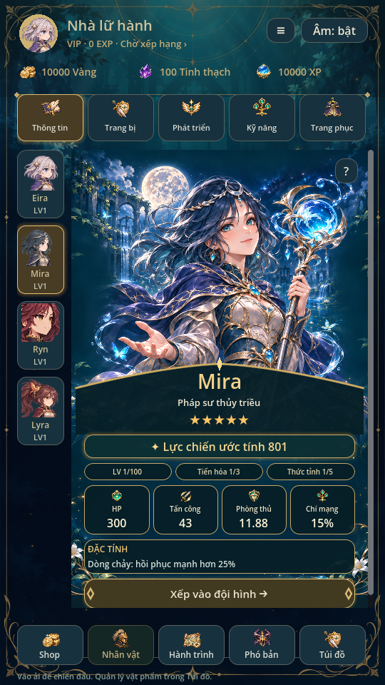
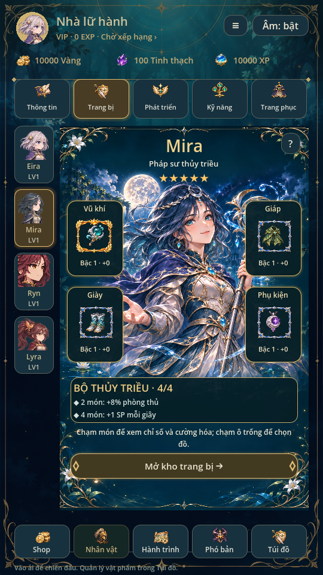
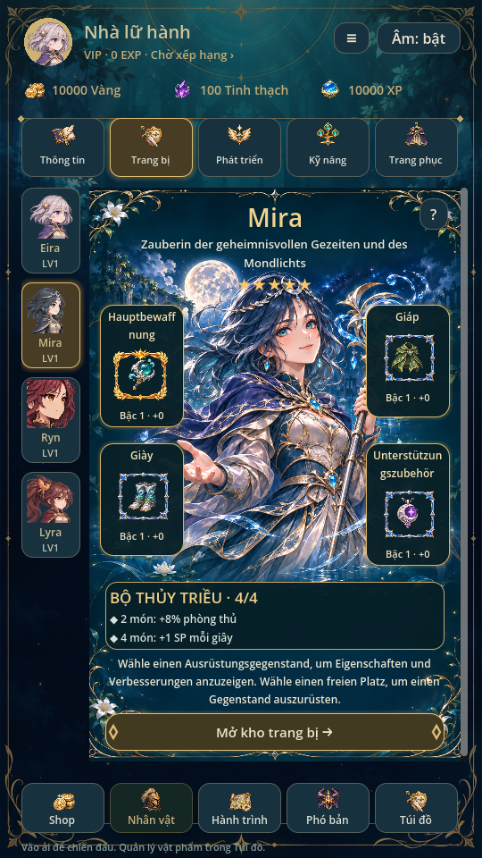

> Trạng thái chuẩn: [GAME_STATE](GAME_STATE.md), [mục lục](INDEX.md). Các phần ghi phiên bản cũ là lịch sử; ưu tiên yêu cầu mới và quy tắc hiện hành.

# Trang Nhân vật liền tranh · 0.31

Theo hai ảnh tham khảo mới và yêu cầu chuẩn bị đa ngôn ngữ: thiết kế cả vùng
Nhân vật thành một trang có tranh/nền/viền đồng bộ. Bỏ cách đặt ảnh chữ nhật
riêng giữa các thẻ. Áp dụng cho Thông tin và Trang bị, đủ Eira/Mira/Ryn/Lyra.

## Tách mỹ thuật khỏi dữ liệu và chữ

Ảnh nguồn `art/character_panels/{hero}.png` là tranh1024×1536 có viền hoa vàng,
nền theo hệ, vùng tiêu đề tối ở trên, hai làn cho ô đồ và vùng nội dung tối
phía dưới. **Không chứa tên, mô tả, nhãn, chữ trên nút, con số, sao, biểu tượng
trang bị hoặc trạng thái khóa.** Khung, đường cong và họa tiết giao diện vẽ
riêng; toàn bộ chữ và nội dung thay đổi đều là control Godot thật.

Thông tin có ảnh lớn liền nền, bảng tên cong, lực chiến, ba chỉ số tiến trình,
bốn thẻ stats, đặc tính và nút đội hình. Trang bị có tên ở trên, bốn ô quanh
nhân vật, thưởng bộ2/4 món, hướng dẫn và nút mở kho. Dữ liệu dùng catalogue,
EquipmentSystem và profile đúng hero đang xem. Chạm ô mở chọn đồ/chi tiết;
giữ khóa pending/read-only. Không thêm nút Trang bị nhanh chỉ vì ảnh minh họa.

Không đổi savev10/túi đồ0.30, UID bản trang bị, công thức, phần thưởng, tương
tác portrait phóng lớn hoặc sprite chibi battle. Ba bản phối màu miễn phí
vẫn dùng tint đã lưu; Trang phục tiếp tục dùng art0.29 hiện có.

## Chữ và bản dịch

- Nhãn và mẫu câu ở CharacterPanelPage dùng `tr()`. Tên/chức danh/đặc tính,
  tên bộ và mô tả bonus từ catalogue cũng đi qua `tr()` khi hiển thị.
- Không nối từ cố định để giả lập dịch; mẫu có placeholder như
  `BỘ %s · %d/4` và `%d món: %s` cho phép bản dịch sắp lại nội dung.
- Label xuống dòng; chiều cao ô đồ tính theo nội dung. Hàng dưới dời theo
  chiều cao thẻ/tên; khung trang giãn và ScrollContainer cuộn khi nội dung
  dài. Chữ trên nút là Button thật, cho xuống dòng.
- Tranh và vị trí trang bị không chứa chữ theo ngôn ngữ. Thay nội dung/bản
  dịch không cần tạo lại ảnh. Khi thêm ngôn ngữ, đưa cả chuỗi catalogue động
  và template vào Translation resource, chọn font có glyph phù hợp và kiểm
  lại thực tế. Bản này **chưa thêm bộ bản dịch hoặc nút đổi ngôn ngữ**.

## Nguồn và renderer

Ảnh được tạo mới bằng image generation, tham chiếu banner riêng đúng hero,
không lấy pixel ảnh mẫu người dùng. Giữ nguyên PNG nguồn; SHA256 trong
provenance.json. `python tools/build_character_panels.py` kiểm kích thước,
nguồn PNG và tái tạo metadata, không chỉnh pixel. Builder battle không ghi đè
tranh trang UI. Ryn vẫn tóc ngang vai/bím nhỏ, Lyra đuôi ngựa cao dài.

HeroBanner tải/cache ảnh theo vòng đời FrameLibrary; panel_art không dựng
mesh hoặc RNG. Trang thông tin phóng ảnh/căn lên bằng transform lúc render,
không sửa PNG. Phần dài hơn nền được tô teal để cuộn tiếp. Chạm tranh có vòng
sáng nhẹ; không dịch cả khung chữ/ô đồ. NamePlate/ButtonOrnament là họa tiết
vector của UI, không phải ảnh chứa chữ.

## Kiểm chứng

Godot4.6.3 Linux/X11/Mesa, profile riêng. character_design render đủ bốn hero,
kiểm texture mới1024×1536, năm tab, dữ liệu không đổi khi xem và bộ chọn đồ.
Thêm Translation giả lập chuỗi tiếng Đức dài: role/nhãn ô/hướng dẫn xuống
dòng, ô không che nhau, vùng dưới dời và có thể cuộn. Bản dịch này chỉ ở test.
character_ui/equipment_ui kiểm nâng cấp đúng hero, mặc/tháo đúng UID, tương
tác5★, chưa sở hữu và khóa pending. ui_flow/animation_gallery/ryn_gallery
render kiểm các màn và battle. Chưa kiểm font/RTL hoặc điện thoại thật.

### Avatar thanh chọn

Thanh hero dùng bộ portrait cận mặt riêng tại `art/avatars/selection.png`, các
pose/góc nhìn khác nhau thay ảnh cắt từ sprite chiến đấu. Ảnh60×60 trong thẻ66×96;
tên/LV là Label riêng. Giữ nhấn để xem hero, trạng thái chưa sở hữu được làm tối
và viền chọn theo hero đang xem; không tự đổi đội hình hay ghi save khi duyệt.
Metadata/provenance tái tạo bằng `python3 tools/build_avatar_manifest.py`.
