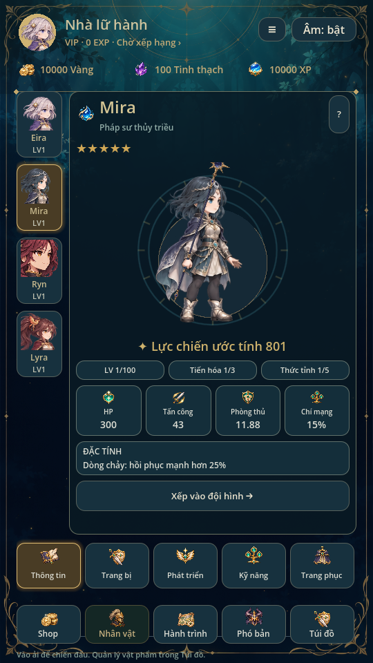
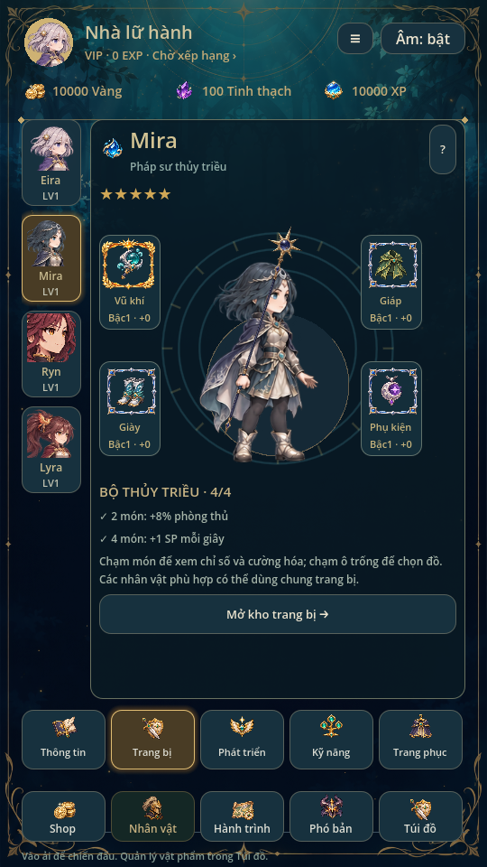
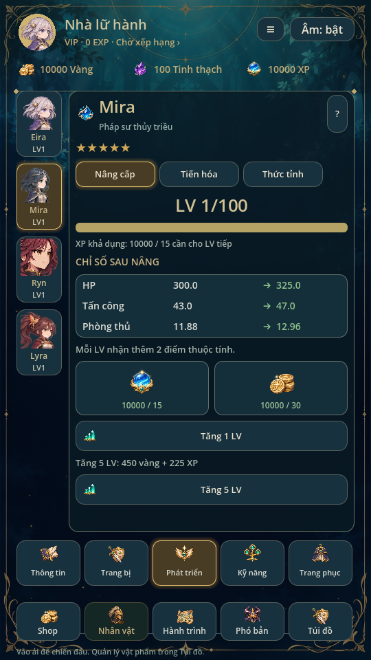
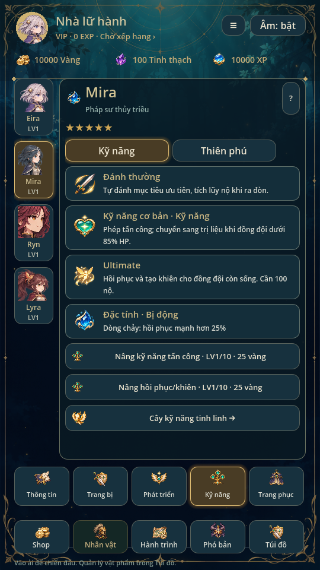
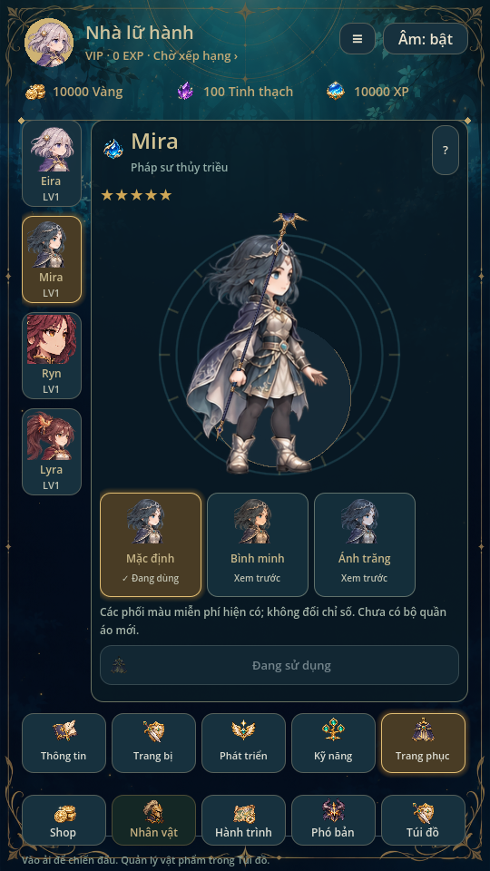
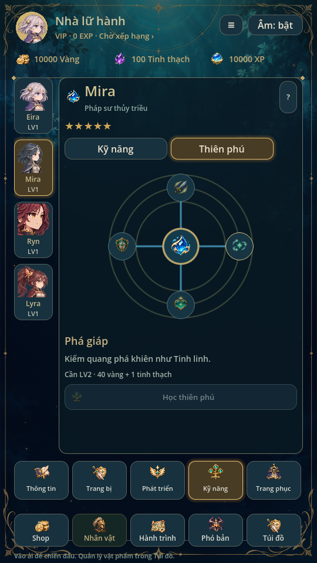

# Nhân vật: năm tab mobile · 0.28

Bố cục theo ảnh sáu màn người dùng gửi: dải chân dung bên trái, nội dung bên
phải, năm tab cố định phía dưới. Giữ phong cách rừng xanh đêm, viền vàng và
art riêng của Eira/Mira/Ryn/Lyra. Chọn chân dung chỉ đổi nhân vật đang xem,
không thay hero ra trận hoặc đội hình. Chân dung chưa sở hữu vẫn xem được,
nhưng không cho nâng cấp/trang bị/áp dụng phối màu.

## Năm tab

- **Thông tin:** hero lớn, hệ, độ hiếm catalogue, lực chiến ước tính, LV,
  tiến hóa/thức tỉnh, bốn thẻ chỉ số thật và đặc tính. Lực chiến chỉ là tóm tắt
  `HP + ATK×10 + phòng thủ×6`, không phải điều kiện khóa ải.
- **Trang bị:** Vũ khí/Giáp/Giày/Phụ kiện quanh hero; icon và khung đúng độ
  hiếm. Chạm món mở chi tiết/cường hóa của đúng hero; chạm ô trống mở bộ chọn
  đồ phù hợp. Bộ2/4 món lấy từ EquipmentSystem, không sao chép hiệu ứng trong
  ảnh tham khảo. Giữ hệ trang bị0.27 và giới hạn+15.
- **Phát triển:** Nâng cấp / Tiến hóa / Thức tỉnh. Giữ LV tối đa100, giá thật,
  xem trước chỉ số và các điều kiện hiện có. Thanh XP là lượng XP tài khoản
  khả dụng so với giá LV tiếp theo, không phải EXP riêng của hero. Thức tỉnh
  dùng mảnh, độc lập độ hiếm5★ và tương tác thiết kế sẵn.
- **Kỹ năng:** thẻ đánh thường, kỹ năng cơ bản, Ultimate và đặc tính; hai nút
  tăng cấp kỹ năng hiện có. Chuyển Thiên phú để xem sơ đồ tròn bốn nhánh
  focus/breaker/restoration/barrier thật. Chạm node chỉ xem; nút Học/Chọn/Bỏ
  chọn mới gọi giao dịch. Không thêm cây sao hoặc node giả từ hình minh họa.
  Cây Tinh linh vẫn riêng, truy cập bằng nút dưới danh sách kỹ năng.
- **Trang phục:** xem hero lớn và ba phối màu Mặc định/Bình minh/Ánh trăng,
  có xem trước và áp dụng riêng. Đây là tint miễn phí, không đổi chỉ số;
  chưa có ba bộ quần áo mới hay shop skin. Giữ tương tác portrait5★ hiện có.

## Tích hợp và giới hạn

CharacterScreen giữ chỉ số trang nội bộ0–6 để các đường dẫn nâng LV/sao/tiến
hóa cũ tiếp tục hoạt động; năm tab dùng map0/1/2/5/6. Ba trang phát triển
vẫn là2/4/3. HeroPortrait thêm chế độ fit_actor chỉ cho vùng xem mới; các
chỗ dùng portrait cũ giữ mặc định. Không đổi marker battle, RNG, schema save,
tỷ lệ triệu hồi, thưởng hay chi phí.

Đã tích hợp commit trang bị0.27 xuất hiện trên main trong lúc làm UI, giữ
đủ bốn slot, frame, thưởng bộ, savev9 và logic TeamBattle mới. Không đưa
asset từ repo tham khảo hoặc hình tham khảo vào runtime.

Build mutation vẫn qua store commit trước RAM; pending run/read-only khóa
nâng cấp, đổi trang bị và áp dụng phối màu. Chỉ xem tab/node/preview không
ghi save. UI nội dung dài cuộn riêng; hai hàng điều hướng cố định, không
che nhau ở viewport540×960.

## Ảnh từ game

## Kiểm chứng

Godot4.6.3 Linux/X11/Mesa, profile test riêng. character_design kiểm thao tác
năm tab/ba mục phát triển, vị trí tab nằm trên điều hướng chính, bốn node,
browse-only và bộ chọn trang bị đúng hero; chụp sáu màn Mira. character_ui
kiểm bảy trang chức năng, nâng LV/sao/tiến hóa, kỹ năng, phối màu, hero khóa
và pending lock. equipment_ui, ui_flow, animation_gallery và ryn_gallery
render trên display; đã xem ảnh. wardrobe, portrait_touch, ryn_art,
equipment_sets, regression87, mechanics72 và campaign5 đều đạt.

Chưa kiểm trên điện thoại thật; bản này dùng art2D hiện có, không thêm rig,
Live2D hoặc SDK. Không thay tạo hình nhân vật bằng ảnh minh họa.
