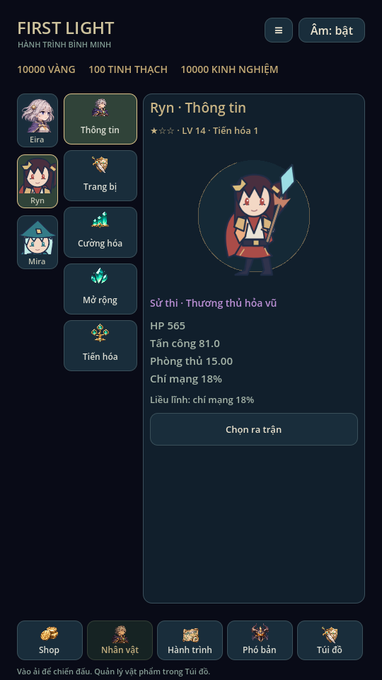
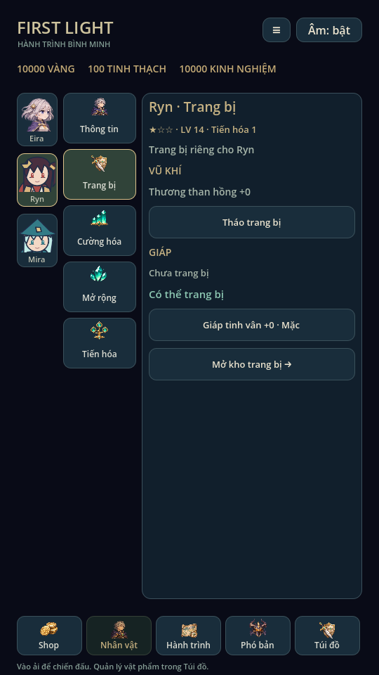
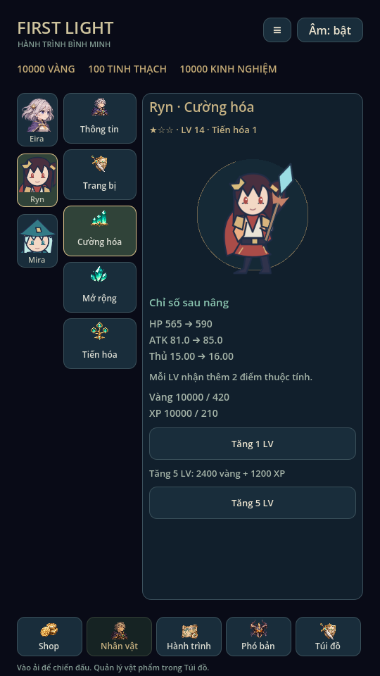
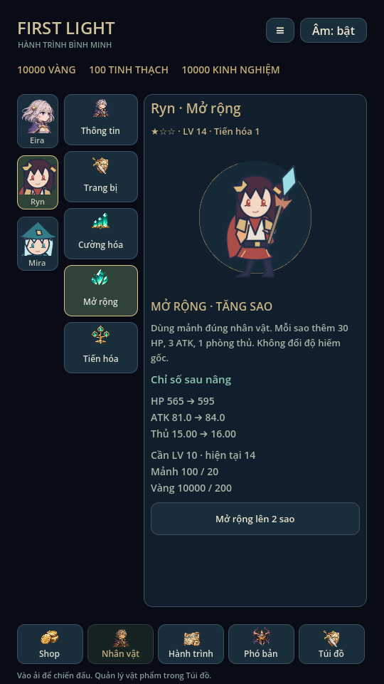
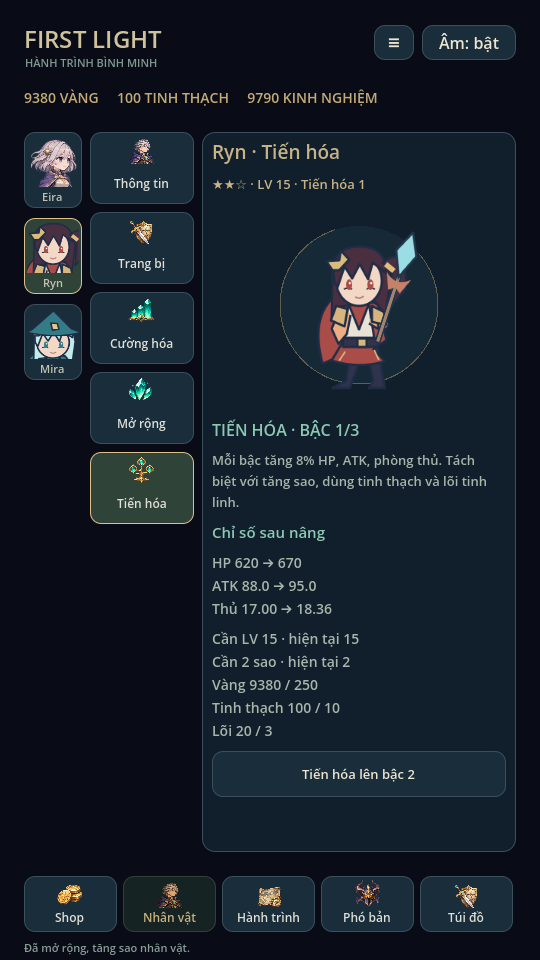

> Trạng thái chuẩn: [GAME_STATE](GAME_STATE.md), [mục lục](INDEX.md). Các phần ghi phiên bản cũ là lịch sử; ưu tiên yêu cầu mới và quy tắc hiện hành.

# Mục Nhân vật ba cột · 0.11

Theo bản vẽ người dùng:

- Trái: ảnh mặt Eira, Ryn, Mira. Dùng region từ texture gốc hiện có, không sửa
  pixel hoặc gán chung một icon cho mọi hero. Nhân vật khóa có mặt mờ và điều
  kiện mở; vẫn xem được hồ sơ.
- Giữa: năm nút cố định **Thông tin, Trang bị, Cường hóa, Mở rộng, Tiến hóa**.
- Phải: thông tin/điều khiển tương ứng; cuộn trong khung, hai cột trái giữ vị trí.

`CharacterScreen` phụ trách bố cục, `main.gd` giữ lựa chọn đang xem và xử lý thao
tác. Chọn ảnh chỉ đổi hero đang xem, không ghi save hoặc đổi hero chiến đấu.
Nút **Chọn ra trận** đổi hero hoạt động. Mọi nâng cấp/trang bị trong khung tác
động đúng hero đang xem, không cần đổi đội hình trước.

## Năm mục

| Mục | Nội dung và thao tác |
|---|---|
| Thông tin | Chân dung, độ hiếm, sao, LV, bậc tiến hóa, HP/ATK/phòng thủ/crit, nội tại; chọn ra trận. Hero đang hoạt động có đường đến thuộc tính/cây kỹ năng. |
| Trang bị | Vũ khí/giáp hiện tại, tháo, danh sách món chưa ai mặc và đúng lớp để trang bị, đường đến kho. Giữ UID và không dùng chung món cho hai hero. |
| Cường hóa | Tăng LV 1 hoặc tối đa 5 cấp; preview chỉ số, lượng vàng/XP hiện có và cần, cap LV100. Giữ giá và giao dịch cũ. |
| Mở rộng | Dùng mảnh đúng hero để tăng 1→2→3 sao. Giữ nguyên tiến trình `awakening` từ 0.9, không reset sao hoặc mảnh. |
| Tiến hóa | Bậc riêng 1→2→3, có điều kiện LV/sao, nguyên liệu và preview trước khi nâng. |

Mở rộng giữ chi phí cũ: lên 2 sao cần LV10, 200 vàng, 20 mảnh; lên 3 sao cần
LV20, 400 vàng, 40 mảnh. Mỗi sao thêm 30 HP, 3 ATK, 1 phòng thủ. Không thay
độ hiếm catalogue. UI dùng tên Mở rộng/tăng sao thay cho Thức tỉnh.

## Tiến hóa nhân vật

Đây là quy tắc mới, tách khỏi cấp/sao và tiến hóa Tinh linh.

| Nâng | Điều kiện | Chi phí | Bonus tổng so với chưa tiến hóa |
|---|---|---|---|
| Bậc 1 → 2 | LV15, 2 sao | 250 vàng + 10 tinh thạch + 3 lõi | +8% HP/ATK/phòng thủ |
| Bậc 2 → 3 | LV30, 3 sao | 500 vàng + 20 tinh thạch + 6 lõi | +16% HP/ATK/phòng thủ |

Bonus nhân lên chỉ số sau cấp, trang bị, thuộc tính và sao; hai bậc cộng theo
8%/16%, không lũy thừa. Không tăng crit hoặc đổi nguyên tố. Chỉ có chỉ số/huy
hiệu bậc mới, chưa có bộ ngoại hình/animation tiến hóa riêng.

`HeroEvolution` lưu map hero→bậc ở trường `evolution` tùy chọn trong save v4.
Save cũ thiếu trường này là bậc 1, không bị sửa khi chỉ đọc; lần tiến hóa đầu
tạo dữ liệu ba hero và commit cùng toàn bộ phí. Dữ liệu hiện có được backup như
trước. Validate đủ hero và bậc 1–3, không âm thầm reset dữ liệu sai. Xem, nâng
LV, tăng sao hoặc mặc đồ không tự tăng bậc tiến hóa.

`ProgressStore` và `Recruitment` hỗ trợ hero đích riêng, giữ nguyên `profile.hero`
khi nâng người đang xem. Ghi lỗi không trừ tài nguyên/đổi RAM; pending run khóa
mọi thao tác build. Snapshot mới có bonus tiến hóa từ `GameCatalog.stats`; trận
đang dở tiếp tục dùng snapshot cũ. Thay hero đang xem trong trận chỉ là xem hồ
sơ, chiến đấu tự pause như các màn quản lý khác.

## Kiểm chứng

Godot 4.6.3 Linux: `tests/hero_management.gd` có 33 checks về hero khóa, nâng đúng
đích, giữ hero hoạt động, UID/lớp trang bị, tăng sao độc lập, tiến hóa/chi phí,
ghi lỗi, giới hạn/validation, reload, snapshot và pending lock.
`tests/character_ui.gd` thao tác ba ảnh/năm mục, xem khóa, nâng LV/sao/tiến hóa,
trang bị và pause/build lock. Đã render X11/Mesa và xem ảnh thực tế.

Chạy lại regression81, mechanics54 tổ hợp, campaign5, expansion60,
expansion_campaign18 địa điểm, thuộc tính62, recruitment451, skill_effects,
combat_presentation, audio93; ui_flow, training_ui và animation_gallery đều đạt.
Profile trong ảnh là fixture riêng. Chưa test điện thoại/touch/safe area thật.
Eira dùng PNG; Ryn/Mira vẫn dùng artwork SVG hiện có.

