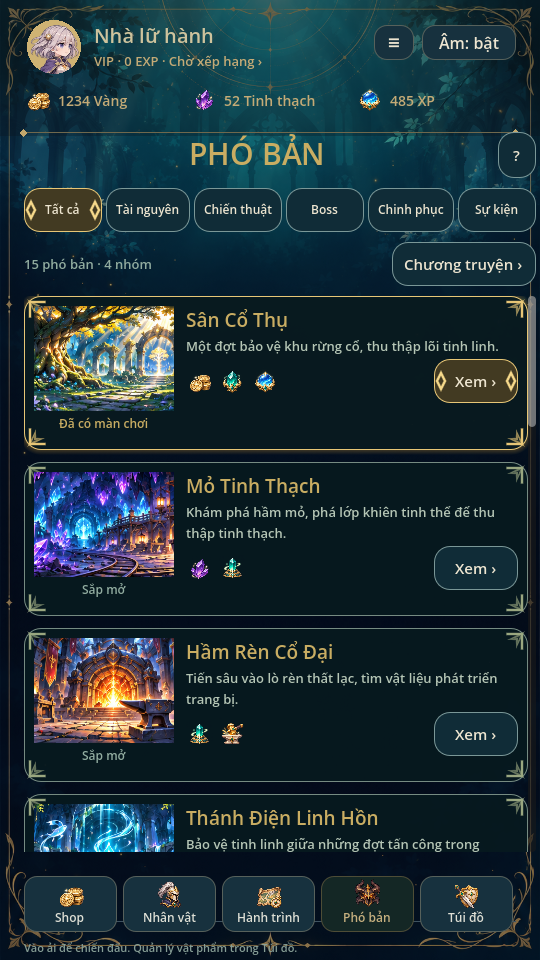
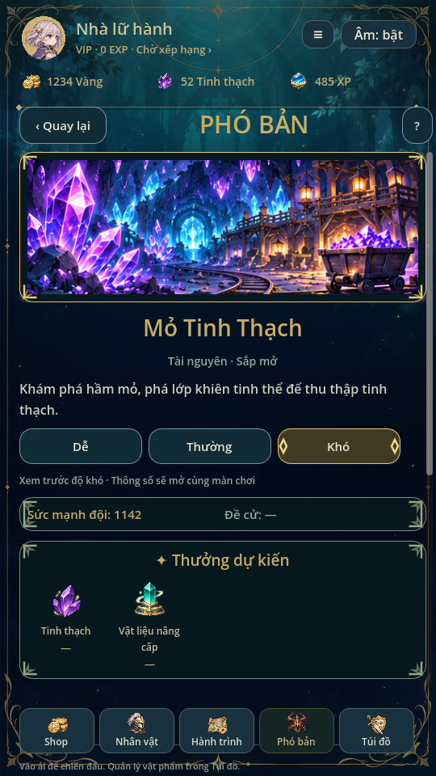
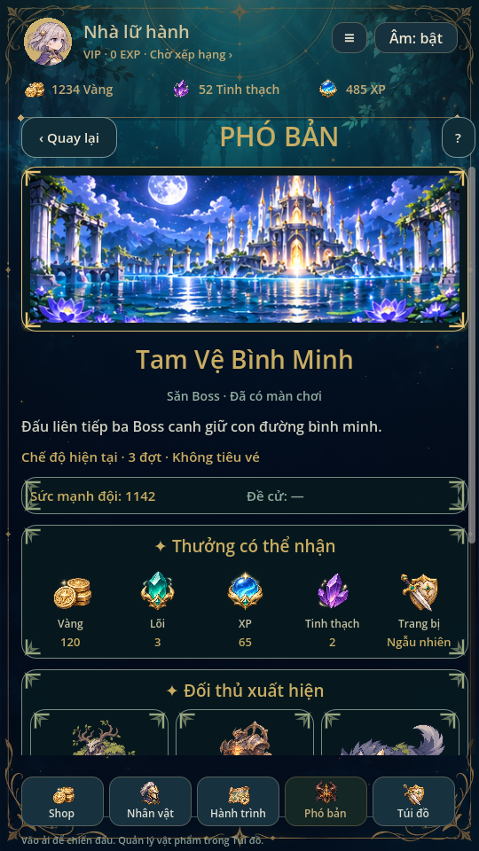
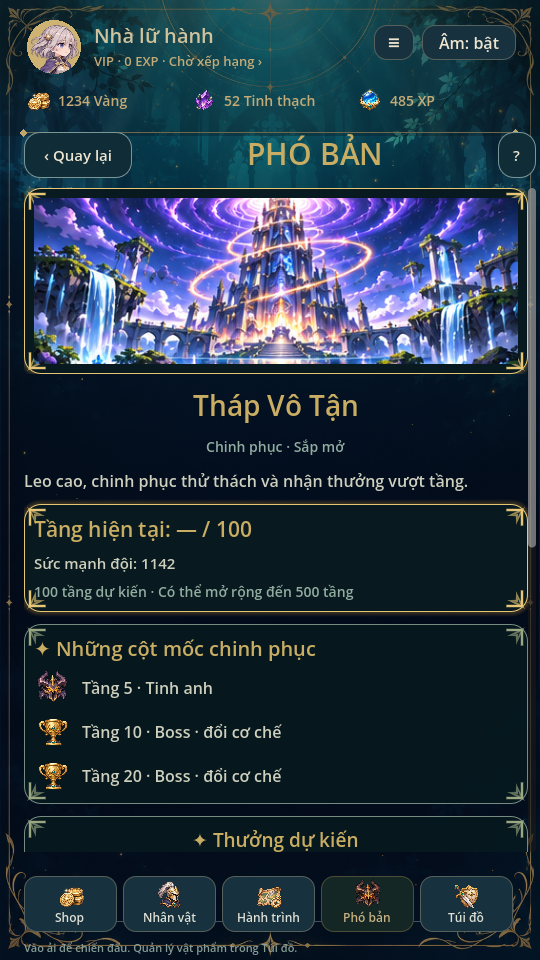

> Từ0.35, ba phó bản chơi được có thêm một nguyên liệu riêng khi thắng:101 hạt,102 mảnh ký ức,103 đá rèn. Xem [SUPPLIES.md](SUPPLIES.md).12 phó bản xem trước vẫn chưa phát thưởng hoặc mở gameplay.

# Thế giới Phó bản · 0.34

Theo yêu cầu: **cài giao diện và đồ họa trước, từng màn chơi thêm sau**.
Danh mục riêng15 phó bản, bốn nhóm5/5/4/1, không thêm encounter hoặc đổi save.

## Danh sách và trang chi tiết

Phong cách rừng xanh đêm/teal, vàng sáng, thẻ có tranh lớn bên trái, mô tả và
icon thưởng bên phải. Bộ lọc Tất cả/Tài nguyên/Chiến thuật/Boss/Chinh phục/Sự kiện,
vuốt trực tiếp trên thẻ và nút nhờ SwipeScroll. Trang chi tiết có banner,
mô tả/cơ chế, phần thưởng, chân dung đối thủ, nút chuẩn bị đội hình và quay lại.
Dải hồ sơ/ví và năm nút chính dùng UI hiện có; số dư lấy từ profile.

| Nhóm | Các phó bản |
| --- | --- |
| Tài nguyên | Sân Cổ Thụ; Mỏ Tinh Thạch; Hầm Rèn Cổ Đại; Thánh Điện Linh Hồn; Kho Báu Hải Tặc |
| Chiến thuật | Tháp Sáu Đợt; Mê Cung Sương Mù; Đấu Trường Nguyên Tố; Hành Lang Gương; Phế Tích Thời Gian |
| Săn Boss | Tam Vệ Bình Minh; Hang Rồng Cổ; Vực Thẳm Hư Không; Cung Điện Nguyệt Thực |
| Chinh phục | Tháp Vô Tận |

Ba mục cũ nối đúng stage101/102/103 qua _enter_stage; giữ điều kiện qua1/2/3,
thưởng, đợt quái, model trận và pending snapshot. Sân Cổ Thụ là tên hiển thị
theo đề xuất; không đổi ID/tên catalogue cũ “Săn cổ thụ”. Tam Vệ hiện vẫn là
ba Boss Cổ thụ thức tỉnh/Hộ vệ than hồng/Ảo ảnh thủy triều, không thay actor
chiến đấu bằng portrait vệ giả mới. Kỷ lục lấy từ expansion.records thật.

Các mục mới ghi Sắp mở, cho xem tranh/đối thủ/cơ chế và ba mức độ khó xem trước.
Nút Khiêu chiến bị khóa, gọi callback trực tiếp cũng không bắt đầu trận hoặc
cấp thưởng. Không hiện số lượt3/3, sao hoàn thành, lực chiến đề cử hoặc lượng
vật liệu giả. “Sức mạnh đội” là ước tính hiển thị từ ba hero đang xếp:
tổng(HP + ATK×5 + DEF×8), không phải sức mạnh server hoặc khóa vào trận.
Thưởng mới ghi Dự kiến; icon vật liệu không tự tạo currency/item ID.

Tháp Vô Tận có tranh riêng, khu tầng hiện tại —/100, mốc Elite5/Boss10 và
cơ chế đổi mỗi10 tầng. Thiết kế hướng tới100 tầng, mở rộng500 mà không cần
hàng trăm map. Hiện chưa lưu tầng, chưa có thưởng lần đầu, quét hoặc xếp hạng.
Sự kiện có trang trống đẹp; chưa tự tạo mùa, countdown, vé hoặc lịch mở.

## Art nguồn và brief đối thủ

- art/dungeons/worlds.png:15 panorama gốc,3 cột×5 hàng, theo thứ tự danh mục.
- art/dungeons/enemies.png:12 tranh concept,4 cột×3 hàng. Golem pha lê/thú băng/
  linh thạch/cơ khí; ba vệ giả Mặt Trăng/Mặt Trời/Tinh Vân và linh hươu; rồng/
  thực thể hư không/nữ hoàng nguyệt thực/thuyền trưởng hải tặc.
- Nhân vật hình người đều thiết kế người trưởng thành, trang phục kín fantasy.
  Brief: vệ giả trăng tóc bạc/giáp xanh ngà/halo trăng; vệ giả nắng tóc vàng/
  giáp ngà vàng/halo mặt trời; vệ giả sao tóc tối/giáp tím/ánh sao; nữ hoàng tóc
  đen bạc/áo cổ cao tím vàng/vương miện nhật nguyệt; thuyền trưởng tóc tối/áo teal/
  mũ ba góc. Không gán tuổi số, lore hoặc quan hệ mới.
- Ba portrait vệ giả hàng2 ô0–2 là **concept dự trữ**, không thay ba Boss cũ,
  không vào roster hero/triệu hồi. Các portrait khác chỉ minh họa đối thủ dự kiến.
  Bộ Ryn/Lyra/Lumi/Ash và art chiến đấu được giữ nguyên.
- Nguồn tạo mới theo phong cách ảnh người dùng, không nhập pixel từ ảnh mẫu
  hoặc các game ở link tham khảo. Không sửa pixel nguồn bằng script.
- manifest.json ghi vùng đã xem, inset2px để tránh rò ô; không giả định mọi
  hàng atlas cao bằng nhau. validate_dungeon_art.py xác minh PNG/hash/bounds,
  tạo provenance.json; runtime chỉ AtlasTexture/clip/scale. Không cắt nguồn.

## Dữ liệu và giữ trạng thái

game/data/dungeon_world.json là catalogue trình bày, tách GameCatalog. Chỉ ba
entry có stage khác0. Bộ lọc, mục xem, độ khó xem trước và vị trí cuộn chỉ ở RAM;
xem/chọn/quay lại không ghi save, tiêu tài nguyên hoặc đổi selected_stage.
Chọn Khiêu chiến của phó bản cũ mới đi vào hộp chuẩn bị cũ. Pending/read-only
khóa lối vào; xem menu trong trận vẫn tạm dừng và Hành trình tiếp tục trận.
Không đổi version save hoặc khóa các phó bản cũ bằng lượt thưởng mới.

## Kiểm tra và triển khai

Workflow .github/workflows/dungeon-ui.yml trên nhánh codex/dungeon-world-ui:
Godot4.6.3, X11/Xvfb, import +19 suite độc lập. tests/dungeon_world.gd kiểm15
trang, nhóm/lịch trống, bounds art/nút, vuốt trên nút không mở nhầm, xem trước
không ghi save, lối vào101–103, khóa điều kiện/pending và tiếp tục trận.
Các suite mobile_inventory/swipe_scroll/ui_flow/animation_gallery/bag_ui/
character_design/music/audio/team_ui/team_flow/regression/mechanics/campaign/
team_battle/complete_art cùng summon_ui/summon_batch/recruitment kiểm các luồng chung.
Đã qua cả19 suite tại [lượt kiểm tra Godot](https://github.com/tai23082004l02-svg/aternal-senia/actions/runs/42449009341). Đã xem ảnh render danh sách/Mỏ/Tam Vệ/Tháp; [biên bản kiểm tra](previews/dungeons/verification.json).
Ảnh và provenance chỉ được CI ghi lên nhánh sau khi cả bộ pass; log/results
giữ trong artifact dungeon-ui-checks. Chưa kiểm cảm ứng/FPS trên điện thoại thật.

Sau này thêm màn chơi: triển khai từng cơ chế trong model/encounter có test,
chốt thưởng/lượt/quét rồi mới đổi stage0 thành ID thật. Không dùng trạng thái
xem trước làm bằng chứng người chơi đã vượt tầng hoặc nhận thưởng.
