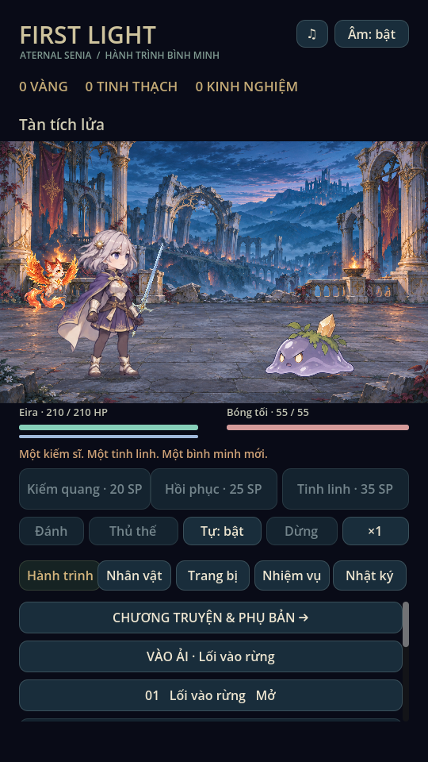
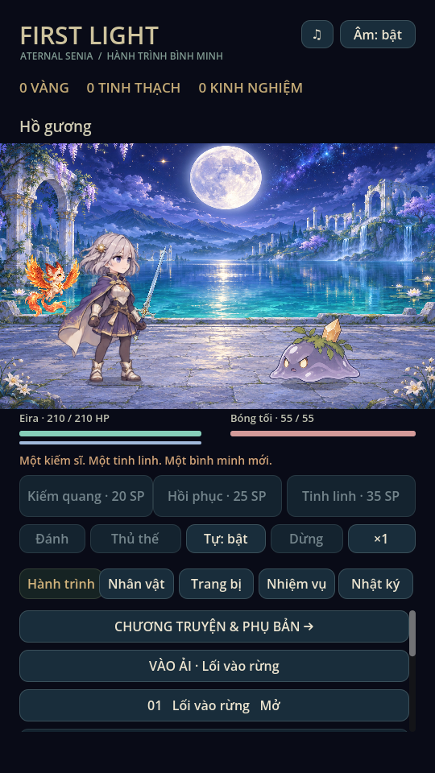

# Mỹ thuật tiếp nối: Phế tích, Hồ gương & Ash

- `art/painted/ruins.png`: phế tích cột ngà, cờ đỏ, lửa hổ phách và núi xanh.
- `art/painted/lake.png`: hồ trăng, vòm đá trắng và sân đá dành cho chiến đấu.
- `art/painted/ash.png`: linh thú phượng hồ lửa, PNG alpha, nhìn sang phải.

Ba ảnh được tạo riêng bằng image generation và giữ nguyên byte nguồn; không
chroma-key, cắt nền bằng code hoặc dùng asset game tham khảo. SHA256 nằm trong
`art/painted/provenance.json`. Builder metadata nền và builder combat đều giữ
các override mới, không thay đổi save hoặc catalogue chiến đấu.

`EnvironmentMotion` vẽ tối đa 24 hạt sáng theo thời gian tuyệt đối, không dùng
RNG và không cấp phát node. Hai lớp trước/sau tạo chiều sâu chuyển động; nền
vẫn là một tranh tĩnh, chưa tách layer parallax. Lumi và Ash lượn/nhún/nghiêng
nhẹ; flash trợ chiến thêm độ nâng và tiến về trước. Đây là transform một sprite,
không tuyên bố có atlas frame mới cho cánh hoặc cho Ryn/Mira.

Trong trận, mọi chuyển động dùng `BattleView.world_time` từ thời gian BattleModel,
vì vậy pause đứng yên và tốc độ trận áp dụng đồng bộ. Ngoài trận dùng clock preview.
Không đọc/ghi HP, SP, ví hoặc RNG. Không thay âm thanh.

Kiểm trên Godot 4.6.3 Linux X11/Mesa: regression (81 checks), mechanics (54 tổ
hợp), campaign (5 màn), painted_art (39 timed entries), ui_flow và
animation_gallery. `tests/environment_art.gd` render hai nền/Ash, chụp ảnh và
kiểm thời gian/transform đứng yên khi pause, RNG không đổi; unpause tiếp tục.
Mọi test dùng profile riêng. Chưa kiểm thiết bị Android/iOS thật hoặc FPS/nhiệt.

