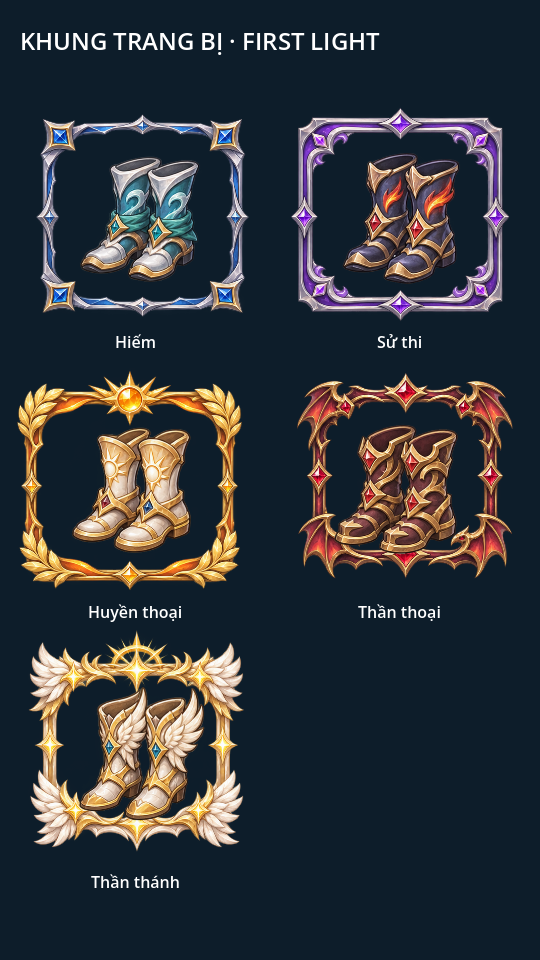
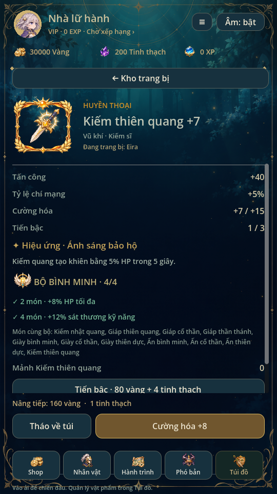
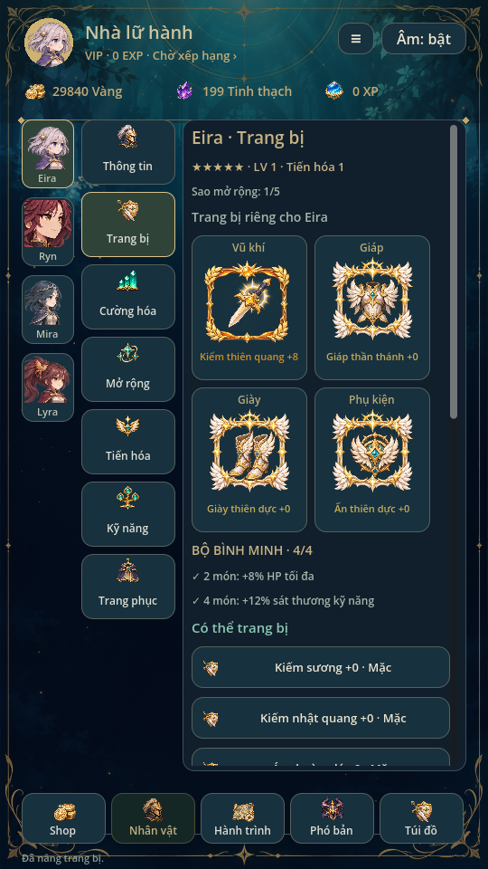

> Trạng thái chuẩn: [GAME_STATE](GAME_STATE.md), [mục lục](INDEX.md). Các phần ghi phiên bản cũ là lịch sử; ưu tiên yêu cầu mới và quy tắc hiện hành.

> Cập nhật0.30: trang bị được sở hữu nhiều bản độc lập; quy tắc mỗi ID một món/chuyển trang bị trùng thành mảnh trong tài liệu cũ đã được thay bằng [Túi đồ hiện hành](BAG_INVENTORY.md). Năm độ hiếm, bốn slot và thưởng bộ vẫn áp dụng.

# Trang bị bốn ô, bộ và khung độ hiếm · 0.27

Từ0.35 có sáu bộ/44 item/98 icon và savev11: [ADDITIONAL_EQUIPMENT](ADDITIONAL_EQUIPMENT.md). Các giới hạn và công thức dưới đây tiếp tục dùng; số lượng0.27 là lịch sử.

Tham khảo bố cục người dùng gửi: ảnh món ở trái, độ hiếm/tên/lớp/nhân vật đang
mặc ở phải; chỉ số thành từng dòng, mô tả hiệu ứng, chi phí và nút nâng cấp.
Áp dụng vào tông xanh đêm–vàng hiện có. Số220 ATK và giá2.000 trong ảnh là
minh họa; game dùng chỉ số và chi phí thật của model.

## Bốn vị trí cho mỗi hero

**Vũ khí · Giáp · Giày · Phụ kiện**. Màn Nhân vật có lưới2×2, món đã mặc có
icon và khung tương ứng. Nhấn món mở chi tiết đúng hero đang xem; thao tác
không đổi hero ra trận. Kho có bộ lọc đủ bốn loại cùng năm độ hiếm.

- Vũ khí: ATK, một số món có crit và hiệu ứng riêng.
- Giáp: HP/thủ; giáp từ Huyền thoại có giảm sát thương2–4%.
- Giày: HP/thủ nhẹ, tăng tốc độ đánh3–7%; từ Sử thi có né1–4%.
- Phụ kiện: HP, crit và hồi SP; Ấn thiên dực có khiên khi dùng kỹ năng Tinh linh.

26 mẫu hiện có:14 ID cũ +5 giày +4 phụ kiện +3 vũ khí mới. `armor_3`/Ấn mặt
trăng chuyển thành phụ kiện đúng hình, vẫn giữ ID. Kiếm thiên quang, Thương
hỏa vũ và Trượng thủy triều là các món mới Huyền thoại, ATK18 tại+0 và+5% crit.
Không lấy ATK100–230 minh họa để áp thẳng vào quái đang có vài trăm HP.

Nhận đồ vẫn theo [UNIQUE_COLLECTION](UNIQUE_COLLECTION.md): một bản mỗi ID,
trùng thành10 mảnh đúng món; nhiều cấu hình hero có thể dùng chung UID. Giày
Hiếm có thể rèn, các món mới từ Sử thi chỉ ở nhóm triệu hồi hiện có. Thêm món
làm đổi tỷ lệ từng mục trong pool; ba nhóm70/25/5%, pity và chi phí giữ nguyên,
UI tỷ lệ tính từ catalogue/trọng số thật.

## Ba bộ, thưởng2 và4 món

| Bộ | Hai món | Bốn món |
| --- | --- | --- |
| Bình Minh | +8% HP tối đa | +12% sát thương kỹ năng |
| Hỏa Vũ | +6% ATK | +5 điểm phần trăm crit |
| Thủy Triều | +8% phòng thủ | +1 SP/giây |

Mỗi ô chỉ tính một món. Các biến thể cùng bộ có thể thay nhau, ví dụ Kiếm
nhật quang hoặc Kiếm thiên quang đều thuộc Bình Minh; giáp/giày/ấn Bình Minh,
Cổ thần và Thiên dực cùng họ bộ này. Hỏa Vũ dùng thương, giáp Hoàng hôn/Tinh
vân, giày/bùa Hỏa Vũ. Thủy Triều dùng trượng, áo Lá/Sương sớm, giày Thủy triều
và Ấn mặt trăng. Danh sách chính xác là `set_id` trên từng item.

Hai và bốn món cộng theo mốc, không nhân số lần theo số cặp. Mốc4 bao gồm
mốc2. Đếm theo trang bị của đúng hero, không cộng đồ đang nằm trong kho hoặc
trang phục. Màn chi tiết cho biết số món đang mặc và tô xanh mốc đang có.

Primary HP/ATK/thủ tăng theo `1 + enhance×0.18 + (rank−1)×0.5`; chỉ số phụ và
hiệu ứng không tăng theo cường hóa. Thưởng bộ áp vào build sau thuộc tính/sao,
trước hệ số tiến hóa. Giới hạn tổng crit75%, tốc đánh30%, né25%, giảm sát
thương25%, hồi thêm3 SP/giây để tránh ghép đồ tạo giá trị quá lớn.

## Hiệu ứng có tác dụng thật

| Món | Hiệu ứng |
| --- | --- |
| Kiếm thiên quang | Marker Kiếm quang tạo khiên5% HP,5 giây |
| Thương hỏa vũ | Đòn thường có15% cơ hội thiêu đốt3 giây, mỗi giây12% ATK trước phòng thủ; làm mới thời gian, không cộng dồn |
| Trượng thủy triều | Marker Hồi phục hoàn5 SP |
| Ấn thiên dực | Marker kỹ năng Tinh linh tạo khiên8% HP,5 giây |

Đây là các công thức riêng của dự án, không phải công thức Eternal Senia đã
khôi phục. Hiệu ứng mới chỉ trên Huyền thoại trở lên. Đặc tính sáu vũ khí cũ
được giữ tương thích. Khiên dùng quy tắc max hiện có, không cộng hai khiên
thành tổng. Thiêu đốt dùng RNG model, dừng khi pause, xóa khi sang đợt; render
không tạo damage hoặc gọi thêm RNG. Khi né, đòn không trừ HP. Tốc độ đánh làm
đồng hồ đòn thường nhanh hơn, không dời marker gây sát thương của animation.
Chưa thêm kháng hiệu ứng vì chưa có hệ debuff lên hero tương ứng.

## Cường hóa và thao tác

Giới hạn mới **+15**, bậc item vẫn1–3. Nâng từ+n lên+n+1 tốn20(n+1) vàng và
1 tinh thạch; không tự tiêu mảnh mới. Trang chi tiết có thanh chi phí và hai
nút Trang bị/Tháo + Cường hóa nằm dưới vùng nội dung cuộn. Chỉ số, giá và trạng
thái khóa lấy từ cùng dữ liệu với giao dịch. Tiến bậc/phân giải trong vùng cuộn.
Pending run/read-only khóa các thao tác làm đổi build và tài nguyên.

## Năm khung có hình khác nhau

| Độ hiếm | Hình khung |
| --- | --- |
| Hiếm | Bạc xanh góc cạnh, đá sapphire |
| Sử thi | Viền đôi tím, góc cuộn hoa văn |
| Huyền thoại | Vàng cam, lá nguyệt quế, ngọc mặt trời |
| Thần thoại | Vàng tối/đỏ, cánh rồng, ruby |
| Thần thánh | Vàng ngà, lông cánh, vương miện sáng |

Không chỉ đổi màu một khung. Bộ ảnh tạo riêng, không nhập ảnh trang bị trong
ảnh tham khảo. `art/equipment/frames.png` giữ nguyên nguồn; metadata chia hàng
đã duyệt ở480px để vương miện hàng dưới không lọt vào ô Sử thi. Panel thứ sáu
là họa tiết bộ dự trữ, **không phải cấp độ hiếm thứ sáu**.

Thêm16 icon ở `art/icons/gear.png`:12 món mới,3 huy hiệu bộ và icon loại giày;
tổng registry80 icon. Ba vũ khí mới có icon riêng; sprite cầm tay trong battle
dùng lại tài nguyên PNG đúng lớp hiện có, chưa có ba atlas cầm tay riêng.
Không đổi tranh hero, sound asset hoặc thêm rig/SDK.

## Save v9 và nguồn cần sửa

Giữ đường dẫn cũ, đọc v2–v8. V7/v8 phải có map mảnh14 ID cũ hợp lệ; sau kiểm tra
mới thêm12 ID mới với0 mảnh, thêm boots/accessory trống. Không phát món miễn
phí. Ấn mặt trăng đang mặc ở ô armor chuyển sang accessory, giữ UID/+n/bậc.
V2–v6 tiếp tục gộp đồ trùng rồi thêm ô mới. Giữ ví, mảnh cũ, next_uid, nhân vật,
thành tích và pending snapshot nguyên dữ liệu. Backup nguyên byte khi ghi đầu;
lỗi ghi không cập nhật RAM. Save v9 sai không tự sửa thành profile mới.

`EquipmentSystem` giữ slot, set, caps và bổ sung stats; `BattleModel`/`TeamBattle` áp dụng
marker/proc. Snapshot lưu thêm gear_effects, equipment_sets, haste/dodge/regen/
damage_reduction; validator cho phép snapshot cũ thiếu các trường mới và không
ghi thêm vào trận đang dở. `EquipmentDetailScreen`, `EquipmentArt` dùng chung
data với model. Khung/texture cache chung, không thêm emitter mỗi item.

Builder: `python tools/build_catalog.py` gọi `build_equipment.extend`;
`python tools/build_complete_art.py` gọi icon/frame builder. Khi đổi art hoặc
metadata, sửa builder tương ứng; provenance ghi SHA256 nguồn. Không crop alpha
hoặc chỉnh pixel bằng script. Khi thêm slot/item ở tương lai, cập nhật schema,
map mảnh, catalogue, builder, stats/snapshot và UI cùng nhau.

## Kiểm chứng

Godot4.6.3 Linux/X11/Mesa. equipment_sets kiểm ba bộ2/4 món, stat thật, marker
khiên/hồi SP,3 tick burn/pause, cap15, rollback, snapshot và migration v7 của
Ấn mặt trăng. equipment_ui render năm khung, bốn bộ lọc slot, lưới2×2, chi tiết
Huyền thoại/Thần thánh, chi phí/nâng cấp thật, hero đích và khóa khi pending.

Regression87, mechanics72 tổ hợp, campaign5, expansion_campaign18, recruitment,
summon_batch, unique_collection, rarity_system, Lyra, hero_management, thuộc
tính, wardrobe, missions, audio93, skill_effects, combat_presentation,
portrait_touch và complete_art đạt. Đã chạy và xem UI kho/nhân vật/shop/triệu
hồi, ui_flow/animation_gallery, training/progression/skill_gallery và visual_ui.
Test dùng save riêng; chưa kiểm điện thoại/touch/safe-area/FPS thực tế.

Bản tích hợp0.27 giữ nguyên đội hình0.25. Trận3vN áp dụng bonus riêng từng hero; hồi SP của đồ chuyển thành hồi nộ mỗi giây, Trượng thủy triều hoàn5 nộ ở marker heal, Kiếm thiên quang tạo khiên ở marker kỹ năng cơ bản. Ấn thiên dực tạo khiên cho đúng người mang khi Ultimate tinh linh thi triển. Burn theo từng địch, không cộng dồn và không lan khi ô địch được tái sử dụng. Save v8 đang có team snapshot giữ nguyên; không tái tính chỉ số giữa trận. equipment_sets có kiểm riêng model3vN, marker, hồi nộ và ba tick burn; team_battle/team_matrix/team_campaign/team_flow/team_ui/formation_layout cũng được chạy sau tích hợp.
