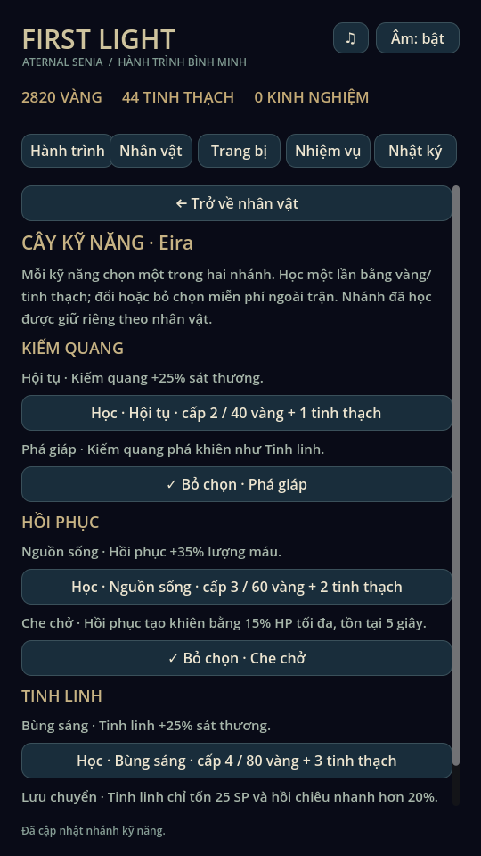
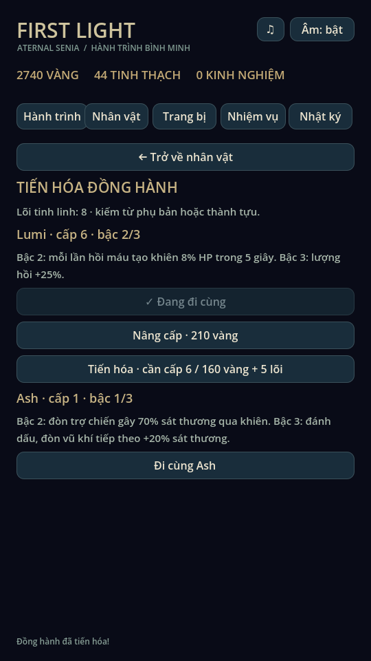
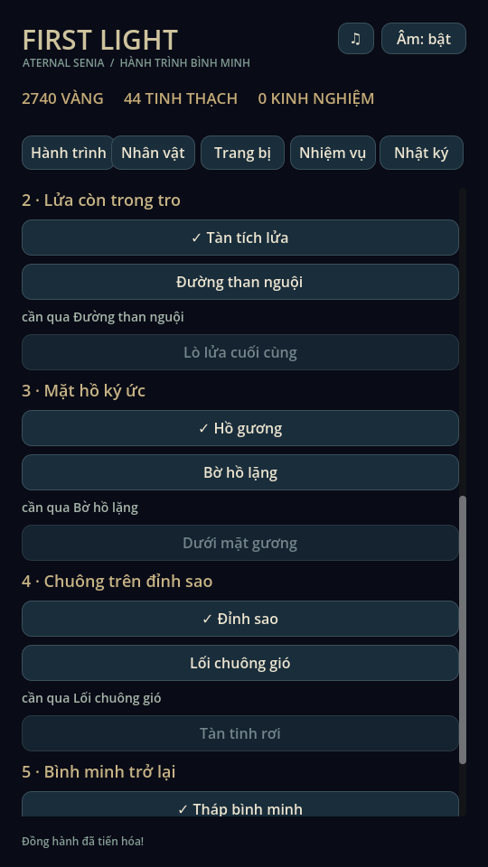
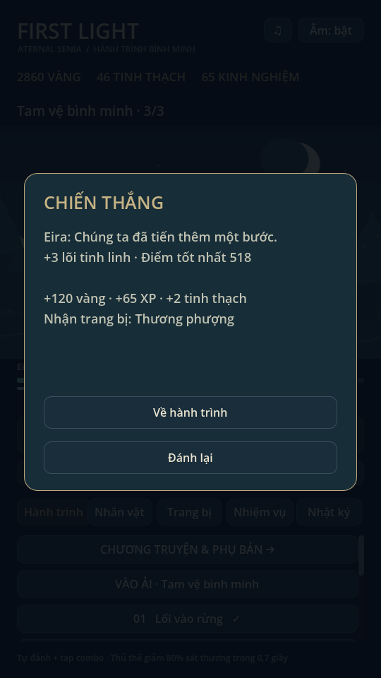

# Ký ức & Đồng hành · 0.7

Sáu nhóm tính năng mới dựa trên cấu trúc dữ liệu trong repo tham khảo. Quy tắc dưới đây được thiết kế riêng; không khẳng định phục hồi công thức game gốc.

## 1. Cây kỹ năng

Nhân vật → Cây kỹ năng. Mỗi hero lưu lựa chọn và các nhánh đã học riêng. Ba tầng mở ở cấp 2/3/4, học bằng 40/60/80 vàng và 1/2/3 tinh thạch. Mỗi kỹ năng chỉ chọn một nhánh; chọn nhánh đã học hoặc bỏ chọn miễn phí ngoài trận. Bộ sáu nhánh hiện dùng chung thiết kế cho cả ba hero, kết hợp với nội tại riêng của hero.

| Kỹ năng | Nhánh A | Nhánh B |
|---|---|---|
| Kiếm quang | Hội tụ: sát thương +25% | Phá giáp: phá khiên tại marker trúng |
| Hồi phục | Nguồn sống: lượng hồi +35% | Che chở: khiên bằng 15% HP tối đa, tồn tại 5 giây |
| Tinh linh | Bùng sáng: sát thương +25% | Lưu chuyển: tốn 25 SP thay vì 35, cooldown ×0,8 |

Không cộng hai nhánh cùng tầng. Khiên mới lấy giá trị lớn hơn giữa khiên đang còn và khiên mới, làm mới thời gian; không cộng dồn vô hạn. Thủ thế giảm sát thương trước, khiên hấp thụ phần còn lại.

## 2. Tiến hóa đồng hành

Nhân vật → Tiến hóa đồng hành. Vẫn nâng cấp bằng vàng như trước; tiến hóa là trục riêng:

| Tiến hóa | Điều kiện | Chi phí | Lumi | Ash |
|---|---|---|---|---|
| Bậc 1 → 2 | Đồng hành cấp 3 | 80 vàng + 2 lõi | Mỗi lần hồi tạo khiên 8% HP / 5 giây | Đòn trợ chiến gây 70% sát thương qua khiên thay vì 35% |
| Bậc 2 → 3 | Đồng hành cấp 6 | 160 vàng + 5 lõi | Lượng hồi tăng thêm 25% | Đòn trợ chiến đánh dấu; đòn vũ khí tiếp theo +20%, tiêu dấu một lần |

Lõi kiếm từ phụ bản và thành tựu. Dấu Ash xóa khi đổi mục tiêu. Không đổi build hoặc tiến hóa khi còn pending run.

## 3. Phụ bản và kỷ lục

Hành trình → Chương truyện & phụ bản. Không dùng vé, không giới hạn ngày:

| Phụ bản | Mở sau | Cấu trúc | Thưởng mỗi lần thắng |
|---|---|---|---|
| Săn cổ thụ | Màn chính 1 | Một boss | 60 vàng, 35 XP, 2 tinh thạch, 1 lõi, loot |
| Tháp sáu đợt | Màn chính 2 | Năm đợt thường và boss cuối | 90 vàng, 50 XP, 2 tinh thạch, 2 lõi, loot |
| Tam vệ bình minh | Màn chính 3 | Cổ thụ → Hộ vệ → Ảo ảnh, lần lượt smash/shield/counter | 120 vàng, 65 XP, 2 tinh thạch, 3 lõi, loot |

Điểm khi thắng = số mục tiêu hạ × 100 + max(0, 300 − floor(thời gian mô phỏng × 3)). Lưu điểm cao nhất và thời gian nhanh nhất độc lập; ×2/×3 không làm giảm thời gian mô phỏng tính điểm. Thua/rút lui không thưởng lõi, không ghi kỷ lục. Đây là kỷ lục local, không phải bảng xếp hạng online. Túi đầy vẫn đổi loot thành tinh thạch như trước.

## 4. Nội tại sáu vũ khí

| Vũ khí | Hiệu ứng thực tế |
|---|---|
| Kiếm sương | Đòn thường trúng hồi thêm 2 SP |
| Kiếm nhật quang | Thủ đòn thành công: đòn vũ khí kế tiếp trong 4 giây +30%; giữ cooldown ×0,92 |
| Thương than hồng | Đòn vũ khí +20% khi mục tiêu trước hit còn dưới 35% HP |
| Thương phượng | Đòn vũ khí gây 70% damage qua khiên; giữ cooldown ×0,92 |
| Trượng giọt sương | Kỹ năng hồi phục +15% |
| Trượng tinh tú | Kỹ năng hoàn 4 SP đúng một lần tại marker; giữ cooldown ×0,92 |

Đòn vũ khí gồm đòn thường và kỹ năng damage của hero. Hiệu ứng không truyền cho assist. Nhặt/trang bị vẫn dùng UID, giới hạn lớp và snapshot như trước. Không trang bị vũ khí thì không được nội tại mặc định.

## 5. Bộ sưu tập và thành tựu

Nhiệm vụ → Bộ sưu tập & thành tựu. Ghi nhớ chín mẫu trang bị đã nhận hoặc rèn, năm boss chính và trạng thái/bậc hai đồng hành. Phân giải đồ không xóa lịch sử khám phá. Save v2 chỉ có thể khôi phục lịch sử từ đồ còn trong túi và bộ khởi đầu; không suy đoán đồ đã phân giải trước bản 0.7.

Sáu mốc nhận một lần: tìm sáu mẫu đồ; hạ đủ năm boss chính; tổng bậc đồng hành đạt bốn; hoàn thành mười màn nhánh; tổng điểm tốt nhất của ba phụ bản đạt 100 và 500. Vàng/tinh thạch/lõi và cờ nhận thưởng được ghi trong cùng transaction.

## 6. Chương và truyện nhánh

Năm chương, mỗi chương có một màn chính và hai màn ký ức. Qua màn chính mở nhánh đầu; qua nhánh đầu mở nhánh sau. Tuyến chính vẫn tiến độc lập, không bắt buộc làm nhánh. Tổng cộng 15 màn truyện / 30 đoạn trước–sau; thêm ba phụ bản thành 18 địa điểm chơi.

| Chương | Hai màn nhánh |
|---|---|
| Tiếng gọi trong rừng | Suối lạc quang → Gốc rễ ký ức |
| Lửa còn trong tro | Đường than nguội → Lò lửa cuối cùng |
| Mặt hồ ký ức | Bờ hồ lặng → Dưới mặt gương |
| Chuông trên đỉnh sao | Lối chuông gió → Tàn tinh rơi |
| Bình minh trở lại | Hành lang cũ → Lời hứa bình minh |

Nhánh tái sử dụng artwork và cơ chế của vùng, tăng HP quái/boss 10% hoặc 25%; mỗi màn có 40 vàng thưởng đầu, loot và hội thoại mới. Nhật ký lưu đối thoại đã mở. Các nhánh không tự mở hero hoặc tăng metric năm màn chính.

## Lưu trữ và kiểm chứng

Schema v3 giữ đường dẫn `first_light_v2.json` để nhận save đang có. Đọc v2 bổ sung dữ liệu mới; lần ghi thành công đầu tiên tạo backup nguyên file v2. Các lần ghi tiếp theo xoay backup như trước. V1 vẫn được chuyển, save tương lai khóa ghi. Snapshot pending v2 được giữ nguyên: trận đang dở không tự nhận nội tại hoặc nhánh mới. Snapshot mới có lựa chọn kỹ năng, bậc đồng hành và trait vũ khí. JSON ghi full precision; chuẩn hóa số nguyên để snapshot đọc lại ổn định.

BattleModel sở hữu marker, SP, buff, khiên, HP và các đợt. View đọc event có presentation_wave để hiệu ứng trúng đúng độ cao mục tiêu kể cả đợt 4/5/6 hoặc boss ở đợt 1. Catalogue trận được copy riêng trước khi thay boss/nền theo đợt; không sửa catalogue toàn cục. Không thay audio ElevenLabs hoặc gọi API trả phí.

Đã kiểm trên Godot 4.6.3 / Linux:

- 81 assertions hồi quy; 93 audio checks; validate 38 SFX và receipt ElevenLabs.
- Mechanics đủ 54 tổ hợp (3 hero × 18 địa điểm), dùng fixture mạnh để tách lỗi nội dung khỏi cân bằng.
- Campaign cũ đủ 5 màn từ profile mới; expansion_campaign đủ 18 màn từ profile mới, chỉ dùng tài nguyên kiếm được, reload giữa mỗi trận, đạt Lumi bậc 3.
- 60 expansion checks: từng nhánh/trait, rank, marker, khiên hết hạn, snapshot/reload, v2 và pending migration, backup, khóa build, điều kiện nhánh, score tốt nhất, reward dedupe, lỗi ghi/retry và khám phá sau phân giải.
- UI cũ, animation_gallery và UI mở rộng render thực trên X11/Mesa. UI mới gồm các màn quản lý và trận ba boss thật với fixture cấp 4, không sửa HP/ATK giữa trận. Xem ảnh, kiểm kết quả và record sau chiến thắng.

Chưa thử điện thoại thật, touch, FPS/nhiệt hoặc nghe qua loa thật. Ryn/Mira/Ash, các vùng ngoài rừng và một số boss vẫn SVG. Đây là bộ nội dung mở rộng hữu hạn, chưa có cây riêng biệt cho từng hero, đồ họa mới cho từng nhánh hoặc phụ bản vô tận.

Nguồn: [schema trong repo tham khảo](https://github.com/tai23082004l02-svg/Tham-kh-o-game/blob/main/research/eternal-senia-2/catalogs/table_schemas.json): skill/passive/skillclass/rune; partner/ability/partner_rankup; realm/godRealm/platinumTrial; weapon; partner_collect/quest/story; chapter/section/map/area.
