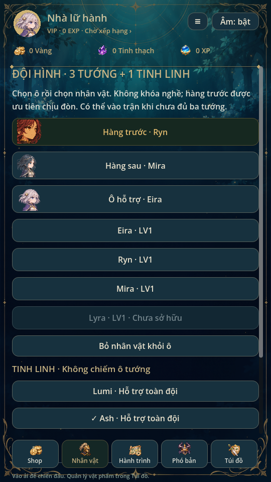

> **Cập nhật 2026-11-08 — runtime 4 hero + 1 tinh linh:** Bốn ô trình bày 2 trước + 2 sau, không khóa nghề. Địch ưu tiên slot còn sống theo thứ tự 0 → 1 → 2 → 3; không tự chia sát thương cho hai ô trước. HUD có bốn thẻ hero và thanh Ultimate tinh linh riêng. Hành trình hiển thị cả bốn hero.
>
> **Tương thích:** Giữ save v12 và đường dẫn cũ, nhận formation 3 hoặc 4 ô. `Formation.state()` mở rộng bản sao thành 4 ô với ô cuối trống; xem UI không ghi save. Chỉnh đội mới ghi bốn ô qua transaction hiện có. Profile chưa có formation lấy hero sở hữu tối đa4; không cấp hero khóa. Snapshot mới v2 nhận 1–4 hero; snapshot v1 tối đa3 hero và pending singleton vẫn đọc nguyên trạng, không tính lại stats/seed/thuốc/phần thưởng. Renderer v1 giữ vị trí cũ. Quy tắc heal/khiên/energy và chỉ số encounter giữ nguyên; cần cân bằng sâu và kiểm tra điện thoại thật riêng.
>
> Phần phiên bản 0.24/0.25 bên dưới là lịch sử, không còn giới hạn runtime hiện hành.

> Trạng thái chuẩn: [GAME_STATE](GAME_STATE.md), [mục lục](INDEX.md). Các phần ghi phiên bản cũ là lịch sử; ưu tiên yêu cầu mới và quy tắc hiện hành.

# Đội hình · 0.25

Giao diện navy/teal, điểm nhấn vàng theo ảnh tham khảo. Sân đội hình dùng lại
background và sprite/weapon/trang phục thật: một vị trí trước ở giữa, hai vị trí
sau ở hai bên; vòng xanh, vị trí đang chọn viền vàng. Thanh tinh linh riêng mở
bộ chọn hiện có; giữ hai tùy chọn tự chiến, Bỏ khỏi ô, Nâng cấp và Hành trình.

Danh sách lấy từ `catalog.data.heroes`, trạng thái sở hữu qua `available_hero`,
cấp độ từ profile, dấu ✓/nhãn Đang ra trận từ `Formation.state().slots`. Không
có danh sách ID hero cố định. Portrait ưu tiên metadata đã có, sau đó banner
theo ID (hoặc trường catalogue `formation_portrait`), rồi sprite/placeholder
nếu art chưa được khai báo. Không tạo hoặc thay artwork nhân vật.

Lưới3 cột nằm trong `SwipeScroll` riêng cao178px. Canvas giữ chiều cao logic
theo số hàng; tối đa12 Button cho hàng nhìn thấy và vùng đệm, tái sử dụng khi
cuộn. Chỉ bind lại khi đổi hàng; texture cache dùng chung. Nút lấy ID từ binding
hiện tại nên không giữ callback của hero cũ. Vị trí cuộn được giữ khi chọn ô,
hoán đổi hoặc bật/tắt tùy chọn. Các nút thao tác và thanh điều hướng nằm ngoài
vùng cuộn; số hero không làm tăng chiều cao màn. Dùng gesture/inertia có sẵn,
không thêm bộ kéo song song.

Chọn ô rồi chọn tướng: có sẵn ở ô khác thì hoán đổi, không nhân bản hero. Có
Bỏ khỏi ô, nhưng không bỏ hero cuối cùng. Hai ô dưới chỉ đổi cách trình bày,
vẫn là slot1/2, không đổi targeting hay khóa nghề. Tướng và tinh linh chưa sở
hữu bị khóa. Có thể mở xem tinh linh khi pending, các nút chọn đều vô hiệu.

Checkbox nối tùy chọn Formation đã có; roster/tinh linh/options cùng giữ quy
tắc commit và khóa pending/read-only cũ. Lỗi ghi không thay RAM hoặc trừ ví.
Không đổi schema save v8, stats, mô hình3vN hay phần thưởng. Những hero/LV trong
ảnh là fixture minh họa Mira trước, Eira/Ryn sau; không áp đặt đội đó lên save.

Kiểm thử formation_layout: vị trí ô, cùng hàng phía sau, độ cao màn, click thật
chọn/hoán đổi, tinh linh, checkbox, nhân vật khóa, lỗi ghi và pending snapshot.
team_ui, ui_flow, animation_gallery và regression87/mechanics72/campaign5 đạt.
Đã xem ảnh Godot Linux; chưa thử điện thoại thật.

Kiểm tra mở rộng: catalogue fixture1004 hero, chiều cao màn/vị trí tùy chọn
không đổi, tối đa12 thẻ, cuộn tới hero cuối, kiểm instance thẻ được tái sử dụng
và profile không thay đổi. `swipe_scroll` kiểm mouse/touch trên vùng roster: chỉ
cuộn vùng con, không đổi đội hình hoặc dịch chuyển vùng ngoài. Đây là mô phỏng
trên Linux/X11; chưa xác nhận FPS/độ mượt trên điện thoại Android thật.
