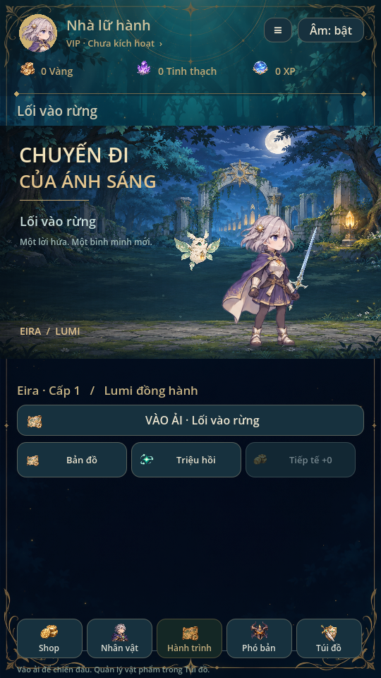
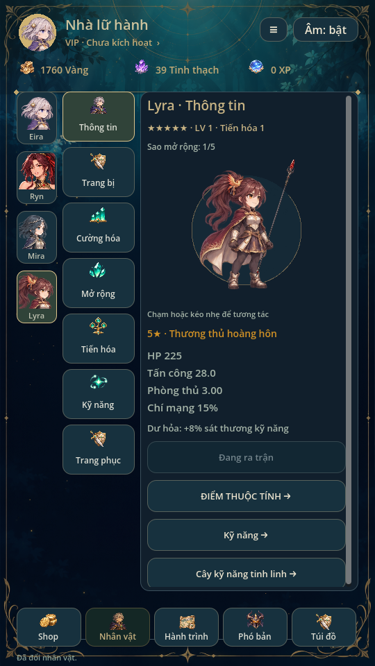
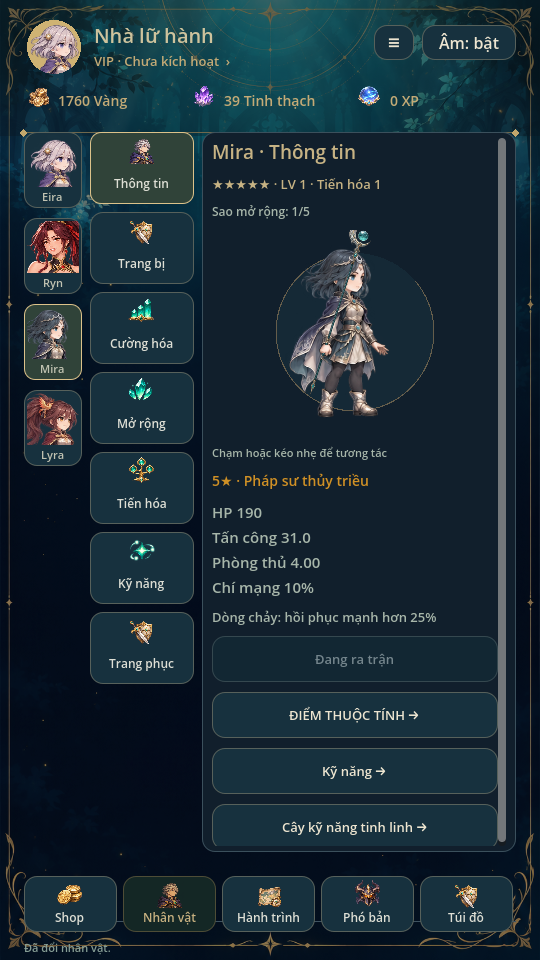
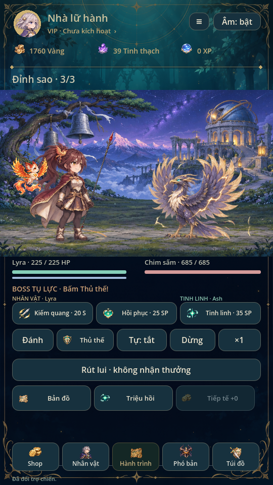
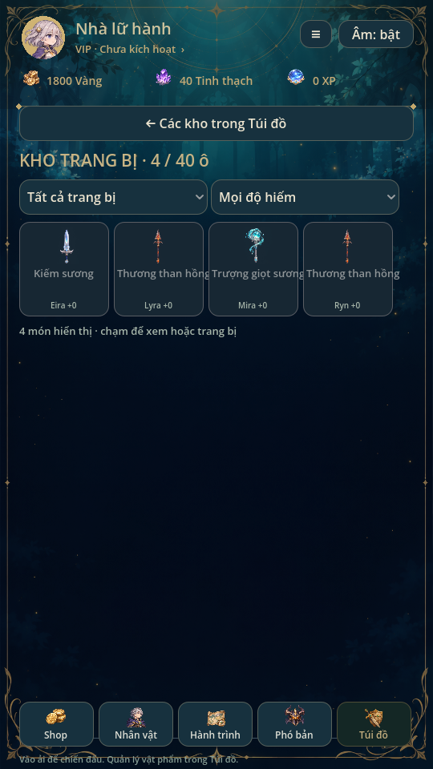

# Giao diện & đồ họa · 0.16

Lịch sử bản0.16. Ryn đã được thay toàn bộ thiết kế và dọn raw cũ ở [0.18](RYN_ART.md); các mô tả giữ ảnh cũ dưới đây chỉ áp dụng tại thời điểm0.16.

Bản này tích hợp trên commit 0.15 `fc2ecfb90a7d23ff4f9d4daa65e29ca37b280835`, giữ hồ sơ/VIP cùng tóc–tà áo Ryn mới nhất và các thay đổi người dùng vừa thêm: thuộc tính, nâng/sao/tiến hóa, cây tinh linh, triệu hồi/pity, bảy độ hiếm trang bị, shop sáu mục, trang phục và màn nhân vật bảy mục.

## Nhân vật

**Ryn giữ nguyên** tuổi 27, portrait/layer body/back, 12 pose có thương vẽ liền và tương tác mạnh của 0.14. Đã đối chiếu hash bốn ảnh nền, hai layer tóc/vải mới cùng nội dung metadata với commit nguồn, không đổi byte. Không vẽ thêm thương trên pose embedded_weapon.

Bộ tranh mới vốn đang làm được đặt tên **Lyra** theo yêu cầu người dùng, không ghi đè Ryn: thương thủ hoàng hôn 24 tuổi, áo choàng đỏ sẫm, tóc nâu buộc cao, hệ lửa, 5★ gốc. Mở sau màn chính 3 hoặc từ nhóm triệu hồi cao cấp hiện có. HP225/ATK22/thủ3/crit15%, skill_bonus1,08. Dùng cùng hai mẫu thương đã có; sáu nhánh kỹ năng được lưu riêng. Tất cả cơ chế thuộc tính, Mở rộng, tiến hóa, trang phục và snapshot hỗ trợ Lyra. Thêm Lyra vào pool làm thay đổi tỷ lệ từng mục trong nhóm; tỷ lệ nhóm và pity không đổi, UI vẫn liệt kê pool/trọng số thực.

Mira có bộ 16 pose PNG mới. Lyra cũng có 16 pose: idle2/run4/attack4/cast2/hurt2/kneel/defeat dùng trong bảy clip; một số pose được dùng lại cho guard/recovery. Tổng bốn hero là **76 pose nguồn** (Eira32, Ryn12, Mira16, Lyra16). Đây là hoạt ảnh sprite hữu hạn, chưa có bộ in-between hay layer tóc riêng cho Mira/Lyra như Ryn.

Mira được làm sạch nền trong suốt bằng image generation lần thứ hai. Thương/trượng dùng atlas vũ khí thân dài riêng để không dùng icon lớn che mặt. Socket/anchor/region explicit; hai frame cuối được thu vùng ngang để loại mảnh pose bên cạnh. Giữ source PNG, không chỉnh pixel bằng script. Builder đầy đủ: `python tools/build_complete_art.py`, gọi các builder nền rồi thêm phần mới, vẫn giữ override Ryn.

## Thế giới và giao diện

- Giữ nguyên tranh rừng, phế tích, hồ và Ash do bản trước thêm; tiếp tục dùng EnvironmentMotion/SkillEffects hiện có.
- Bổ sung núi sao và tháp bình minh. Atlas giữ thêm hai tranh vùng như bản nghiên cứu phong cách; runtime tiếp tục dùng ruins/lake của người dùng.
- Hộ vệ lửa, linh thú hồ và chim sấm có idle/charge/slam. Người giữ tháp dùng lại hộ vệ với phối màu lạnh, chưa có silhouette riêng. Slime/sói/cổ thụ giữ tranh đã có.
- Cả sáu vũ khí có PNG khi vẽ rời; Ryn giữ thương liền. Đủ 14 icon trang bị; thêm icon tài nguyên và huy hiệu. Không còn SVG làm hình hiển thị hero/nền/boss/vũ khí ở gameplay; file mẫu cũ vẫn giữ cho lịch sử/công cụ.
- Nền menu xanh đêm/vàng, header tài nguyên có biểu tượng, thẻ khu vực và nhật ký có tranh. Kho vẫn giữ lưới/bộ lọc của người dùng nhưng mỗi món có ảnh riêng; chi tiết item có ảnh lớn. Màn chiến thắng có huy hiệu. Giữ nguyên thứ tự năm nút điều hướng và bố cục nhân vật bảy mục.
- Không thêm SDK, quảng cáo, gói thanh toán, phí runtime hoặc yêu cầu API âm thanh mới. Những mục dịch vụ chưa mở tiếp tục khóa như trước.

## Save

Schema **v6**, giữ đường dẫn cũ; đọc v2/v3/v4/v5. Chỉ thêm Lyra vào hero/build và các trường tùy chọn training/evolution/outfits/recruitment khi chuyển save cũ. Giữ nguyên Ryn, tiền, đồ, lịch sử và pending snapshot. Save cũ không bị ép thêm item vào túi; Lyra bắt đầu không mặc đồ, người chơi có thể rèn/trang bị thương. Profile mới có starter như các hero khác.

Lần ghi đầu backup nguyên byte save cũ. Lỗi ghi giữ dữ liệu cũ; save v6 sai không tự bổ sung lại trường bị thiếu. Không thay stat trận đang dở; Lyra chỉ xuất hiện ở lựa chọn build sau trận.

## Kiểm tra

Godot4.6.3 Linux/X11/Mesa:

- Regression87, mechanics72 tổ hợp (4 hero ×18 màn), campaign5 và expansion_campaign18 màn từ profile mới chỉ dùng tài nguyên kiếm được.
- Expansion60, thuộc tính62, recruitment451, hero_management33, rarity_system, wardrobe, portrait_touch, Ryn art và marker/skill_effects đều đạt.
- Audio93 và validate38 ElevenLabs SFX/receipt; không thay audio/gain.
- `lyra.gd`: tách biệt Ryn, mở khóa/run snapshot, chuyển save v5 đầy đủ các trường tùy chọn, giữ Ryn/pending, lỗi ghi và backup.
- `complete_art.gd`: 76 pose, clip, atlas bounds, PNG cho toàn hero/nền/vũ khí/boss, companion và 24 icon.
- Render và xem ảnh: ui_flow, character_ui, shop_ui, mobile_inventory, training_ui, progression_ui, skill_gallery, environment_art, animation_gallery, ryn_gallery và complete_art_gallery. `visual_ui.gd` chụp tất cả menu, bốn hero, năm vùng/boss, item và âm thanh bằng profile fixture riêng.
- `visual_movie.gd` ghi Godot Movie Maker 894 frame/30fps =29,8 giây; xem profile Ryn/Mira/Lyra và trận ba boss thật của Lyra cấp8/Lumi cấp6 bậc2 từ fixture, không sửa HP/sát thương giữa trận. Có lưu record/kết quả. File phát hành H.264/AAC; xem các frame trích xuất, chưa nghe qua loa thật.

Chưa thử điện thoại, touch/safe-area thật, FPS/nhiệt hoặc nghe loa. Một số pose/ảnh tạo sinh có sai khác chi tiết, tháp dùng lại silhouette boss; không gọi đây là bộ animation thương mại đã polish tuyệt đối.

[Video có âm thanh](previews/visual-showcase.mp4)

Hồ sơ/VIP0.15 được giữ nguyên logic; lưới chọn avatar đổi thành hai cột để đủ bốn hero. VIP vẫn chỉ xem giao diện, không tạo cấp/điểm/thưởng/nạp giả. Video được ghi trước khi ghép header hồ sơ0.15; ảnh preview cuối phản ánh header mới.
