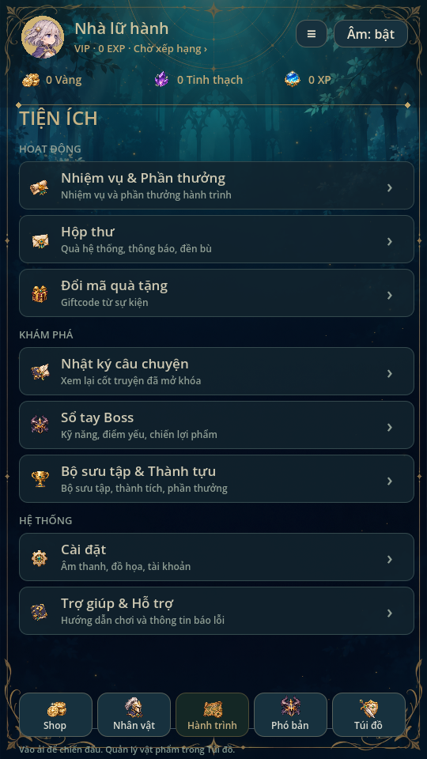
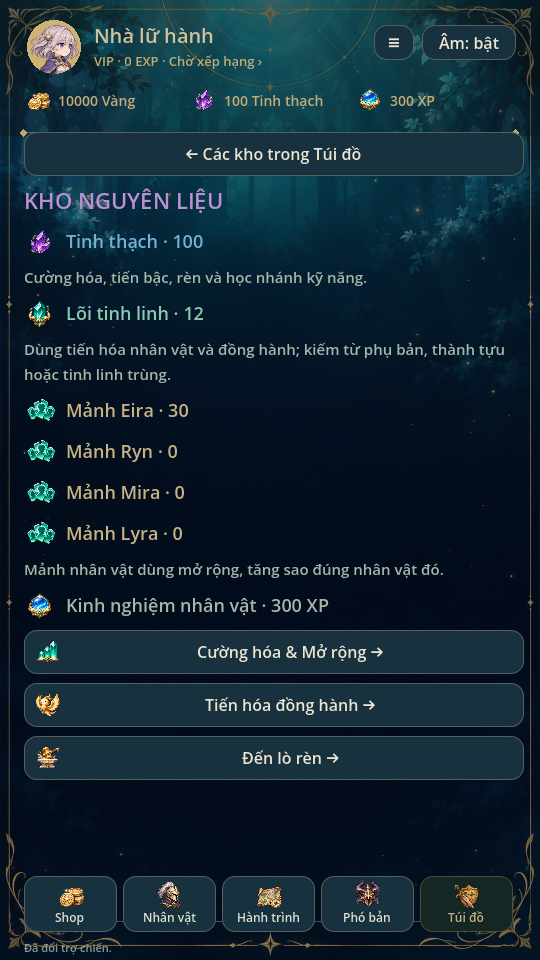

# Bộ icon giao diện và đạo cụ · 0.22

> Từ [0.27](EQUIPMENT_SETS.md) registry có80 icon với sheet `gear.png` bổ sung16 ô. Catalogue có26 item. Danh mục64 icon dưới đây mô tả bộ nền0.22.

64 icon gốc được tạo bằng image generation, cùng nét fantasy anime vẽ tay,
kim loại vàng/ngà, vải xanh đêm và ngọc teal của game. PNG trong suốt, không
nhập asset từ Eternal Senia hoặc tải bộ icon bên ngoài. Nguồn ảnh tham chiếu
là `art/ui/icons.png` của chính dự án; bộ mới thay hình đang dùng qua registry.
Không chỉnh pixel, alpha hoặc chroma-key bằng script.

## Danh mục và cách dùng

| Atlas trong `art/icons/` | 16 ô, đọc từ trái sang phải rồi xuống hàng |
| --- | --- |
| `navigation.png` | journey, hero, equipment, quest; journal, slash, heal, spirit; guard, training, talents, companion; boss, forge, gold_ui, crystal_ui |
| `systems.png` | mail, gift, settings, help; achievement, wardrobe, evolution, awakening; summon, afk, daily, weekly; chest, chest_open, vip, event |
| `equipment.png` | sword_1, sword_2, spear_1, spear_2; staff_1, staff_2, armor_1, armor_2; armor_3, armor_uncommon, armor_4, armor_5; armor_6, armor_7, weapon_category, armor_category |
| `resources.png` | gold, shards, xp, cores; fragments, potion, victory, training_item; slash_spell, heal_spell, burst, ticket; fire, water, light, vip_exp |

14 món trang bị hiện có đều có icon riêng đúng ID catalogue: hai kiếm, hai
thương, hai trượng và tám món phòng cụ/phụ kiện. Các icon kỹ năng, chiến thắng
và tài nguyên dùng chung nguồn với UI khi phù hợp. Icon giáo/trượng là hình
đầu vũ khí để dễ đọc trong ô nhỏ; sprite vũ khí cầm trong chiến đấu vẫn dùng
bộ tài nguyên dài và socket riêng, không thay bằng icon.

Đã gắn vào điều hướng, nút chiến đấu, header tiền/XP, bảy mục Nhân vật, sáu
mục Shop, triệu hồi, tiện ích, nhiệm vụ ngày/tuần, rương hoạt động, tiếp tế AFK,
nút xem VIP, kho trang bị/chi tiết đồ và kho nguyên liệu. Các mục đóng như thư,
giftcode, banner cao cấp hoặc thanh toán vẫn giữ điều kiện hiện có; thêm icon
không mở dịch vụ hoặc phát thưởng. Potion, ticket và biểu tượng nguyên tố được
chuẩn bị sẵn; **không có nghĩa game đã thêm potion/vé/nguyên liệu mới**.
Mảnh nhân vật dùng biểu tượng mảnh chung với tên hero rõ ràng, không giả rằng
đã có bốn tranh mảnh chân dung riêng.




## Registry chung và builder

`art/icons/manifest.json` là danh mục64 ô duy nhất. `UIIcons` tạo AtlasTexture,
cache bốn texture nguồn và dùng alias tương thích: crystal→shards,
shop→gold, utilities→settings, dungeon→boss, collection→achievement.
Alias không được tính thành ảnh mới. `build_complete_art.py` lấy cùng region
để cập nhật `art/painted/manifest.json`; FrameLibrary tiếp tục cung cấp
`icon_<ID>` cho kho, HUD và phần thưởng. Không đổi ID item, stats hoặc save.

Tái tạo từ thư mục repo:

```sh
python tools/build_complete_art.py
```

`tools/build_icon_manifest.py` chỉ đăng ký cell và hash, đọc kích thước từ PNG
header rồi chia bốn hàng/cột theo atlas đã duyệt. Không chỉnh ảnh. Để chỉ tái
tạo registry có thể chạy builder icon riêng; nếu cần cập nhật manifest runtime
của FrameLibrary, luôn chạy builder đầy đủ. `art/icons/provenance.json` ghi
nguồn, phương pháp, ngày, kích thước và SHA256 của từng PNG.

Giữ nền trong suốt và khoảng trống giữa ô. Đặt `filter_clip=true` cho mọi
AtlasTexture. Không tự crop bằng alpha bbox hoặc scale/cắt PNG nguồn để sửa
lỗi layout: chỉnh region khi cần, hoặc tạo lại ảnh bằng image generation.
Không thay tranh nhân vật/atlas chiến đấu trong một yêu cầu làm icon.

Khi thêm icon: đọc [CHARACTER_BIBLE](CHARACTER_BIBLE.md) về style chung, xem
bốn atlas hiện tại, bổ sung ID ổn định vào builder, cập nhật danh mục này và
provenance. Nếu thêm sheet khác layout, khai báo region đã duyệt riêng, không
ép vào giả định4×4. Không gán icon biểu thị chức năng khác chỉ để hết ô trống.

## Kiểm chứng

Godot4.6.3 Linux/X11/Mesa. Đã import, chạy complete_art, ryn_art,
portrait_touch và icon_gallery. Registry có64 ô nằm trong bounds, có pixel
hiển thị, filter clipping; toàn bộ item catalogue có region giống giữa UIIcons
và FrameLibrary. Gallery render64 icon ở104px và28px để kiểm độ rõ thực tế.

Đã chạy và xem ảnh các luồng: utilities_ui, missions_ui, journey_ui,
character_ui, shop_ui, summon_ui, mobile_inventory, player_profile, ui_flow
và animation_gallery. Rương nhiệm vụ chuyển sang icon trên/chữ dưới, tăng
chiều cao72px để đủ hai dòng; kho nguyên liệu có hình bên cạnh số lượng.
Test dùng profile/capture riêng. Không đổi audio, không gọi API âm thanh.
Chưa thử trên điện thoại thật; pass render không phải bằng chứng đã đo FPS
hoặc thử touch/safe-area thiết bị thật.

Lệnh xem atlas trong Godot, cần display/Xvfb:

```sh
godot --path . --script tests/icon_gallery.gd
```

Đặt `FIRST_LIGHT_CAPTURE_DIR` để chọn nơi ghi ảnh. Báo đúng giới hạn: chi tiết
mảnh nhỏ và hiệu ứng phát sáng sẽ giảm khi icon xuống28px; nút vẫn giữ chữ hoặc
tooltip. Không gọi64 icon là64 vật phẩm mới.
