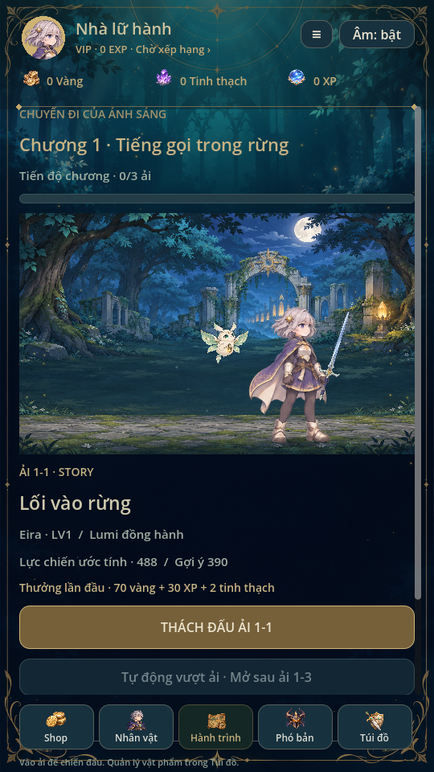
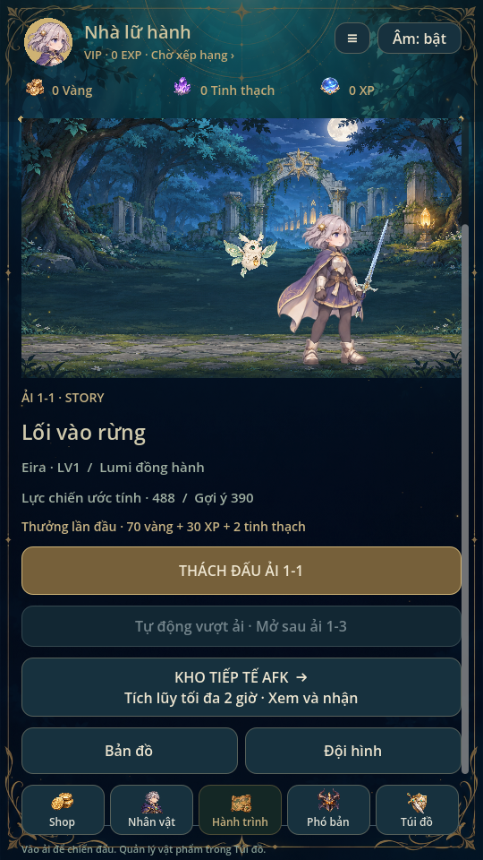
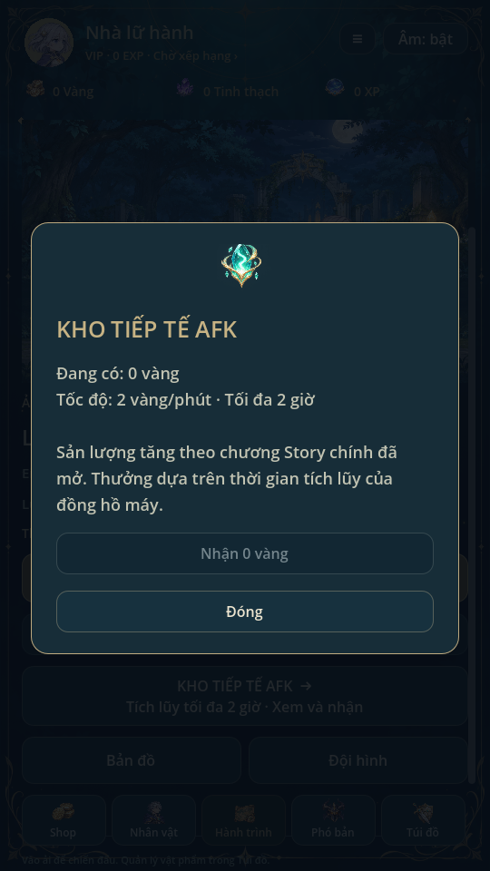

> Trạng thái chuẩn: [GAME_STATE](GAME_STATE.md), [mục lục](INDEX.md). Các phần ghi phiên bản cũ là lịch sử; ưu tiên yêu cầu mới và quy tắc hiện hành.

# Hành trình · 0.21

## Giao diện hiện hành · thiết kế lại theo ảnh tham khảo

Thẻ ải nền navy/teal, viền vàng, cảnh đội hình lớn phía trên; nhãn mã/trạng thái,
tên ải serif, đội đồng hành, hai ô lực chiến/gợi ý và thưởng lấy từ dữ liệu thật.
Giữ tên chương, tiến độ và thanh tiến độ trong thẻ. Nút Thách đấu vàng là hành
động chính; nút Tự chiến & Ultimate màu teal; Bản đồ, Đội hình và AFK nằm cùng
một hàng. Ví có khung riêng và tab Hành trình sáng hơn khi đang ở màn trại.
Các trang khác và HUD chiến đấu giữ giao diện hiện có.

Dùng lại background/renderer hero, tinh linh, trang phục hiện có; không bake
nhân vật, chữ hoặc số liệu vào tranh. Giữ SwipeScroll, các callback, điều kiện
khóa, công thức, thưởng, AFK, pending và save. Nội dung dài vẫn cuộn được.

## Thiết kế và hành vi nền

Theo wireframe: tiêu đề chuyến đi, tên chương và tiến độ; cảnh đội hình trong
vùng hiện tại; mã ải/tên ải; lực chiến ước tính; thưởng lần đầu; Thách đấu; Tự
chiến; Kho tiếp tế AFK; Bản đồ/Đội hình. Tông xanh/vàng giữ nguyên. Nội dung cuộn
trong viewport dọc, thanh điều hướng và hồ sơ giữ cố định.

Cảnh dùng đúng hero/tinh linh/trang phục đang chọn, vùng theo ải. BattleView
preview chỉ vẽ, không sửa model/RNG/ví. Khi vào trận dùng renderer và HUD chiến
đấu cũ, không có hai cảnh chồng nhau. Đổi tab/hồi về trại tạo lại thẻ hiện tại.

Dữ liệu thực: mỗi chương gồm1 màn chính và2 nhánh ký ức, nên hiển thị0/3 chứ
không sao chép0/10 trong ví dụ. Mã1-1/1-2/1-3 ứng với stage1/6/7. Tiến độ lấy
`cleared`, tên lấy catalogue. Phó bản challenge không cộng tiến độ Story.

Lực chiến là ước tính giao diện: HP + ATK×10 + DEF×6; gợi ý theo ải là enemy_hp×2
+ boss_atk×8. Không dùng con số này để khóa ải hay sửa combat, không bảo đảm
thắng. Điều kiện vào ải vẫn là can_enter/pending/read-only hiện tại.

Thưởng lần đầu hiển thị gold+first_gold, XP và2 tinh thạch từ settlement; khi đã
clear, đổi sang thông tin đánh lại (gold, XP,2 tinh thạch). Loot trang bị vẫn theo
pool hiện có, không tạo thêm thưởng từ preview hoặc thao tác xem thẻ.

Tự chiến mở sau khi clear1-3 (stage7). Nút mở xác nhận rồi chạy trận thật với
auto_attack hiện có; người chơi vẫn dùng kỹ năng/thủ thế. Dừng ở kết quả, chưa
tự chuyển ải, lặp farm hoặc quét nhận thưởng. Không thêm setting vào save.

Kho AFK mở modal: số vàng hiện có, tốc độ theo unlocked_stage, cap2 giờ và nút
nhận. Dùng claim_offline hiện tại, cùng transaction và hook nhiệm vụ ngày/tuần;
pending/read-only khóa nhận, không nhận quà chỉ vì mở kho. Số liệu dựa trên đồng
hồ máy như cơ chế cũ. Bản đồ và Đội hình mở màn bản đồ và quản lý nhân vật cũ.

journey_ui kiểm chapter0/3→3/3, mã nhánh, khóa/mở Tự chiến, AFK có vàng thật và
hook nhiệm vụ, vào trận/hồi trại, duyệt không sửa save. Regression87, mechanics72,
campaign5, missions, ui_flow, animation_gallery, mobile_inventory và visual_ui đạt.
Đã xem ảnh Godot Linux; chưa kiểm điện thoại/touch thật. Không sửa save schema,
BattleModel, chi phí, chỉ số hay phần thưởng.

Từ0.24, Hành trình preview toàn đội; Đội hình mở màn3 ô +tinh linh. Đánh thường/cơ bản tự động ngay từ đầu, mục Tự chiến thay bằng thiết lập Ultimate/chuyển ải. Tham khảo TEAM_COMBAT.md.
