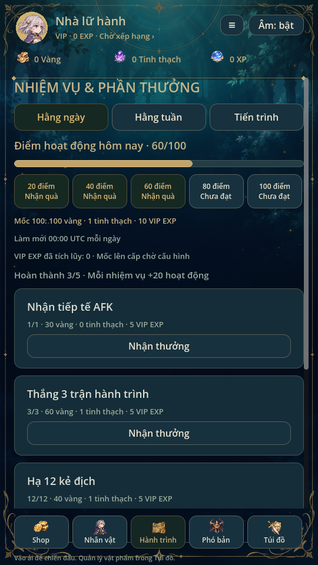
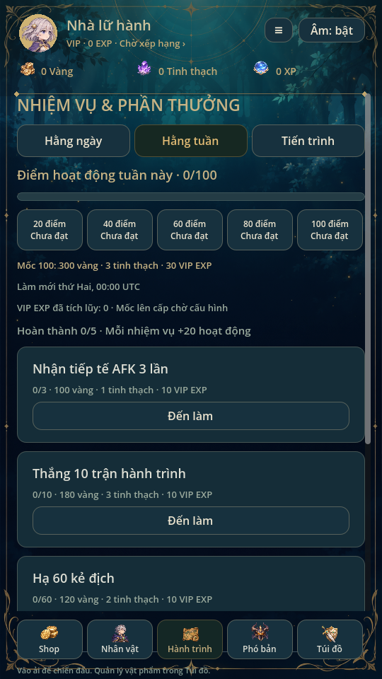
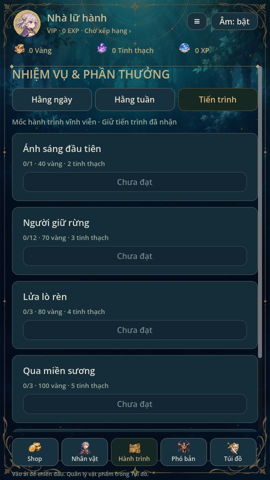
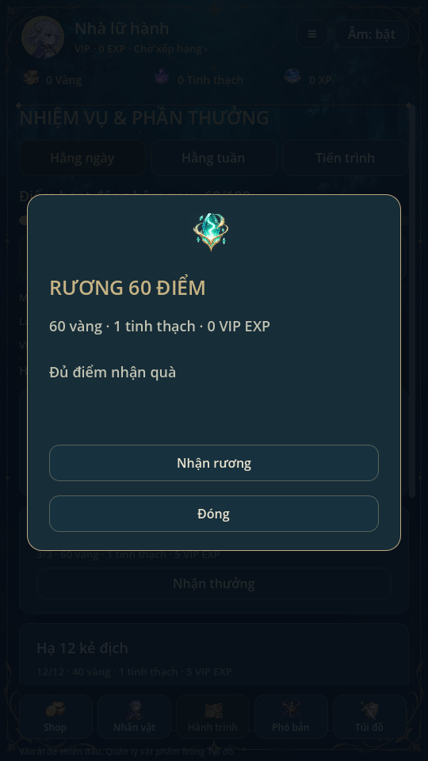

# Nhiệm vụ & Phần thưởng · 0.20

Ba tab Hằng ngày / Hằng tuần / Tiến trình, giữ tông màu game. Ngày và tuần có
thanh hoạt động0–100; mỗi nhiệm vụ hoàn thành cho20 điểm, không cần nhận nhiệm
vụ trước. Mỗi rương20/40/60/80/100 mở xem thưởng rồi nhận một lần trong chu kỳ.
Danh sách thẻ cuộn, có tiến độ, quà và nút Đến làm/Nhận thưởng/Đã nhận.

| Nhiệm vụ | Ngày | Tuần |
|---|---|---|
| Nhận tiếp tế AFK | 1 lần, 30 vàng | 3 lần, 100 vàng +1 tinh thạch |
| Thắng trận hành trình | 3 trận, 60 vàng +1 tinh thạch | 10 trận, 180 vàng +3 tinh thạch |
| Hạ địch | 12 địch, 40 vàng +1 tinh thạch | 60 địch, 120 vàng +2 tinh thạch |
| Cường hóa/tiến bậc | 1 lần, 30 vàng +1 tinh thạch | 3 lần, 100 vàng +2 tinh thạch |
| Triệu hồi | 1 lượt, 40 vàng +1 tinh thạch | 10 lượt, 200 vàng +3 tinh thạch |

Mỗi nhiệm vụ ngày nhận5 VIP EXP, tuần nhận10. Rương ngày thưởng số vàng bằng
mốc +1 tinh thạch; rương tuần gấp3 tài nguyên. Rương100 thêm10 VIP EXP ngày,
30 EXP tuần. Hoàn tất và nhận mọi nhiệm vụ/rương: ngày tối đa500 vàng +9 tinh
thạch +35 VIP EXP; tuần1600 vàng +26 tinh thạch +80 VIP EXP. Đây là cấu hình
khởi đầu cho nền kinh tế hiện tại, không dùng các số500/1000 vàng từ hình gợi ý.

**Người dùng đã đổi yêu cầu: nhiệm vụ ngày/tuần có VIP EXP.** EXP tích lũy lưu
ở `missions.vip_exp`, hiển thị trên header/hồ sơ/VIP. Mốc EXP lên cấp1–10 và
quyền lợi chưa chốt nên chưa tự xếp hạng hoặc kích hoạt buff. Không thêm vé
Cao cấp, kim cương hoặc dịch vụ nạp chưa có trong game. Bảng VIP cũ vẫn xem được.

Ngày làm mới00:00 UTC; tuần mới thứ Hai00:00 UTC. Khi mở menu và thực hiện thao
tác, state tính chu kỳ hiện tại; màn đang mở tự cập nhật qua mốc reset. Ngày
lùi không reset lại chu kỳ đã lưu; ngày tiến cho chu kỳ mới. Game offline dùng
đồng hồ máy, chưa có thời gian máy chủ chống chỉnh đồng hồ. Không hồi tố metrics
cũ vào nhiệm vụ ngày/tuần. Nhiệm vụ tiến trình cũ giữ `claimed` và phần thưởng.

Record nằm cùng candidate với settle/enhance/AFK/summon, không đếm mở menu,
trận settle lặp, giao dịch thất bại. Thắng chỉ tính hành trình (không challenge),
hạ địch tính các trận, AFK cần nhận được vàng thật; x10 tính10 lượt. Claims ghi
phần thưởng/VIP EXP/dấu nhận cùng commit; pending/read-only khóa nhận thưởng.
Save v6 có trường tùy chọn `missions`, save cũ thiếu trường vẫn hợp lệ và không
bị sửa chỉ vì xem menu. Huy hiệu Tiện ích cộng cả quest vĩnh viễn và nhiệm vụ/
rương đủ điều kiện chưa nhận, không dùng số minh họa.

Kiểm thử missions: event thật, rollback ghi lỗi, reload/nhận lặp, reset UTC/
thứ Hai, đồng hồ lùi, pending lock và save cũ. missions_ui: ba tab, hoạt động,
rương, nhận quà và VIP EXP hồ sơ. Regression87, mechanics72, campaign5,
recruitment451, summon_batch, skill_effects, progression_ui, skill_gallery,
utilities_ui, player_profile, ui_flow, animation_gallery đạt. Đã gộp Ryn0.19,
kiểm lại ryn_art, complete_art và visual_ui. Đã xem ảnh Godot
Linux; chưa thử điện thoại thật.

Từ0.26, giao diện đổi khung fantasy/viền vàng, rương lớn và thẻ ngang; logic và thưởng giữ nguyên. Xem [MISSION_VISUALS.md](MISSION_VISUALS.md).
