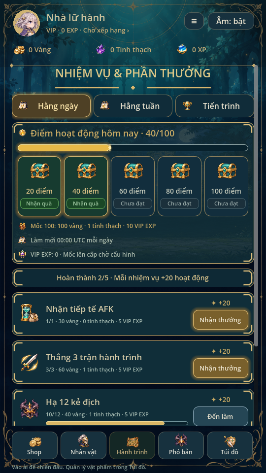
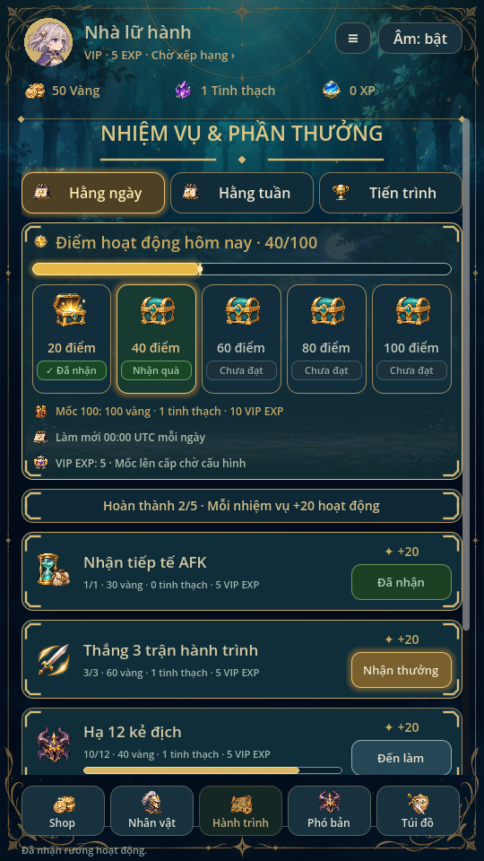
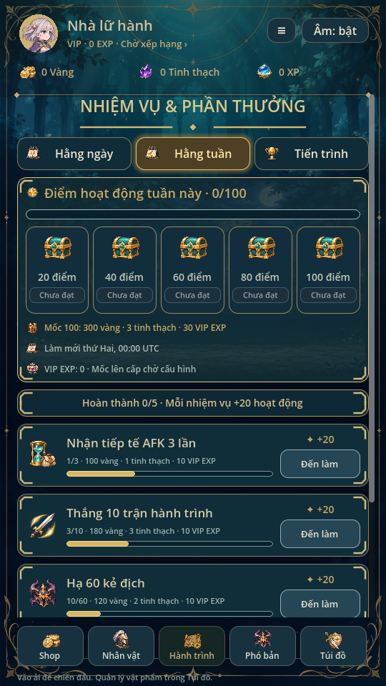

> Trạng thái chuẩn: [GAME_STATE](GAME_STATE.md), [mục lục](INDEX.md). Các phần ghi phiên bản cũ là lịch sử; ưu tiên yêu cầu mới và quy tắc hiện hành.

# Nhiệm vụ & Phần thưởng · Giao diện0.26

Áp dụng phong cách minh họa người dùng vào UI đang chạy: xanh đen/teal, viền
vàng và nét góc trang trí, tiêu đề với đường phân cách, tab đang chọn sáng vàng.
Bảng hoạt động có nền rừng mờ, thanh vàng với điểm sáng ở đầu tiến độ, năm rương
mốc có icon lớn và nhãn trạng thái. Dùng icon trong registry0.22, không đưa ảnh
minh họa nguyên màn vào game hay vẽ chữ/phần thưởng cố định trên ảnh.

Rương đủ điểm chưa nhận: nền xanh lá/viền vàng sáng và Nhận quà. Rương đã nhận:
icon mở và dấu Đã nhận. Chưa đủ điểm: nhãn Chưa đạt. Các rương đều mở xem chi
tiết qua callback cũ, điều kiện nhận kiểm lại ở model.

Thẻ nhiệm vụ chuyển sang hàng ngang: icon bên trái, tên và số tiến độ/phần
thưởng ở giữa, +20 hoạt động và nút bên phải. Nút nhận đủ điều kiện sáng vàng,
đã nhận xanh lá và vô hiệu; chưa hoàn thành có thanh tiến độ và nút Đến làm.
Ngày/tuần/tiến trình dùng cùng thiết kế, có cuộn riêng khi nội dung dài.

Giữ nguyên nhiệm vụ, mốc20–100, giá trị thưởng, VIP EXP, claimed, reset UTC và
khóa pending/read-only. Không thêm nhiệm vụ nâng LV từ ảnh minh họa hoặc thay
nhiệm vụ cường hóa trang bị hiện có. Duyệt tab không cộng điểm/nhận quà. Save v8
không đổi schema, không thay trận3vN, số dư hay header điều hướng chung.

Kiểm thử mission_polish: fixture40 điểm thực (AFK +win), hai rương đủ điều kiện,
quái10/12; ba tab không đổi save, click nhận nhiệm vụ/rương, VIP EXP và dấu nhận.
missions_ui, missions, ui_flow và animation_gallery đạt. Đã xem ảnh render Godot
Linux; chưa thử điện thoại thật.

