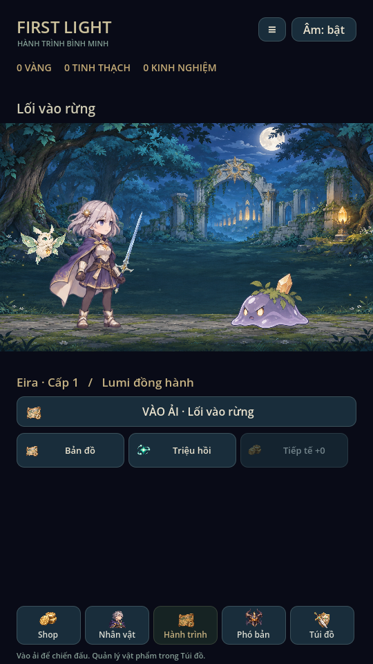
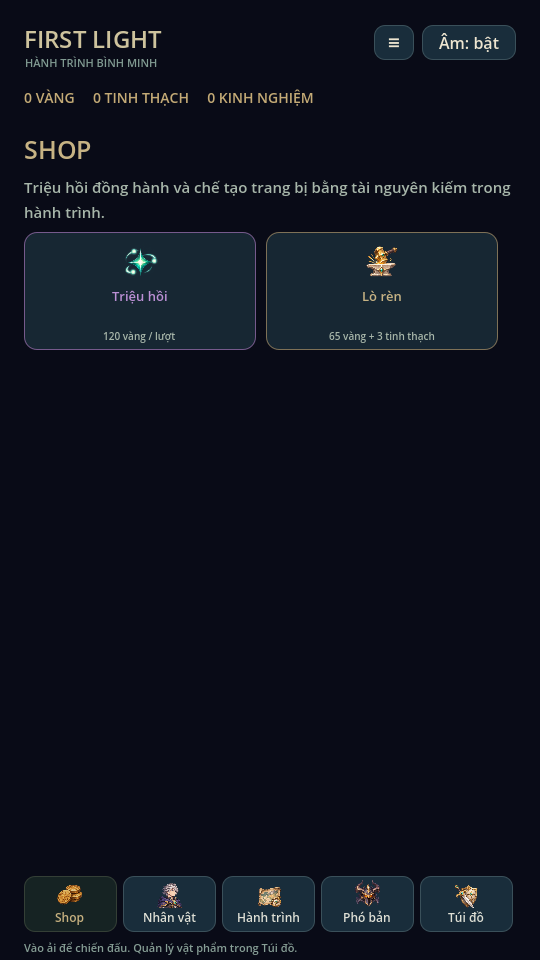
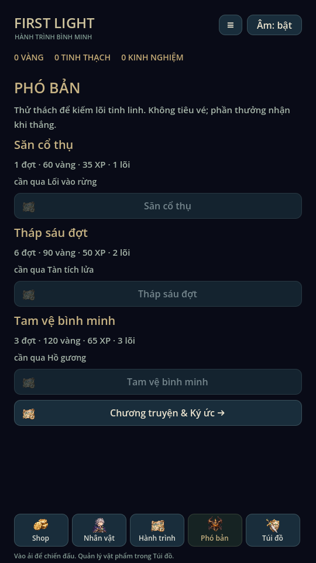
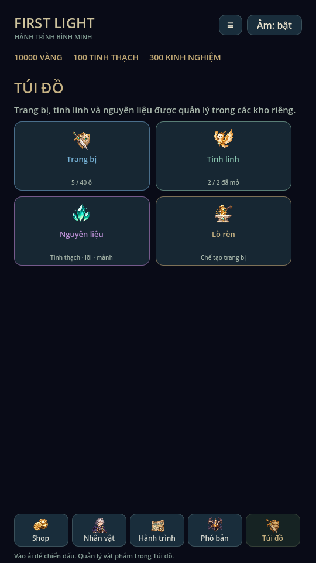
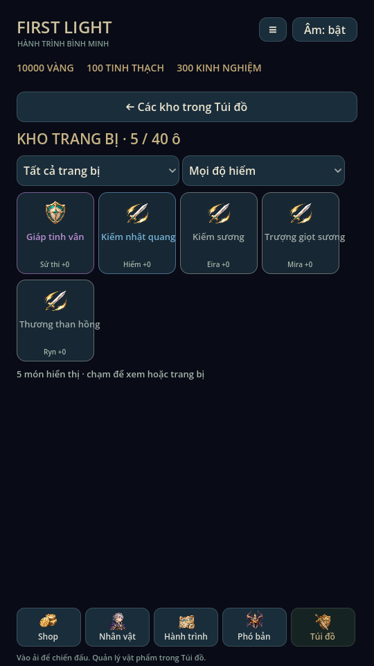
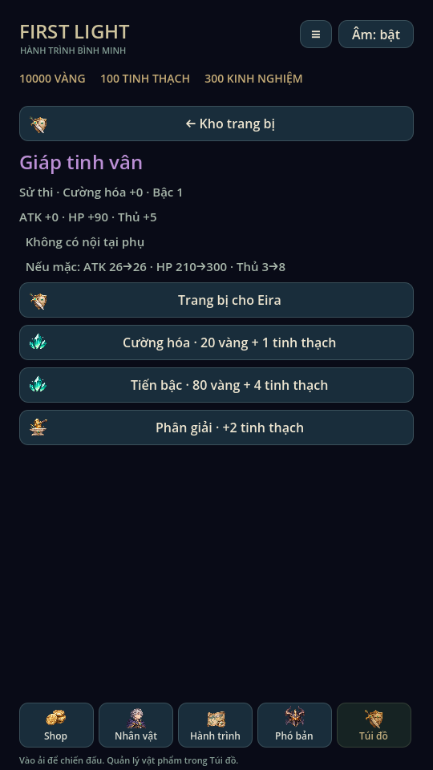
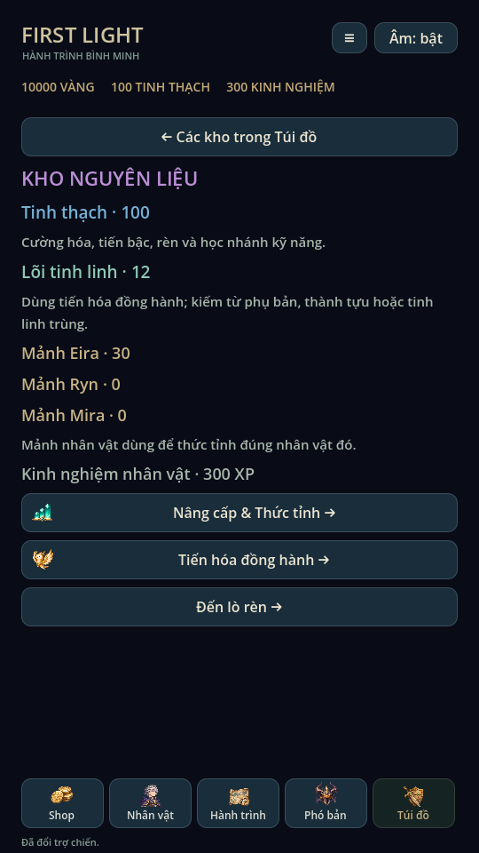
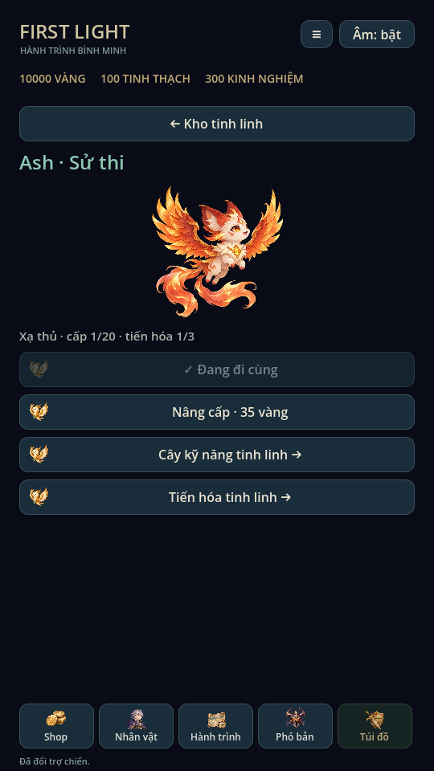

# Giao diện mobile & Túi đồ · 0.10

Theo bố cục người dùng cung cấp, thanh dưới có đúng năm mục từ trái qua phải:
**Shop, Nhân vật, Hành trình, Phó bản, Túi đồ**. Hành trình nằm giữa và mở mặc
định. Thanh giữ vị trí khi chuyển màn. Menu ≡ góc trên mở nhiệm vụ, nhật ký,
sổ tay boss, thành tựu và cài đặt âm thanh.

- Shop: truy cập triệu hồi và lò rèn hiện có, không thêm loại phí hoặc sản phẩm mới.
- Nhân vật: quản lý nhân vật, cấp/thức tỉnh, thuộc tính và hai cây kỹ năng.
- Hành trình: cảnh hiện tại, đội hình và vào ải; ba lối tắt Bản đồ/Triệu hồi/Tiếp
  tế. Các nút kỹ năng, HP/SP và điều khiển chỉ hiện khi có trận.
- Phó bản: ba thử thách, điều kiện mở, phần thưởng, kỷ lục và đường đến truyện nhánh.
- Túi đồ: trung tâm các kho riêng, không trộn danh sách trang bị và nguyên liệu.

## Các kho

Trang bị: lưới bốn cột, màu độ hiếm, tên, cường hóa và chủ sở hữu. Hai bộ lọc
loại (tất cả/vũ khí/giáp) và độ hiếm; sắp bậc hiếm trước, UID giữ thứ tự ổn định.
Chạm món đồ mở màn riêng: chỉ số, so sánh khi mặc, trang bị/tháo, cường hóa,
tiến bậc và phân giải có xác nhận. Phân giải thành công trở về kho. Có trạng thái
lọc rỗng. Icon theo loại, chưa có hình riêng từng mẫu trang bị.

Tinh linh: danh sách đã mở/chưa mở, chi tiết artwork, vai trò/cấp/tiến hóa. Có thể
chọn đi cùng rồi nâng cấp, sang cây kỹ năng hoặc tiến hóa. Tinh linh chưa mở có
hướng dẫn điều kiện chương/triệu hồi.

Nguyên liệu: tinh thạch, lõi tinh linh, mảnh của từng hero và XP. Hiển thị lượng
thực trong profile cùng mô tả công dụng; đường đến nâng cấp/thức tỉnh/tiến hóa/rèn.
Lò rèn là màn riêng, dùng công thức hiện có.

Các kho là cách tổ chức giao diện trên cùng dữ liệu cũ. Không di chuyển hoặc
nhân bản dữ liệu, không đổi tiền tệ, UID, slot trang bị, giới hạn túi 40 hay save
schema v4. Bộ lọc/lựa chọn kho chỉ là trạng thái UI trong phiên. Khi đang có trận,
mở màn quản lý tự pause, chỉ xem; thao tác thay đổi build vẫn bị ProgressStore khóa.

## Bố cục và kiểm chứng

Canvas dọc 540×960, thanh dưới 876–932; nội dung quản lý 132–864 trong vùng cuộn,
không đè thanh dưới. Nút hành động ít nhất 44px, card kho 118px. Ngoài trận, nội
dung nhanh từ y540; trong trận, hàng kỹ năng/điều khiển và nút rút lui được giữ.
Đây là tọa độ thiết kế, chưa xác nhận safe area hoặc cảm ứng trên điện thoại thật.

Godot 4.6.3 Linux X11/Mesa: `tests/mobile_inventory.gd` kiểm thứ tự/đích của năm
tab, kho/bộ lọc, trang bị, chọn Ash, nguyên liệu, rèn/phân giải, túi đầy 40 món
cuộn trong vùng, trạng thái rỗng, đổi bản đồ, pause/build lock và reload save.
Chạy lại ui_flow, training_ui, animation_gallery và xem ảnh render; regression
81 checks, mechanics 54 tổ hợp và campaign 5 màn đều đạt. Test dùng profile riêng.

