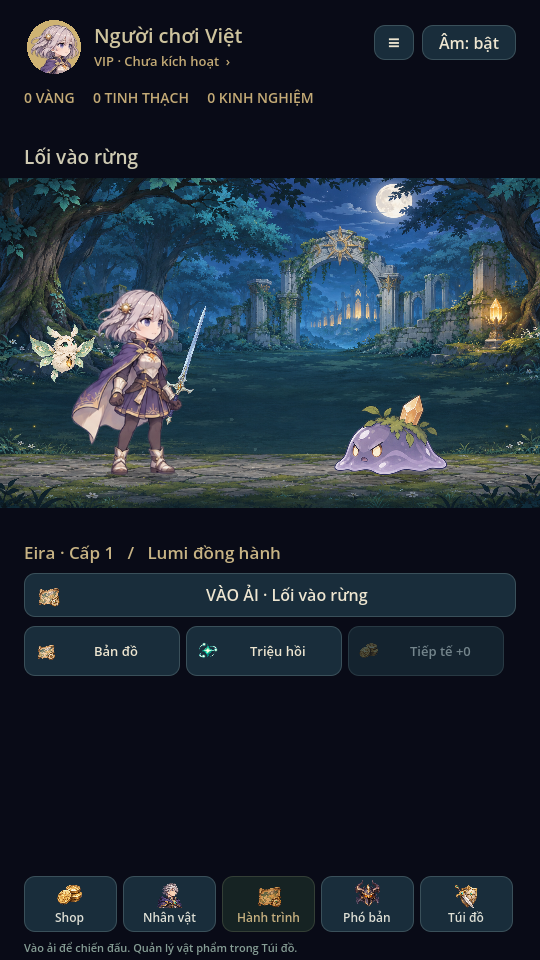
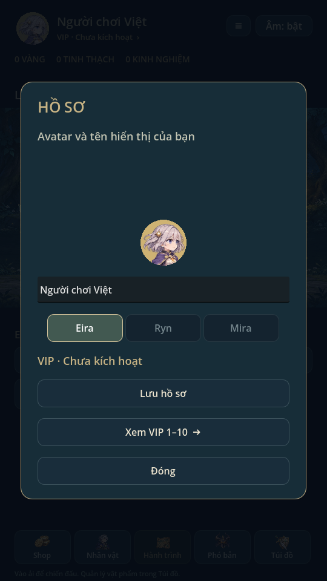
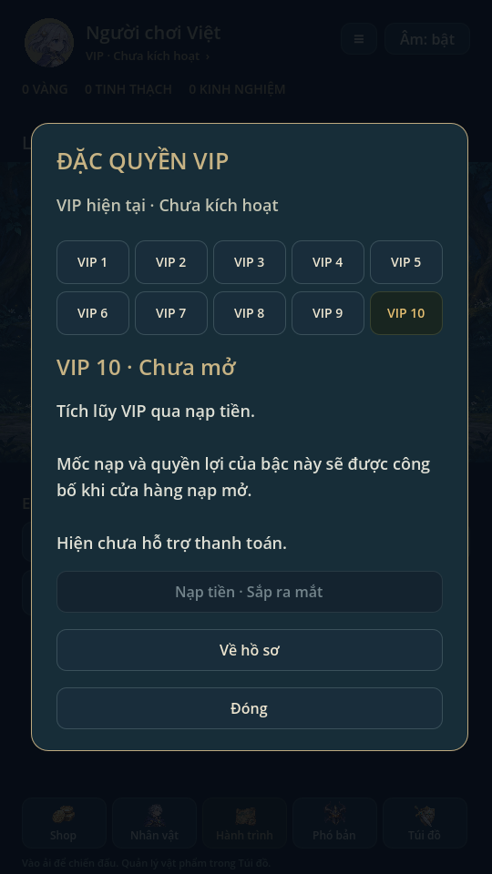

# Hồ sơ và VIP · 0.15

Theo phác thảo: avatar tròn ở góc trái, tên bên phải phía trên, trạng thái VIP
phía dưới. Chạm cụm hồ sơ để đổi tên (1–20 ký tự, hỗ trợ tiếng Việt) và chọn
avatar từ nhân vật đã sở hữu. Avatar hồ sơ độc lập với hero ra trận.

VIP theo nạp tiền, trước mắt chỉ triển khai giao diện theo yêu cầu. Bảng có đủ
VIP1–10, chọn từng bậc để xem trạng thái. Tài khoản hiện ghi “Chưa kích hoạt”.
Mốc nạp và quyền lợi chờ cấu hình; nút nạp bị vô hiệu và ghi “Sắp ra mắt”.
Chưa tích hợp thanh toán/xác minh hóa đơn, chưa có điểm VIP hoặc cấp VIP thật,
không cấp thưởng, buff, tăng VIP từ nhiệm vụ hoặc trừ ví khi xem bảng.

Hồ sơ lưu trong trường tùy chọn `identity` của save v5; save cũ không cần đổi
phiên bản, mặc định “Nhà lữ hành” và avatar Eira. Tên/avatar được kiểm tra trước
khi commit, lỗi ghi không đổi RAM. Không mở hồ sơ giữa trận; không đổi snapshot.
Save chỉ đọc vẫn xem được và khóa lưu hồ sơ.

Kiểm chứng trên Godot4.6.3 Linux: player_profile kiểm save cũ, tên tiếng Việt,
avatar sở hữu, reload, lỗi ghi/read-only, 10 bậc không đổi dữ liệu. Regression81,
mechanics54 tổ hợp, campaign5 màn, ui_flow và animation_gallery đạt. Đã xem ảnh
render thực; chưa kiểm thử trên điện thoại thật.
