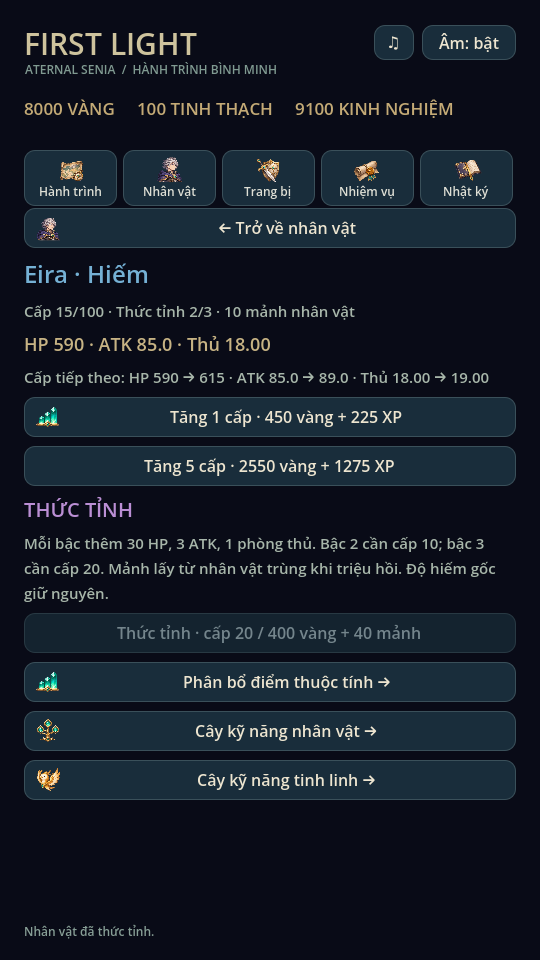
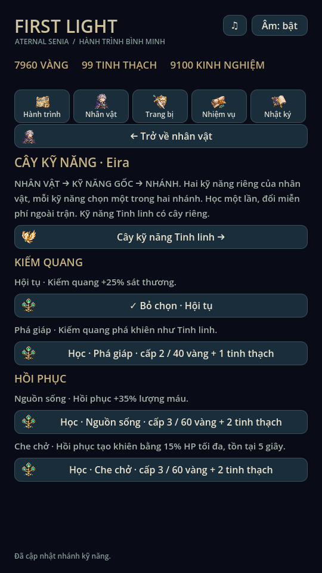
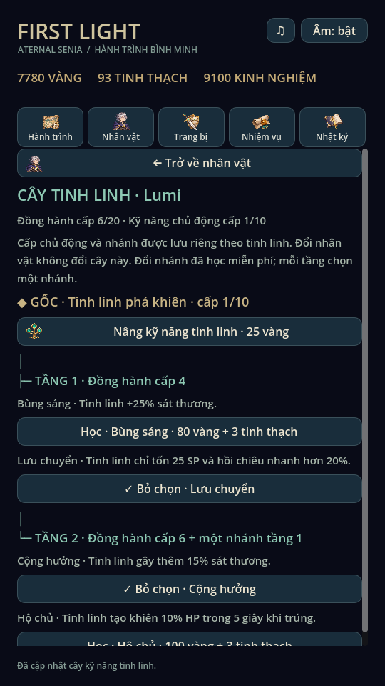
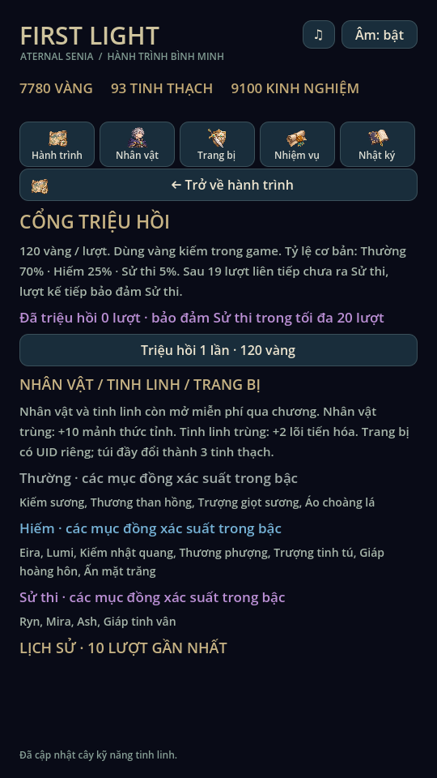
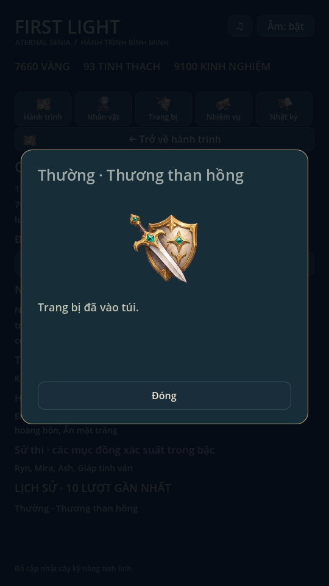
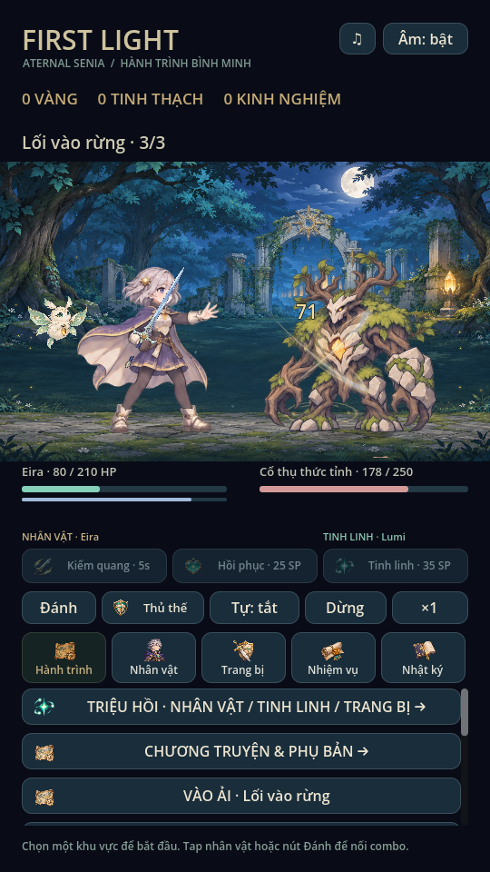
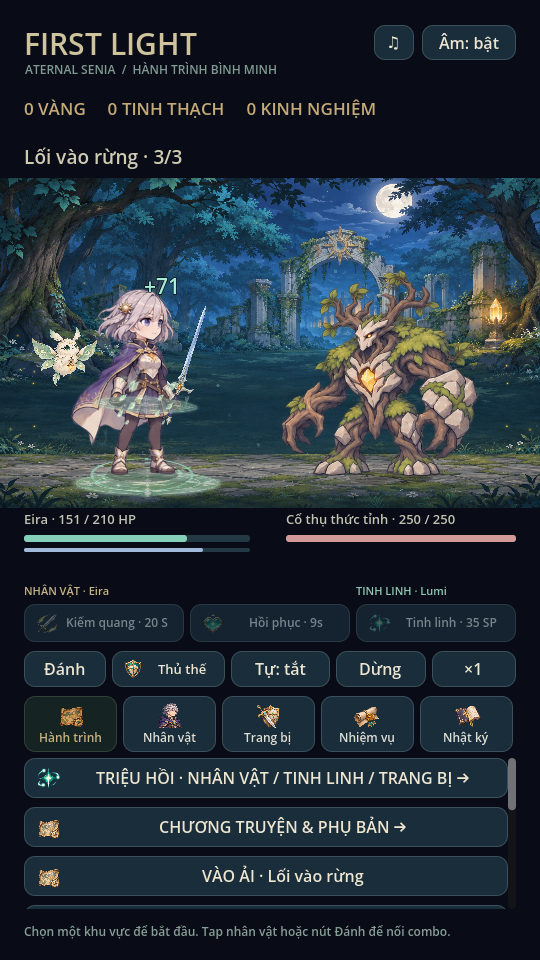
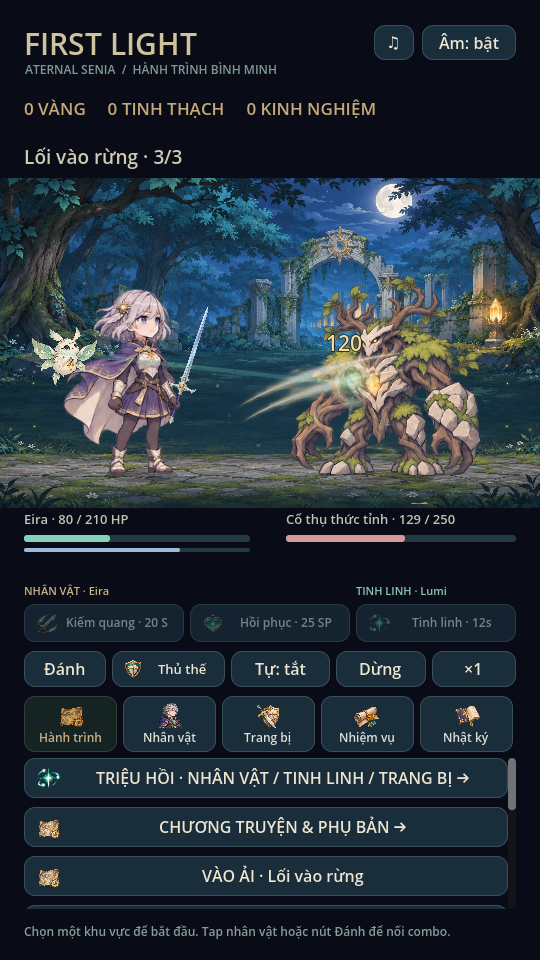

# Kỹ năng, nâng cấp, triệu hồi · 0.9

## Hai cây kỹ năng

Nhân vật → Cây kỹ năng: Kiếm quang và Hồi phục, mỗi gốc hai nhánh chọn một,
giữ cấp/nhánh theo Eira, Ryn hoặc Mira. Chi phí/hiệu ứng của bốn nhánh cũ giữ
nguyên. Cấp kỹ năng nhân vật tối đa 10.

Nhân vật → Cây kỹ năng Tinh linh: Lumi/Ash có cấp chủ động (1–10) và nhánh riêng,
không đổi khi chuyển hero. Nâng chủ động tốn 25 × cấp hiện tại vàng. Đây là trục
khác với cấp đồng hành (1–20) và tiến hóa đồng hành (1–3).

| Tầng | Điều kiện | Chọn một trong hai |
|---|---|---|
| Gốc | Có tinh linh | Kỹ năng chủ động phá khiên |
| 1 | Đồng hành cấp 4 | Bùng sáng: damage +25%; Lưu chuyển: 25 SP, cooldown ×0,8 |
| 2 | Đồng hành cấp 6 + đang chọn tầng 1 | Cộng hưởng: damage +15%; Hộ chủ: khiên 10% HP / 5 giây khi trúng |

Tầng 1 học bằng 80 vàng + 3 tinh thạch; tầng 2 bằng 100 vàng + 3 tinh thạch.
Đổi/bỏ nhánh đã học miễn phí, bỏ tầng 1 tự bỏ chọn tầng 2 nhưng không quên nhánh.
Khiên dùng quy tắc lấy giá trị lớn hơn, không cộng dồn vô hạn. Nhánh tầng 2 được
chốt trong snapshot và chỉ tác động tại marker thật.

Hai kỹ năng nhân vật nằm ở nhóm trái trong trận; Tinh linh ở nhóm phải, có tên
đồng hành. Hiệu ứng niệm Tinh linh ở vị trí đồng hành, hero không phát pose/lunge
thi triển Tinh linh đối với snapshot mới. Tất cả vẫn dùng chung SP 100 và lịch
action hiện có; sát thương Tinh linh vẫn dựa ATK snapshot của hero và cấp chủ động
Tinh linh, không tuyên bố có chỉ số ATK Tinh linh độc lập hoặc bộ chiêu riêng mới
cho từng đồng hành.

## Nâng cấp nhân vật

Nhân vật → Nâng cấp & Thức tỉnh: xem HP/ATK/phòng thủ hiện tại và sau một cấp;
nâng một cấp hoặc tối đa năm cấp cùng một commit. Giá từng cấp vẫn 30 × cấp
vàng và 15 × cấp XP. Không đủ toàn bộ chi phí thì không tăng/trừ một phần. Cấp
tối đa 100. Điểm thuộc tính tiếp tục tính từ cấp thực, không nhận điểm hai lần.

Thức tỉnh ba bậc (bắt đầu 1): lên bậc 2 cần hero cấp 10, 200 vàng, 20 mảnh;
lên bậc 3 cần cấp 20, 400 vàng, 40 mảnh. Mỗi bậc thêm 30 HP, 3 ATK, 1 phòng thủ.
Thức tỉnh tách biệt độ hiếm gốc. Mảnh có từ nhân vật trùng trong triệu hồi.

## Triệu hồi và độ hiếm

Hành trình → Triệu hồi, 120 vàng kiếm trong game mỗi lượt, hoàn toàn offline.
Tỷ lệ cơ bản theo bậc: Thường 70%, Hiếm 25%, Sử thi 5%. Sau 19 lượt liên tiếp
chưa có Sử thi, lượt tiếp theo bắt buộc Sử thi; mọi kết quả Sử thi đặt lại bộ đếm.
Trong mỗi bậc, các mục có xác suất bằng nhau. Danh sách đầy đủ nằm ngay trong UI.

| Bậc | Nhân vật | Tinh linh | Trang bị |
|---|---|---|---|
| Thường | — | — | Kiếm sương, Thương than hồng, Trượng giọt sương, Áo choàng lá |
| Hiếm | Eira | Lumi | Ba vũ khí bậc hiếm, Giáp hoàng hôn, Ấn mặt trăng |
| Sử thi | Ryn, Mira | Ash | Giáp tinh vân (+90 HP, +5 phòng thủ) |

Nhân vật/Tinh linh mới mở để chọn ngay; đường mở miễn phí qua chương giữ nguyên.
Nhân vật đã mở đổi bản sao thành 10 mảnh đúng hero. Tinh linh đã mở đổi thành 2
lõi tiến hóa. Trang bị luôn tạo UID mới; đầy 40 ô đổi thành 3 tinh thạch. Giáp tinh
vân chỉ từ triệu hồi, không nằm trong lò rèn hoặc loot màn. Có lịch sử 10 lượt,
kết quả kèm tên/bậc/phần thưởng và icon minh họa chung (không có tranh riêng mỗi món).

Độ hiếm là nhãn catalogue, không thay thế cấp, cường hóa hoặc bậc tiến hóa. Không
thêm tài khoản, SDK, server hay giao dịch tiền thật.

## Hiệu ứng kỹ năng

`SkillEffects` phối lại texture gốc hiện có: vòng niệm quay và bốn hạt tụ lực,
hai vệt Kiếm quang giao nhau/cột sáng, vòng và dải hồi phục đi lên, vụ nổ/mảnh
Tinh linh và đường sáng từ đồng hành đến mục tiêu. Hai lớp trước/sau nhân vật;
không flash toàn màn. Mỗi release chỉ xuất hiện theo hit/heal event thật, không
theo frame hình. Giữ giới hạn 96 effect, tự hết hạn; không node tăng vô hạn.
Thời gian lấy clock trận: pause đứng yên, ×1/×2/×3 đồng bộ, không dùng RNG chiến
đấu hoặc sửa HP. Không tạo âm thanh mới hoặc gọi dịch vụ sinh asset trả phí.

## Save và tính nhất quán

Save v4 ở đường dẫn cũ `first_light_v2.json`. Đọc v2/v3; lần ghi thành công đầu
giữ nguyên file cũ trong `.bak`. Pending snapshot cũ giữ nguyên, không tự gắn
nhánh/cấp/bonus mới giữa trận. Bản game cũ nhận save v4 sẽ khóa ghi như save tương
lai. V1 vẫn đi qua cơ chế migration có sẵn.

Khi tách kỹ năng cũ, cả hai Tinh linh kế thừa cấp chủ động cao nhất từng nâng
trong ba hero, các nhánh nova/flow đã học và lựa chọn của hero hiện tại. Không
xóa trường hero cũ. Dữ liệu Tinh linh chỉ được tạo/lưu khi người chơi nâng hoặc
chọn nhánh lần đầu; sau đó Lumi/Ash phát triển độc lập. Cách kế thừa này bảo toàn
tài nguyên đã bỏ ra, không trừ phí chuyển đổi.

Triệu hồi dùng RNG riêng từ seed/count lưu trong profile, không đụng RNG combat.
Trừ vàng, pity, count, mở khóa/vật phẩm/mảnh/lõi và lịch sử cùng một commit. Ghi
lỗi không đổi RAM hoặc ví; thử lại cùng seed/count cho cùng kết quả. Không có
settle kép từ modal vì modal chỉ đọc phần thưởng đã commit. Đây là game offline,
không có cơ chế chống chỉnh save hoặc dự đoán RNG.

Nâng cấp, thức tỉnh, triệu hồi và đổi cây đều khóa khi pending run còn tồn tại,
kể cả sau restart. Save hỏng/dữ liệu ngoài miền dùng cơ chế backup/khóa ghi cũ.

## Kiểm chứng

Godot 4.6.3 Linux: 451 checks trong `tests/recruitment.gd` (gồm 200 lượt cố định,
pity, đủ ba nhóm thưởng, bản sao, túi đầy, nâng cấp, thức tỉnh, hai cây, ghi lỗi,
reload, pending lock và v3→v4/backup). `tests/skill_effects.gd` kiểm ba kỹ năng ×
ba tốc độ, marker, target, pause, dedupe, expiry, renderer không sửa simulation.

Regression 81 checks, mechanics 54 tổ hợp, campaign 5 màn, expansion 60 checks,
expansion_campaign đủ 18 địa điểm từ profile mới, thuộc tính 62 checks, audio 93
checks và combat_presentation đều đạt. `progression_ui`, `skill_gallery`, `ui_flow`
và `animation_gallery` chạy trên X11/Mesa; đã xem ảnh. Các số dư lớn trong ảnh
là fixture test riêng, không phải save người chơi. Chưa test điện thoại thật,
cảm ứng, FPS/nhiệt hoặc nghe qua loa thật.

