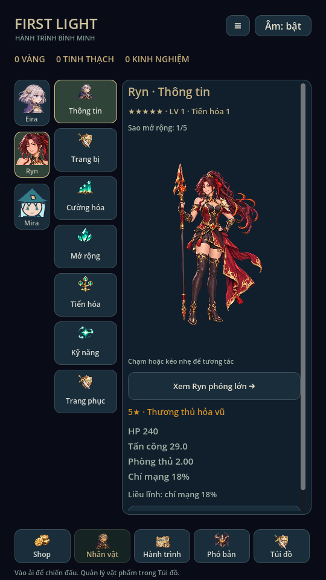
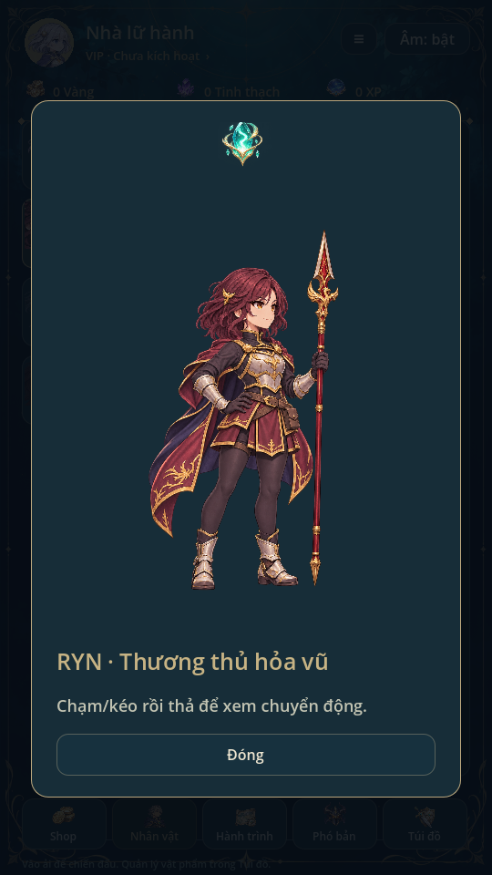
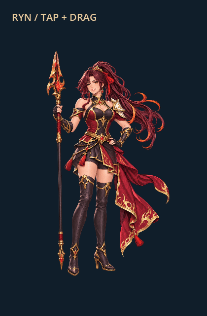
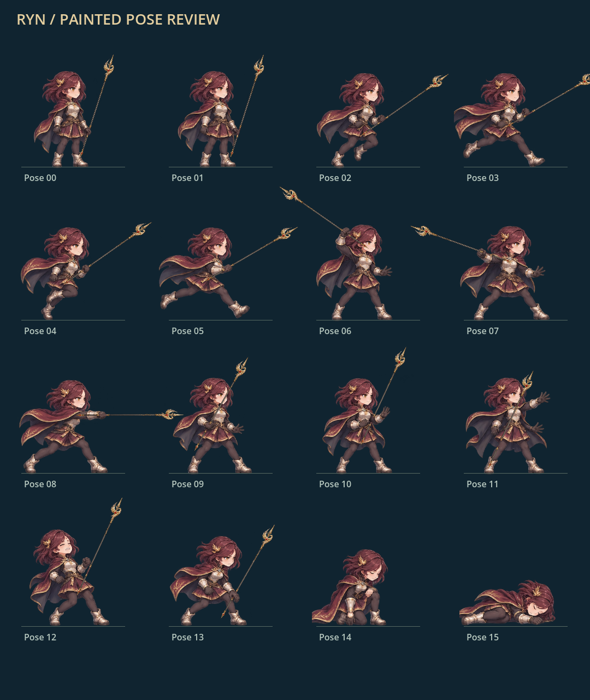
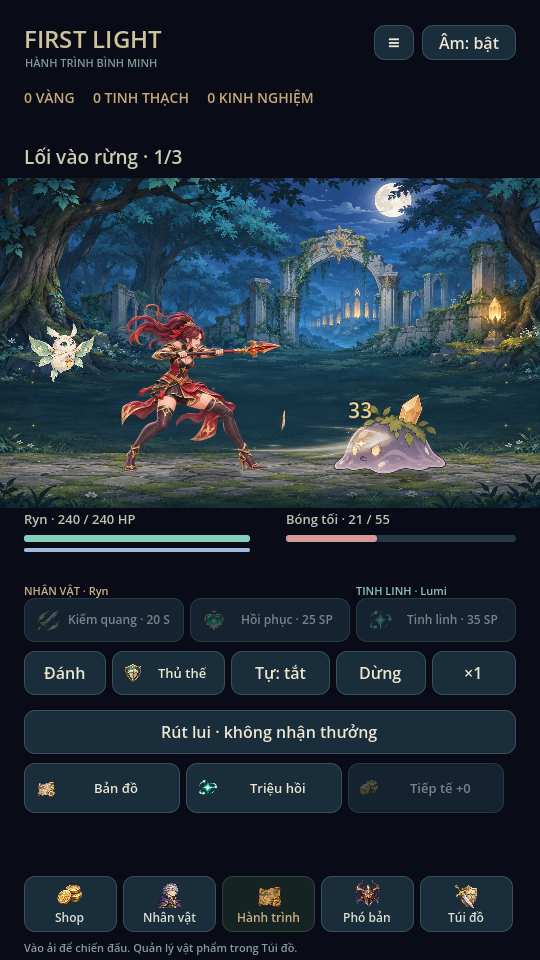

> Trạng thái chuẩn: [GAME_STATE](GAME_STATE.md), [mục lục](INDEX.md). Các phần ghi phiên bản cũ là lịch sử; ưu tiên yêu cầu mới và quy tắc hiện hành.

# Ryn · Thiết kế đồng bộ · 0.19

Ryn được vẽ lại theo phong cách Eira/Mira/Lyra: tỷ lệ sprite khoảng 3,4 đầu,
nét anime vẽ tay, giáp ngà, áo trong tối màu, áo choàng đỏ rượu viền vàng,
tóc đỏ rượu ngang vai có bím nhỏ và kẹp phượng. Không dùng đuôi ngựa để phân
biệt với Lyra. Giữ tên Ryn, tuổi 27, lớp thương, hệ lửa, chỉ số, ID và tiến trình.
Không thêm nhân vật thay thế hoặc đổi save.

## Bộ ảnh hiện tại

Toàn bộ ảnh mới nằm trong `art/ryn/`:

- `portrait.png`: chân dung đầy đủ, dùng avatar/fallback.
- `body.png`: thân, mặt, tóc mái, giáp, tay/chân và thương; vẽ phía trước.
- `hair.png`: tóc sau, cùng vị trí trên canvas1024×1536.
- `cloth.png`: áo choàng, cùng canvas, phía sau thân.
- `atlas.png`: 16 pose chiến đấu trên canvas1254×1254.
- `provenance.json`: phương pháp, SHA256 nguồn và danh sách file đã loại.

Ảnh được tạo/chỉnh bằng image generation, tham khảo style bộ tranh hiện có.
Không chỉnh pixel, chroma-key hoặc cắt alpha bằng script. Các lớp giữ nguyên
kích thước nguồn. RGB ngoài alpha có thể có màu nền từ mô hình; runtime chỉ vẽ
phần alpha và đã kiểm render trên nền game.

## Chân dung và chuyển động

Giữ chạm/kéo, thở, hồi vị trí và hai lớp tóc/áo choàng uốn riêng bằng mesh/shader
hiện có. Điều chỉnh điểm gắn cho tóc ngang vai và áo choàng mới; không thêm rig
hoặc runtime. Thân/thương giữ chung transform, tóc/vải có độ trễ riêng. Khi mất
focus hoặc ẩn, pointer được hủy như trước. Preview trang phục tint cả bộ ảnh.

Tóc/vải được tạo riêng từ chân dung nên có sai khác nhỏ ở mép/lớp; không gọi
đây là rig hoặc bộ minh họa hoàn toàn nhất quán từng pixel giữa mọi pose.

## Chiến đấu

16 pose nguồn trong bảy trạng thái: idle2, run4, windup/thrust/recovery,
channel/release, guard (dùng lại windup), hurt2, kneel/defeat. Clip quay lại idle
và giữ marker attack0,22 / skill0,5; model vẫn sở hữu damage. Tổng đội hình hiện
80 pose nguồn (Eira32, Ryn16, Mira16, Lyra16).

Khác bộ cũ, Ryn mới **không có thương vẽ liền trong sprite chiến đấu**. Hai mẫu
thương PNG hiện có gắn theo socket từng pose, nên đổi vũ khí đổi hình đúng mẫu.
Mỗi frame ghi region, anchor, source_size/source_anchor/trim_offset và grip_rect.
Một số region thu ngang để không lấy mảnh áo/giày của pose bên cạnh. Có lớp bàn
tay vẽ đè cán; pose thua không vẽ thương rời.

## Dọn ảnh cũ

Sau khi xem render mới, đã xóa khỏi cây file hiện tại:

- Sáu PNG Ryn cũ và metadata riêng trong `art/painted/` (7 file).
- Toàn bộ28 SVG Ryn mẫu ở thư mục `art/`; xóa fallback Ryn khỏi `art/clips.json`.
- Metadata import/cache cũ liên quan ở workspace; builder SVG bỏ qua Ryn nên
  không tạo lại bộ cũ. Các ảnh/GIF xem trước mang tên Ryn được thay bằng bản mới.

Không giữ thư mục backup raw cũ trong repo. Lịch sử Git không được viết lại;
file ở commit cũ vẫn thuộc lịch sử, không phải asset đang phát hành. Thương dùng
chung với Lyra, âm thanh và các nhân vật khác được giữ nguyên.

## Công cụ và kiểm chứng

`python tools/build_complete_art.py` tái tạo metadata đầy đủ; builder nền chứa
Ryn mới nên chạy combat builder không hồi lại bộ cũ. Không chạy tool tạo SVG để
thay PNG. Nguồn ảnh mới và hash được giữ để đối chiếu.

Godot4.6.3 Linux/X11/Mesa: regression87, mechanics72 tổ hợp, campaign5 màn,
recruitment451, summon_batch x1/x10 atomic, audio93, wardrobe, Lyra migration,
portrait_touch, combat_presentation, complete_art80 pose và Ryn art16 pose đạt.
Ryn art còn kiểm source bounds, source/trim anchor, hai layer tương tác, chuyển
động có giới hạn và sự vắng mặt của raw cũ. Không đổi audio/gain.

Đã render và xem ryn_gallery, complete_art_gallery, character_ui, ui_flow,
animation_gallery và summon_ui mới nhất. ryn_motion_capture ghi90 frame chạm/
kéo thực, GIF15fps ở trên. Test dùng profile riêng, không chạm save người chơi.
Chưa thử điện thoại/touch/hiệu năng thật hoặc nghe loa.
