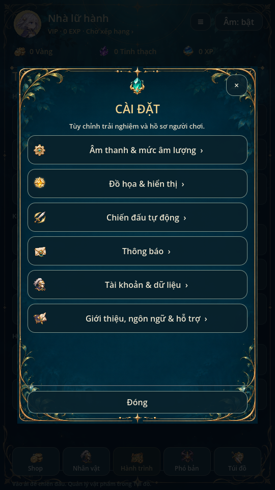
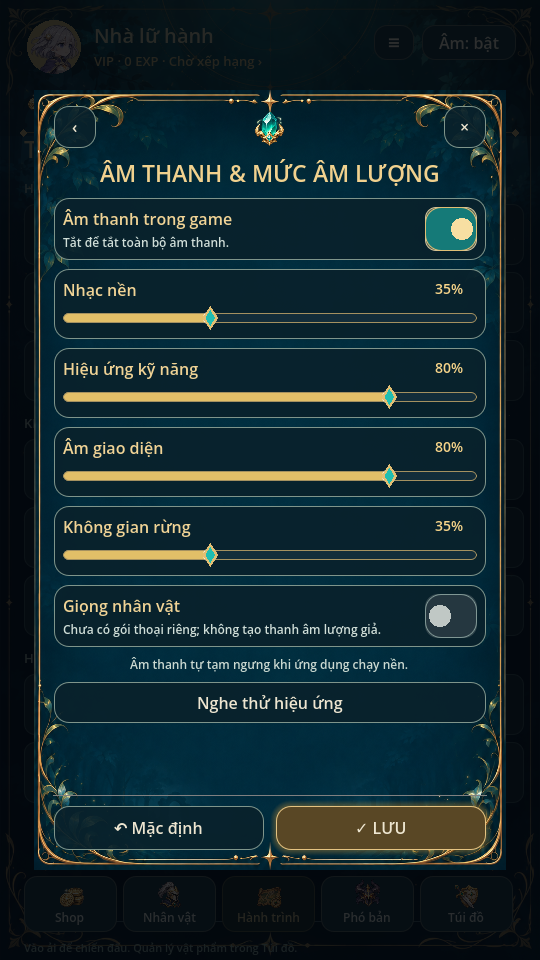
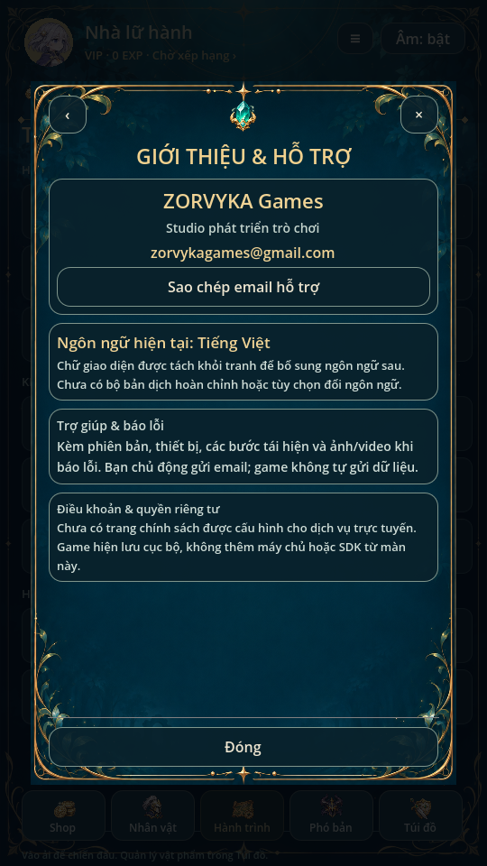

# Cài đặt · 0.36

Studio: **ZORVYKA Games**. Email hỗ trợ: **zorvykagames@gmail.com**.
Thông tin do chủ dự án cung cấp; đặt ở Cài đặt → Giới thiệu & Hỗ trợ và
Tiện ích → Trợ giúp. Nút sao chép email chỉ ghi clipboard, không gửi thư.

Cửa sổ phủ tối, nền rừng xanh đêm, khung vàng và sáu nhóm. Art nguồn
`art/settings/window.png` không chứa chữ, nút, thanh trượt hoặc dữ liệu.
`tools/build_settings_art.py` chỉ ghi kích thước/hash/provenance, không sửa pixel.
Các nhãn dùng `tr()`, xuống dòng và SwipeScroll; chưa có bộ bản dịch khác hoàn chỉnh.

## Tùy chọn hoạt động

- Âm thanh: bật/tắt toàn bộ, nhạc nền, kỹ năng, UI và ambience. Nghe thử,
  mặc định và Lưu. UI/SFX dùng bus riêng nhưng chung pool12 voice có giới hạn;
  save cũ lấy UI volume bằng SFX volume. App chạy nền vẫn luôn tạm ngưng âm.
- Hiển thị: mức hiệu ứng2D thấp/vừa/cao, giới hạn30/60 FPS, hạt sáng, rung nhẹ,
  số sát thương và tiết kiệm pin. Tiết kiệm pin giới hạn30FPS và giảm trang trí.
  Không đổi tranh nguồn, hit marker, HP, RNG, khiên hoặc dấu hiệu Boss.
- Tự chiến: Ultimate, ưu tiên hồi máu cơ bản của Mira khi đồng đội dưới85% HP,
  tự qua ải, tốc độ mặc định1/2 và rút gọn hiệu ứng phụ. Dừng Boss quan trọng
  vẫn là quy tắc bắt buộc. Tùy chọn chiến đấu khóa khi pending; ưu tiên hồi máu
  nằm trong snapshot trận mới, snapshot cũ mặc địnhtrue.
- Thông báo: bật/tắt badge thưởng thật trong Tiện ích; không đổi quyền nhận quà.
- Hồ sơ: sửa tên/avatar sở hữu bằng PlayerIdentity hiện có. Sao lưu tệpJSON,
  kiểm tra và xác nhận trước khi khôi phục; file hỏng/phiên bản không hỗ trợ/
  lớn hơn2MiB/pending bị từ chối. Không export/restore lúc đang có trận.
  Lưu qua ProgressStore.commit, lỗi ghi giữ nguyên RAM/save; không có cloud.

Âm thanh và đồ họa có xem trước, đóng/quay lại hủy phần chưa lưu. Mặc định chỉ
đổi bản nháp cho tới khi Lưu. Cửa sổ chỉ tiếp tục trận mà chính nó đã tạm dừng.
Các preference là trường tùy chọn savev11, không cấp tài nguyên hay đổi schema.

## Phạm vi dịch vụ

Giọng nhân vật riêng, thông báo hệ điều hành, sự kiện push và quét phó bản3★
chưa có chức năng; hàng tương ứng vô hiệu hóa và giải thích. Không tạo ID
máy chủ, đăng nhập/liên kết tài khoản, giftcode, chính sách trực tuyến hoặc
SDK giả. Liên hệ studio bằng email do người chơi chủ động gửi.

## Kiểm tra

Godot4.6.3: settings/settings_audio/settings_ui; regression/mechanics/campaign;
team_battle/team_matrix/team_campaign/team_flow/team_ui; audio/additional_audio/
music, validate_audio.py, audio_capture; player_profile/utilities_ui/swipe_scroll;
ui_flow và animation_gallery có render và xem ảnh. Music và các bài render
chạy trên X11; headless không có frame_post_draw. Chưa kiểm thiết bị thật hoặc
nghe loa thật. PCM mixer không đồng nghĩa đã nghe âm thanh.

