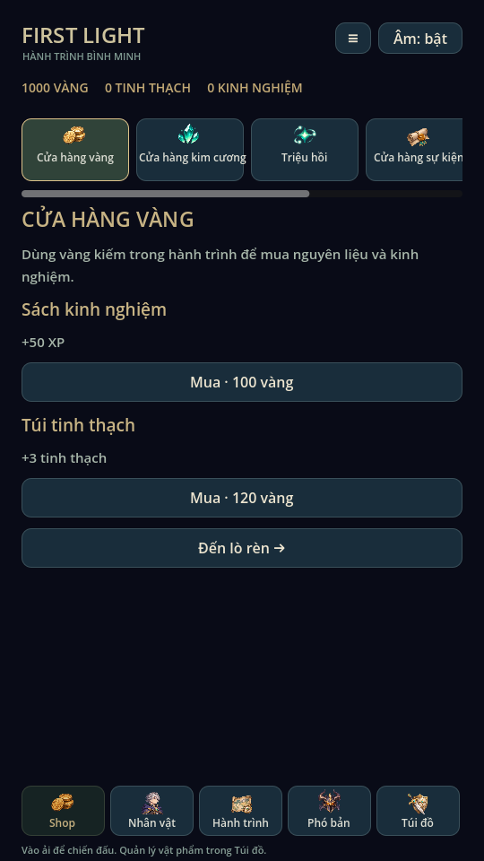
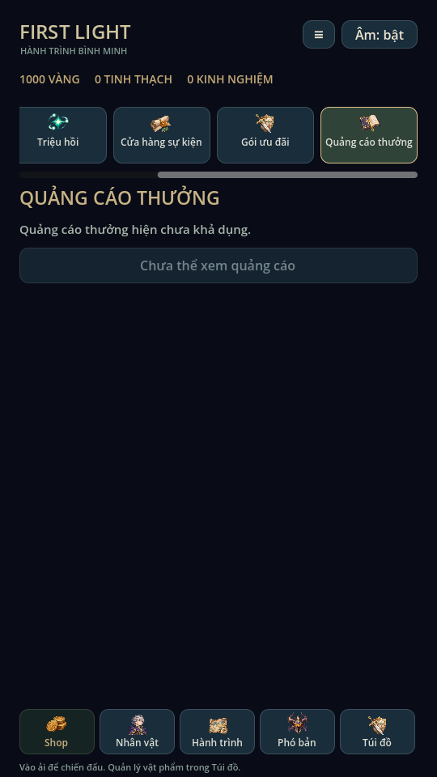
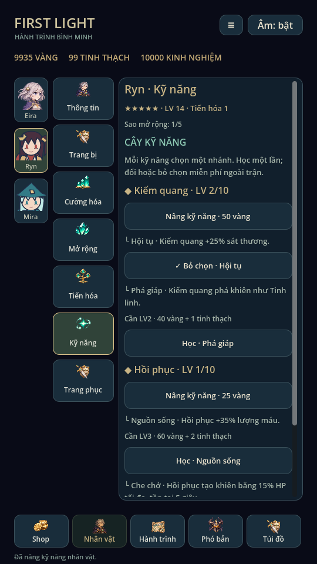
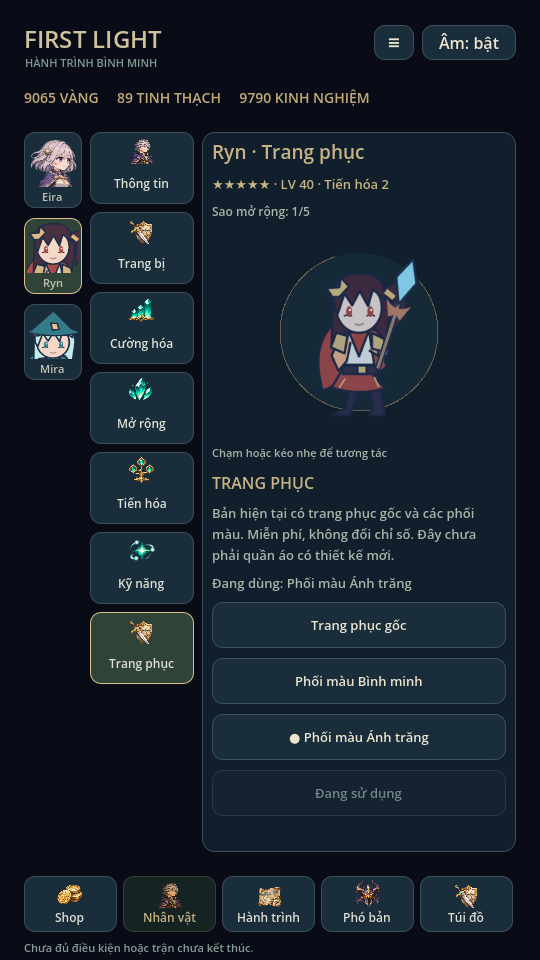
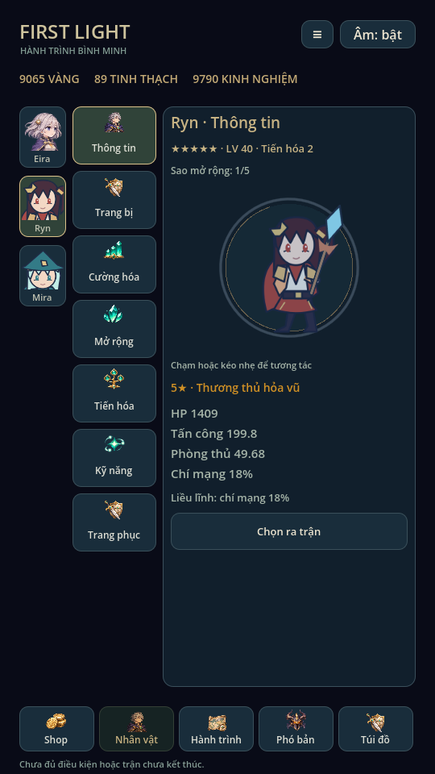

> Trạng thái chuẩn: [GAME_STATE](GAME_STATE.md), [mục lục](INDEX.md). Các phần ghi phiên bản cũ là lịch sử; ưu tiên yêu cầu mới và quy tắc hiện hành.

# Shop, độ hiếm & nhân vật · 0.12

## Nhân vật bảy mục

Giữ cột ảnh mặt, cột thao tác và khung phải. Thứ tự: **Thông tin, Trang bị,
Cường hóa, Mở rộng, Tiến hóa, Kỹ năng, Trang phục**. Cây Kỹ năng hiển thị và học/
chọn/nâng ngay trong khung phải theo hero đang xem; không tự đổi hero ra trận.
Cây Tinh linh tiếp tục lưu độc lập, có đường sang màn riêng.

Trang phục có gốc, phối tông Bình minh và Ánh trăng. Chọn để xem trước, nhấn áp
dụng mới commit. Đây là tint trên artwork gốc (cả sprite/vũ khí), không phải ba
bộ quần áo có hình học mới. Không đổi HP/ATK/currency; giữ lựa chọn riêng từng hero,
áp dụng trong chân dung và trận qua snapshot. Đổi trang phục bị khóa khi còn run.

## Độ hiếm gốc và tương tác

**Không nâng hero 1★ lên 5★ để mở khóa tương tác.** Theo thiết kế người dùng,
hero 5★ được tạo với tương tác ngay từ đầu; hero/NPC 1–4★ chủ yếu dành cho đối thủ
phó bản. Catalogue hiện có Eira/Ryn/Mira là mẫu chơi 5★; `opponents` ghi Slime1,
Sói2, Cổ thụ3, Hộ vệ4, Chim sấm4. Đây là phân loại mới trên nội dung sẵn có,
không tuyên bố đã bổ sung các NPC dạng người hoặc minh họa trưởng thành mới.

Chân dung hero 5★ đã sở hữu có tap/drag, nhún hồi vị trí và thở nhẹ. Hero mẫu
1–4★ dùng chân dung tĩnh. `HeroPortrait` xử lý chuột/touch, giữ một pointer,
giới hạn lệch 14px, tự dừng khi mất focus/ẩn. Không sửa model, âm thanh, ví hoặc
RNG. Kiếm dùng cùng transform vị trí/scale với actor để không tách khỏi tay.

Clip người dùng là tham khảo chuyển động, không nhập artwork từ clip. Bản thử
này chỉ biến đổi toàn sprite hiện có; chưa có layer tóc/vải, mesh deformation,
rig hoặc chuyển động cơ thể chi tiết. Để đạt phong cách minh họa trong clip cần
bộ tranh nhân vật trưởng thành, thiết kế/tách lớp riêng. Ryn/Mira vẫn là SVG.

`awakening` cũ giữ làm **sao Mở rộng**, tách khỏi độ hiếm gốc. Hiển thị riêng:
5★ gốc / sao Mở rộng1–5 / LV / Tiến hóa1–3. Không đổi sao mở rộng cũ khi đổi
độ hiếm catalogue. Mở rộng n→n+1 cần LV10n, 200n vàng và 20n mảnh đúng hero;
tối đa5. Bonus mỗi sao giữ +30HP/+3ATK/+1thủ, không mở khóa tương tác.

## Ba hệ phân loại

| Trang bị | Tên | Màu |
|---|---|---|
| 1 | Thường | Xám |
| 2 | Không phổ biến | Xanh lá |
| 3 | Hiếm | Xanh dương |
| 4 | Sử thi | Tím |
| 5 | Huyền thoại | Cam |
| 6 | Thần thoại | Đỏ |
| 7 | Thần thánh | Vàng nhạt |

Trang bị Hiếm cũ (rarity2) thành bậc3; Giáp tinh vân cũ thành bậc4, giữ nguyên
chỉ số/UID. Thêm Áo choàng sương sớm bậc2 và ba giáp bậc5/6/7, tạo đủ14 mẫu.
Bậc4–7 chỉ triệu hồi. Bộ lọc kho đủ1–7; không thay cường hóa/bậc item.

Nhân vật dùng sao gốc1–5 từ catalogue, hero chơi hiện tại đều5★. Tinh linh dùng
SR/SSR/UR, độc lập với cấp/tiến hóa: Lumi SR, Ash SSR; UR hỗ trợ trong dữ liệu,
validator và bộ lọc nhưng chưa có mẫu UR mới. Không đổi rarity khi tiến hóa.

## Shop sáu mục

Sáu tab cuộn ngang cố định phía trên nội dung, thanh năm mục chính vẫn ở đáy:

| Mục | Trạng thái hiện tại |
|---|---|
| Cửa hàng vàng | Sách +50XP/100 vàng; túi +3 tinh thạch/120 vàng; có xác nhận mua |
| Cửa hàng kim cương | Khung giao diện, chưa mở hàng/currency kim cương |
| Triệu hồi | Hệ thống hiện có, danh sách/tỷ lệ/kết quả trong Shop |
| Cửa hàng sự kiện | Trạng thái chưa có sự kiện |
| Gói ưu đãi | Trạng thái chưa có gói mở bán |
| Quảng cáo thưởng | Chưa khả dụng, nút tắt, không phát thưởng giả |

Giá cửa hàng vàng là giá mẫu, dùng tài nguyên offline. `LocalShop.buy` trừ vàng
và cộng vật liệu trong một commit; lỗi ghi/pending không thay ví. Các mục chờ
không giả lập thanh toán/quảng cáo, không thêm SDK/phí runtime. Kim cương tách
khỏi tinh thạch hiện có, chưa tạo ví kim cương hoặc nguồn nạp tự ý.

## Nhóm triệu hồi và save

Giữ120 vàng/lượt và ba nhóm xác suất cơ bản70% / nâng cao25% / cao cấp5%, bảo
đảm nhóm cao cấp sau19 lượt không ra. **Nhóm triệu hồi không phải độ hiếm chung.**
Nhóm1 chứa trang bị1–2; nhóm2 gồm gear3, Eira5★, LumiSR; nhóm3 gồm gear4–7,
Ryn/Mira5★, AshSSR. Trọng số từng mục được liệt kê ngay trong UI. Gear4/5/6/7
có trọng số12/6/3/1 trong nhóm cao cấp, nên bậc7 ít hơn bậc4. Không gọi bảo đảm
này là bảo đảm UR hoặc nhân vật mới; bản sao vẫn đổi mảnh/lõi như trước.

Save v5 tại đường dẫn cũ; đọc v2/v3/v4, giữ nguyên số dư, vật phẩm, Mở rộng và
pending snapshot. Lịch sử cũ đổi nhãn rarity sang hệ mới khi khớp metadata cũ;
ghi group cũ vào `grade`. Dữ liệu sai không được âm thầm sửa thành phần thưởng.
Lần ghi đầu backup nguyên byte file cũ. Game cũ thấy v5 sẽ khóa ghi. Trường
`outfits` tùy chọn; save thiếu dùng gốc, snapshot thiếu `look_tint` dùng trắng.

## Kiểm chứng

Godot4.6.3 Linux: rarity_system kiểm bảy bậc, sao mở rộng, ba nhãn Tinh linh,
migration v4/history/backup; wardrobe kiểm xem trước/commit, chỉ số không đổi,
hero đích/snapshot/lock; portrait_touch kiểm pointer, biên độ/hồi vị trí/focus.
shop_ui kiểm sáu mục, mua/xác nhận, ghi lỗi/reload, pending và dịch vụ chưa mở.
character_ui kiểm bảy mục, skill/outfit và native4★ tĩnh/native5★ tương tác dù
sao Mở rộng vẫn1. Đã render X11/Mesa và xem ảnh.

Regression81, mechanics54 tổ hợp, campaign5, expansion60, expansion_campaign18
địa điểm, thuộc tính62, recruitment451, hero_management33, audio93, skill_effects,
combat_presentation đều đạt. ui_flow, mobile_inventory và animation_gallery đạt.
Ảnh dùng fixture riêng. Chưa thử điện thoại/touch/safe-area thật hoặc hiệu năng.

