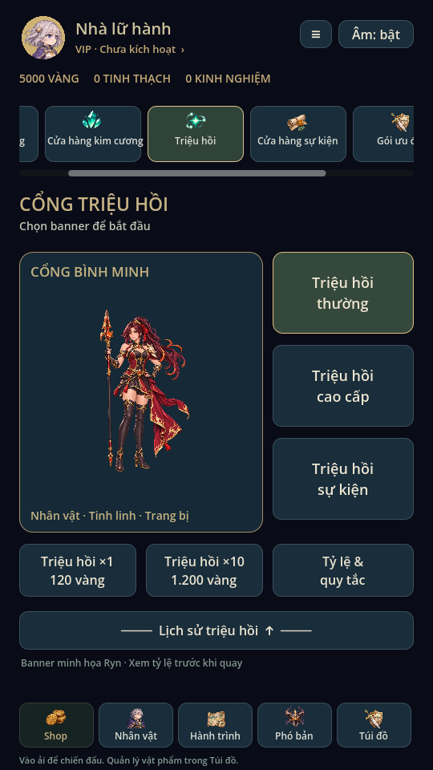
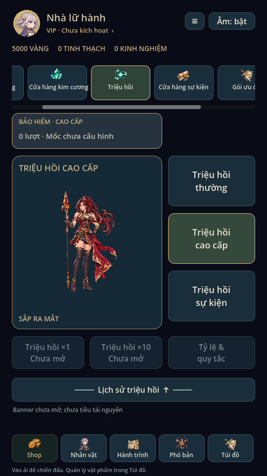
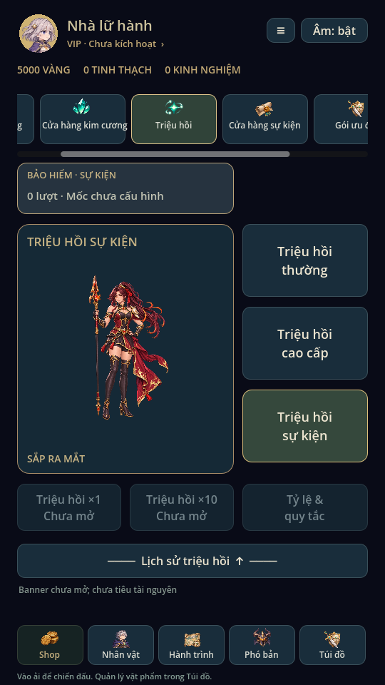
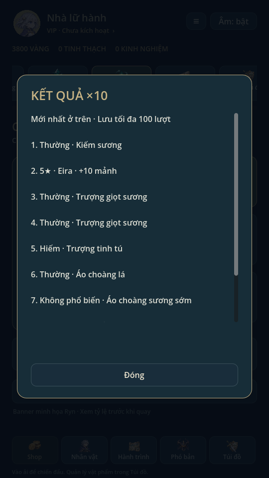

# Triệu hồi · 0.16

Theo phác thảo người dùng: banner bên trái, ba nút Thường/Cao cấp/Sự kiện xếp
dọc bên phải. Dưới banner là x1/x10, bên dưới có thanh mở lịch sử. Banner đang
dùng tranh Ryn có sẵn để minh họa, không biểu thị rate-up hoặc bảo đảm ra Ryn.
Có nút xem tỷ lệ, trọng số và quy tắc trước khi quay.

Theo sửa đổi cuối: **x10**, không phải x18. Thường120 vàng/lượt, x10 là1200 vàng,
không chiết khấu; có xác nhận chi phí trước khi thực hiện. Quay x10 chạy10 lượt
trên một candidate rồi commit một lần: phí, RNG count, phần thưởng, trùng hero/
tinh linh, đầy túi và pity cũ đều giống10 lần đơn. Không có giao dịch dở dang nếu
không đủ tiền hoặc ghi thất bại. Giữ khóa pending/read-only và không dùng RNG trận.

**Bộ đếm giao diện chỉ hiện ở Cao cấp và Sự kiện.** Hai giá trị dự phòng trong
`recruitment.banner_pity.premium` / `.event` độc lập, mặc định0 nếu save cũ không
có trường này. Theo người dùng, mốc bảo hiểm và phần thưởng tính sau: không tự
đặt ngưỡng, tỷ lệ, currency hoặc pool. Hai banner hiện chỉ xem giao diện; x1/x10
vô hiệu và ghi Chưa mở. Quay Thường không thay đổi các bộ đếm này. Pity20 của
cơ chế Thường cũ được bảo toàn nội bộ và công bố ở mục quy tắc; không dùng nó
làm bộ đếm cho Cao cấp/Sự kiện. Chưa có reset/chuyển tiếp giữa các mùa sự kiện.

Lịch sử mở modal cuộn, mới nhất ở trên, giữ tối đa100 lượt thay cho10 lượt cũ;
quay x10 có bảng kết quả đủ10 dòng. Save v5 cũ vẫn đọc được, UID/phần thưởng cũ
giữ nguyên. Bản game cũ trước0.16 không hỗ trợ lịch sử dài hơn10 lượt.

Kiểm thử: summon_batch so sánh x10 với10 lần đơn, lỗi ghi/reload, thiếu vàng,
giữ hai bộ đếm riêng; summon_ui kiểm bố cục, xác nhận, khóa banner chưa mở,
lịch sử và tỷ lệ. Recruitment451, regression81, mechanics54 tổ hợp, campaign5,
skill_effects, progression_ui, skill_gallery, shop_ui, ui_flow và animation_gallery
đạt. Đã xem ảnh Godot Linux; chưa test điện thoại thật.
