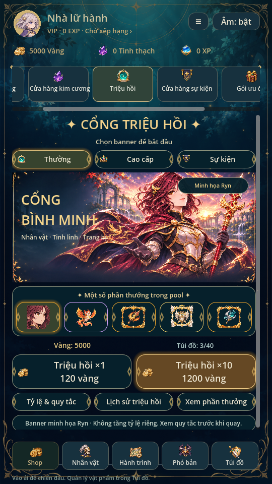
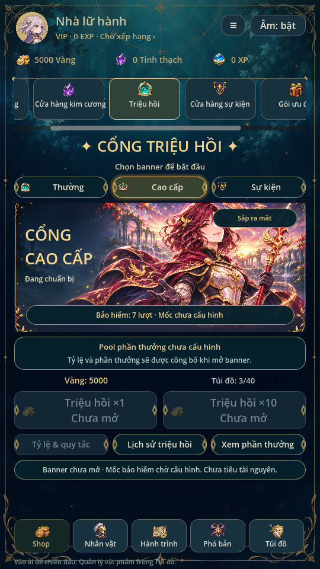
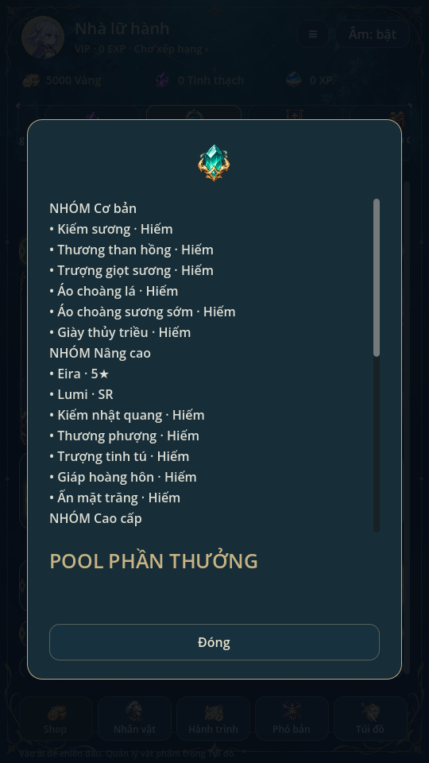
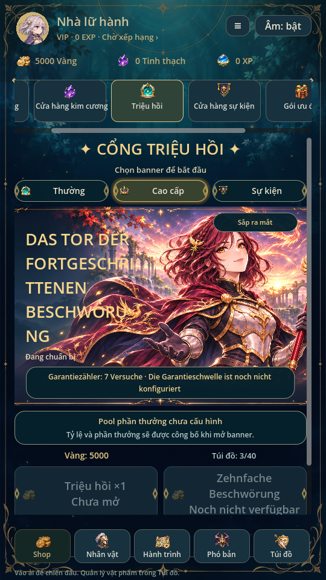

> Từ0.35 thêm Vé Triệu Hồi Thường dùng qua kho vật phẩm, có lối vào từ Cổng Thường. Giá quay bằng vàng/pool/pity cũ giữ nguyên; chưa mở Cao cấp/Sự kiện. Xem [SUPPLIES.md](SUPPLIES.md).

# Cổng triệu hồi fantasy · 0.33

Theo ảnh mới: ba loại Thường/Cao cấp/Sự kiện nằm ngang, tiêu đề vàng, banner
Ryn toàn cảnh bình minh, phần thưởng bấm xem, ví và hai nút x1/x10 lớn, hàng
Tỷ lệ & quy tắc / Lịch sử / Xem phần thưởng. Tab Shop ở trên vẫn vuốt ngang,
thanh điều hướng chính ở dưới. Nội dung dài cuộn bằng SwipeScroll.

## Tranh không chứa chữ

Nguồn mới `art/summon/gateway.png`,1774×887, được tạo riêng từ banner Ryn
hiện hành: tóc đỏ rượu ngang vai, bím nhỏ, giáp ngà và thương phượng. Viền
vàng/rừng bình minh cùng tranh, vùng trái và dưới chừa cho nội dung thật.
Không đưa chữ, giá, thời hạn, bộ đếm, nút, icon quà hoặc lời hứa nhận đồ vào
PNG. Tất cả nhãn/template mới dùng `tr()`, chữ xuống dòng; layout VBox/HBox
và vùng banner tự giãn khi dịch dài, không phải sửa lại ảnh.

`python tools/build_summon_art.py` kiểm PNG/kích thước và tạo provenance với
hash SHA256, không chỉnh pixel. Nguồn được copy nguyên byte từ image generation,
không nhập pixel ảnh mẫu người dùng hoặc repo tham khảo. Không đổi sprite
battle, avatar, lore hoặc kỹ năng Ryn.

## Giá, pool và trạng thái thật

- Thường giữ120 vàng/lượt, x10 là1200 vàng, lấy từ Recruitment.PRICE; không
  thêm chiết khấu hoặc chuyển sang tinh thạch. Giữ xác nhận và transaction
  x10, RNG riêng, bag capacity/rollback, savev10 và reveal SFX0.32 hiện có.
- Năm thẻ Ryn/Ash/Thương hỏa vũ/Giáp thần thánh/Trượng thủy triều được lấy từ
  **pool Thường thật** qua Recruitment.pool, không phải danh sách ưu đãi.
  Tên lấy catalogue, icon đúng loại/độ hiếm. Chạm mở mô tả chỉ xem, không
  phát quà hoặc thay ví. Xem phần thưởng liệt kê đủ các pool theo ba nhóm;
  Tỷ lệ & quy tắc vẫn mở dữ liệu trọng số/công thức hiện hành.
- Tranh Ryn và thẻ đầu không tăng tỷ lệ hoặc bảo đảm nhận Ryn. Có chú thích
  trực tiếp trong màn. Không dựng Rate Up, rồng tinh linh mới, vé quay,
  countdown6 ngày hoặc bảo hiểm Legendary50/Epic10 từ ảnh minh họa.
- Cao cấp/Sự kiện vẫn **chưa mở**, không đặt pool/giá/mốc thưởng thay người
  dùng. Chỉ hai chế độ này hiện bộ đếm; đọc riêng banner_pity.premium/event,
  ghi rõ mốc chưa cấu hình. Không vẽ thanh tiến độ có mẫu số giả. Thường không
  có bộ đếm trên banner; quy tắc pity20 cũ vẫn được công bố ở mục tỷ lệ.
- Lịch sử luôn mở được, tối đa100 lượt, mới nhất ở trên. Không tự chọn lại
  trạng thái/RNG hoặc phát âm reveal khi xem lịch sử/phần thưởng.

## Kiểm chứng

Godot4.6.3 Linux/X11/Mesa, profile test riêng. summon_ui kiểm ba chế độ, hàng
ngang và nút lớn, năm thẻ đúng pool, xem quà không ghi save, bộ đếm7/11 độc
lập trong fixture, banner khóa, xác nhận x10, giá/count/history/rates; thêm
bản dịch giả lập dài để kiểm xuống dòng/giãn vùng. Không cung cấp bộ bản
dịch hay nút đổi ngôn ngữ ở bản này.

summon_batch/recruitment451/bag_inventory kiểm transaction và save hiện có;
shop_ui/swipe_scroll/ui_flow/animation_gallery render kiểm luồng, cuộn và
battle. Đã xem ảnh giao diện; chưa thử điện thoại thật hoặc nghe audio.
