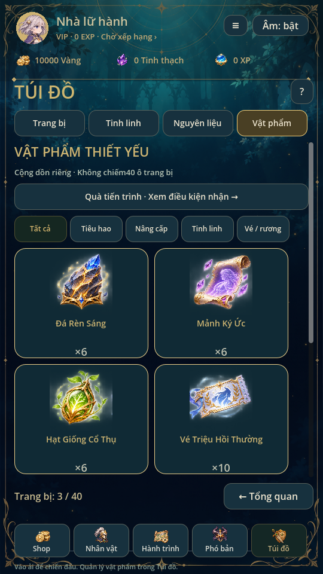
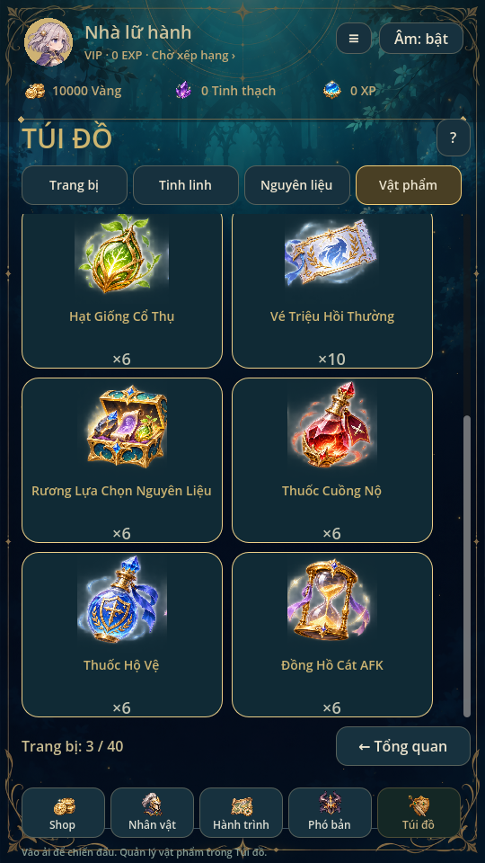
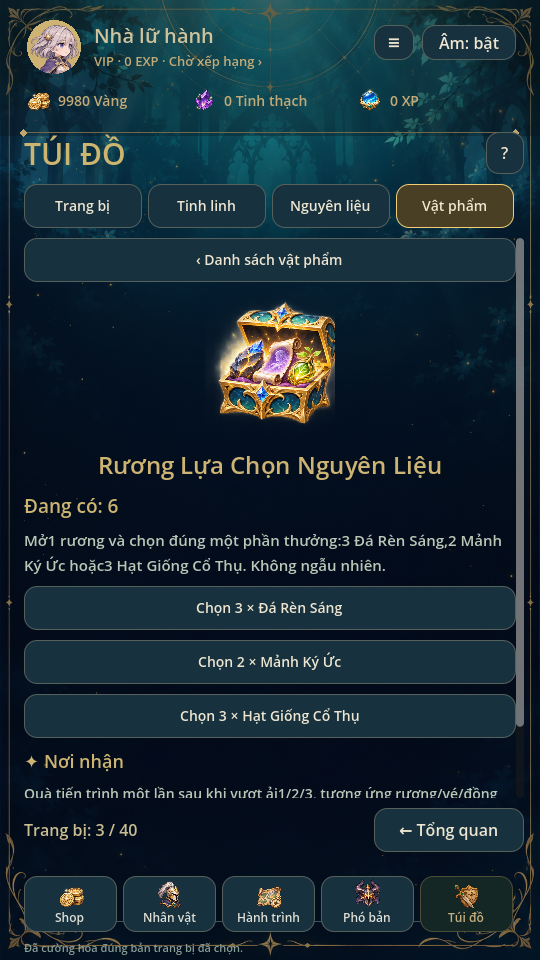
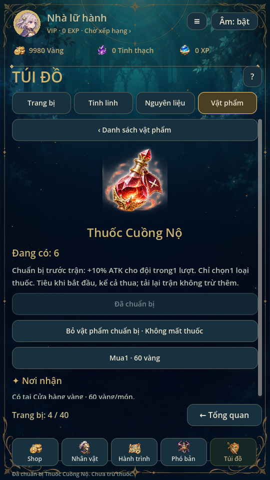

# Vật phẩm thiết yếu · 0.37

Theo yêu cầu mới nhất: **làm những món cần thiết trước**, không triển khai cả30
vật phẩm/5 trang bị cùng lúc. Bản này có8 món dùng được thật, không thêm vào pool
trang bị hoặc tạo thêm hero/tinh linh.22 món và5 trang bị còn lại ở lộ trình.

## Tám món và nguồn nhận

| Món | Công dụng/chi phí thực | Nơi nhận hiện tại |
| --- | --- | --- |
| Đá Rèn Sáng |1 đá thay1 tinh thạch khi tăng1 cấp cường hóa; vẫn trả vàng20×(cấp+1), trần+15 | Tam Vệ Bình Minh:2 đá/thắng; rương chọn |
| Mảnh Ký Ức |Tăng1 LV một trong2 kỹ năng nhân vật, tốn số mảnh bằng LV hiện tại; trần10, không tốn vàng | Tháp Sáu Đợt:2 mảnh/thắng; rương chọn |
| Hạt Giống Cổ Thụ |Tinh luyện3 hạt thành1 Lõi tinh linh dùng trong tiến hóa hiện có | Sân Cổ Thụ:1 hạt/thắng; rương chọn |
| Vé Triệu Hồi Thường |1 vé/1 lượt, hỗ trợ×1/×10; pool/pity/RNG/hist như quay vàng, không trừ vàng | Quà tiến trình vượt ải2,1 vé một lần |
| Rương Lựa Chọn Nguyên Liệu |Mở1 rương, chọn3 đá hoặc2 mảnh hoặc3 hạt; không ngẫu nhiên | Quà tiến trình vượt ải1,1 rương một lần |
| Thuốc Cuồng Nộ |Chuẩn bị trước trận: +10% ATK đội trong1 lượt | Cửa hàng vàng:60 vàng/món |
| Thuốc Hộ Vệ |Chuẩn bị trước trận: +10% phòng thủ đội trong1 lượt | Cửa hàng vàng:60 vàng/món |
| Đồng Hồ Cát AFK |Tiêu1, nhận ngay2 giờ vàng theo công thức AFK hiện có | Quà tiến trình vượt ải3,1 đồng hồ một lần |

Hầm Rèn Cổ Đại là nguồn đá dự kiến về sau; hiện chưa mở màn chơi, không giả
vờ phát thưởng từ đó. Mỗi phó bản đang chơi chỉ thêm1 nguyên liệu đặc trưng.
Giữ nguyên vàng/XP/tinh thạch/lõi/gear cũ. Thua không rơi nguyên liệu, settle
lặp không trả lại. Không thêm toàn bộ vật phẩm vào mọi bảng rơi.

Ba quà tiến trình có điều kiện cleared1/2/3 thật, nhận bằng nút xác nhận một lần.
Người đã vượt từ bản cũ vẫn đủ điều kiện; không tự phát khi migration. Lưu cờ
nhận riêng, không đụng claimed của nhiệm vụ cũ, không dùng thư/giftcode giả.
Không bán đồng hồ lấy vàng để tránh vòng mua/nhận vàng vô hạn.

## Dùng trong game

Túi đồ có tab **Vật phẩm**, lọc Tiêu hao/Nâng cấp/Tinh linh/Vé-rương. Chạm thẻ
để biết số đang có, công dụng, chi phí và nguồn nhận; có nút đến đúng phó bản.
Khung số40 là riêng trang bị. Nguyên liệu cũ vẫn ở tab Nguyên liệu.
Cửa hàng vàng thêm hai thuốc, Cổng triệu hồi có lối xem/dùng Vé Thường.

Cường hóa bằng đá chọn **đúng UID** trong trang vật phẩm hoặc chi tiết trang bị.
Kỹ năng cho chọn hero đã sở hữu; chỉ đổi hero đang xem, không đổi đội hình.
Hai lối trả bằng vàng/tinh thạch cũ không bị khóa hoặc tăng chi phí.
Rương chỉ trừ sau khi xác nhận lựa chọn; mở rương vẫn được khi40 ô gear đầy.

Chỉ chuẩn bị1 loại thuốc/lượt. Chọn hoặc hủy chuẩn bị chưa trừ thuốc. Khi bắt
đầu run, cùng commit tạo pending: trừ1, ghi chỉ số vào snapshot của từng hero,
xóa lựa chọn. Thua vẫn đã dùng; tự qua ải/đánh lại không tự dùng tiếp. Resume
run giữ snapshot, không trừ lần nữa hoặc cộng buff hai lần. Không có nút spam
thuốc giữa combat, không sửa RNG hoặc damage từ renderer. Giá trị buff mới
chuẩn hóa6 chữ số thập phân trước khi lưu để tránh lệch ULP khi đọc JSON;
không tái tính/chuẩn hóa các snapshot cũ.

AFK hiện chỉ trả vàng:120 phút × mốc Hành trình đã mở ×2 vàng/phút.
Dùng đồng hồ không sửa last_offline; phần AFK đang tích lũy vẫn giữ nguyên.
Âm thưởng/nâng cấp/reveal dùng bộ ElevenLabs hiện có và chỉ phát sau commit.

## Save và transaction

Save **v12 đọc v2–v11**, thêm supplies={counts:8 ID,selected,claimed}. Số lượng
là số nguyên0..1e12, không chiếm equipment.items/UID. Không gộp trang bị trùng;
giữ quy tắc nhiều bản, enhance/rank riêng,40 ô từ0.30. Giữ ví, mảnh, roster,
trang phục, nhiệm vụ, RNG/pity/history, bag_rewards và pending cũ. V10 thêm18 ID mảnh bằng0 theo migration0.35; v11 chỉ thêm
ledger rỗng; không đổi stats/trận đang lưu. Giữ backup raw theo cơ chế cũ.

Mọi thao tác clone candidate/validate/commit rồi mới đổi RAM. Lưu lỗi, thiếu
nguyên liệu, chọn sai ID, pending/read-only hoặc cap đều không trừ một phần.
Ticket×10 gồm phí vé, RNG/pity/history và phần thưởng trong một transaction;
thiếu ô cho bất kỳ gear nào thì rollback toàn bộ, không tự chuyển sang quay vàng.
NormalTicket chỉ mở pool Thường; Cao cấp/Sự kiện tiếp tục khóa/chưa cấu hình.

## Đồ họa và kiểm tra

Nguồn art/supplies/icons.png tạo mới theo4 ảnh tham khảo,8 hình, nền có alpha,
không chứa nhãn/số. Giữ nguyên byte; không cắt/chỉnh pixel nguồn bằng code.
Tất cả vùng đi qua registry art/icons/manifest.json; build_icon_manifest.py giữ
98 icon hiện có và thêm8 vùng mới (tổng106). Crops từng hàng đã xem, runtime dùng
AtlasTexture. validate_supply_art.py ghi kích thước/hash/provenance, không vẽ ảnh.

Supplies là model duy nhất quản lý ledger/nguồn/recipe; UI không tự tăng số.
tests/supplies kiểm migration/backup/UID, rollback/claims/rương/cap/ticket đầy túi,
snapshot thuốc/mở lại/loss/replay, skill/seed/AFK. supplies_ui kiểm confirm/hủy,
đúng hero/UID, bounds, source navigation, pending khóa và alpha thật.
Workflow supplies.yml chạy thêm các suite save/combat/inventory/gacha/audio/UI
cũ trước khi xuất ảnh (39 suite, gồm team_matrix/team_campaign/shop_ui hai suite ba bộ mới cùng các suite cài đặt/âm thanh/tiện ích). Chưa thử cảm ứng/FPS hoặc nghe qua loa điện thoại thật.
