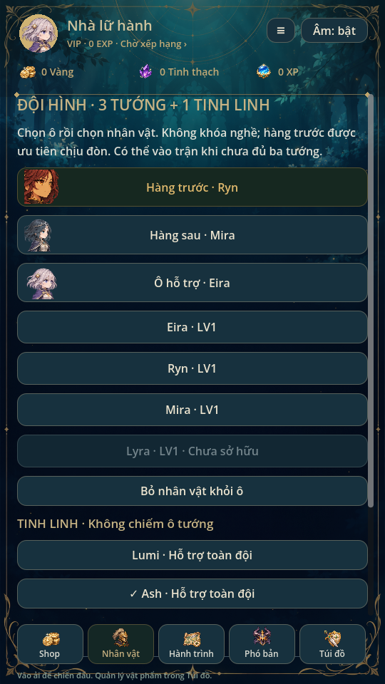
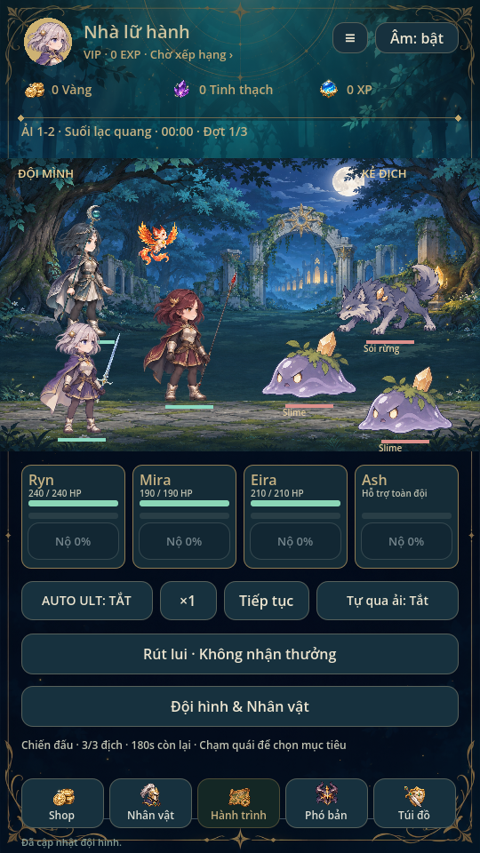
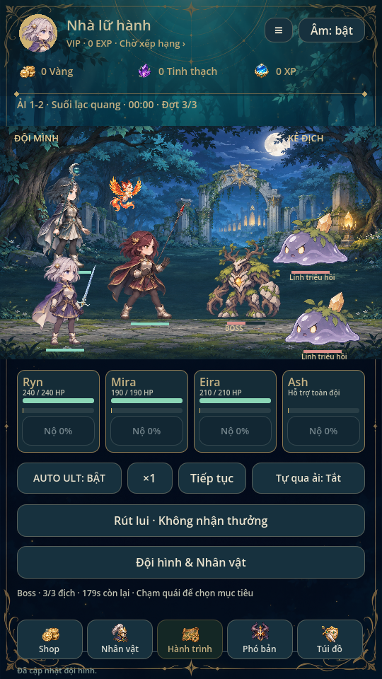

> **0.40.1:** Trận mới dùng TacticalArenaBattle/snapshotv4, preset hành vi riêng từng hero; chỉ số phát triển và cooldown kỹ năng giữ nguyên. Pendingv3 vẫn ArenaBattle gốc. Xem [ARENA_COMBAT](ARENA_COMBAT.md).

> **0.40.0 — quy tắc mới:** Trận mới dùng `ArenaBattle`, team snapshotv3. AI di chuyển tự do trong đấu trường2D; slot chỉ là vị trí xuất phát, địch chọn hero gần nhất. Kiểm tầm, đạn phép và vòng cảnh báo thuộc model. Pendingv1/v2 giữ TeamBattle/luật cũ. Savev13 không đổi. Đọc [ARENA_COMBAT](ARENA_COMBAT.md).

> **Cập nhật 2026-11-08 — runtime 4 hero + 1 tinh linh:** Bốn ô trình bày 2 trước + 2 sau, không khóa nghề. Địch ưu tiên slot còn sống theo thứ tự 0 → 1 → 2 → 3; không tự chia sát thương cho hai ô trước. HUD có bốn thẻ hero và thanh Ultimate tinh linh riêng. Hành trình hiển thị cả bốn hero.
>
> **Tương thích:** Giữ save v12 và đường dẫn cũ, nhận formation 3 hoặc 4 ô. `Formation.state()` mở rộng bản sao thành 4 ô với ô cuối trống; xem UI không ghi save. Chỉnh đội mới ghi bốn ô qua transaction hiện có. Profile chưa có formation lấy hero sở hữu tối đa4; không cấp hero khóa. Snapshot mới v2 nhận 1–4 hero; snapshot v1 tối đa3 hero và pending singleton vẫn đọc nguyên trạng, không tính lại stats/seed/thuốc/phần thưởng. Renderer v1 giữ vị trí cũ. Quy tắc heal/khiên/energy và chỉ số encounter giữ nguyên; cần cân bằng sâu và kiểm tra điện thoại thật riêng.
>
> Phần phiên bản 0.24/0.25 bên dưới là lịch sử, không còn giới hạn runtime hiện hành.

Kiểm chứng thay đổi 4+1 trên Godot 4.6.3/Linux/X11: 23 suite đạt (`team_battle`, `team_matrix`, `team_campaign`, `team_flow`, `team_ui`, `formation_layout`, `journey_ui`, `english_ui`, `supplies_ui`, `regression`, `mechanics`, `campaign`, `ui_flow`, `animation_gallery`, `supplies`, `bag_inventory`, `unique_collection`, `equipment_sets`, `additional_equipment`, `recruitment`, `summon_batch`, `collection_ui`, `hero_contract`), cùng import và verify_repo/validate_english. Matrix gồm108 tổ hợp (6 đội ×18 ải), fixture LV8/seed17; đây là kiểm tra giới hạn/kết thúc hợp lệ, không chứng minh cân bằng sâu. Team campaign qua15 màn Story bằng tài nguyên kiếm được. Đã xem ảnh render đội bốn hero và HUD; kiểm nút Ultimate riêng cho hero thứ tư/tinh linh và không chồng nút. Chưa kiểm FPS/cảm ứng/nhiệt trên điện thoại thật.

> Trạng thái chuẩn: [GAME_STATE](GAME_STATE.md), [mục lục](INDEX.md). Các phần ghi phiên bản cũ là lịch sử; ưu tiên yêu cầu mới và quy tắc hiện hành.

# Đội hình 3vN · 0.24

## Đội hình

Trận mới dùng tối đa3 hero khác ID +1 tinh linh. Ba ô là hàng trước, hàng sau,
ô hỗ trợ; không khóa lớp/nghề và không ép dùng healer. Đổi hai hero đã có trong
đội sẽ hoán đổi vị trí. Có thể bỏ ô nhưng cần ít nhất1 hero. Hàng trước/ô có số
nhỏ nhất còn sống được quái ưu tiên đánh; khi bị hạ quái chuyển sang người còn
sống tiếp theo. Cùng một hero không chiếm hai ô.

Chỉ dùng hero/tinh linh đã mở qua Story hoặc triệu hồi. Profile chưa lưu đội hình
lấy hero đang chọn trước, tự bổ sung các hero đã sở hữu theo catalogue, tối đa3;
không cấp miễn phí hero khóa. Profile mới chỉ có Eira nên vẫn vào trận một người,
thêm được đồng đội khi mở khóa. Đội hình đã lưu không tự thay lựa chọn người chơi.

Vào Đội hình từ Hành trình hoặc hộp chuẩn bị ải. Có chọn tinh linh, cấu hình
AUTO Ultimate và tự qua ải, lối sang nâng cấp nhân vật. Khi còn pending run, đổi
đội/gear/nâng cấp bị khóa; mở menu trong trận tạm dừng. Avatar hồ sơ độc lập.

## Model, đơn vị và kỹ năng

TeamBattle dùng fixed step1/60 giây và RNG từ seed snapshot, tách khỏi renderer.
Mỗi hero giữ stats/gear/training/sao/tiến hóa/tint riêng, HP/nộ/target/action/
cooldown/khiên riêng. Đánh thường tự động; kỹ năng cơ bản có hồi chiêu5,5 giây
(nhân cooldown_scale của vũ khí). Nộ tích lũy qua thời gian, ra đòn, chịu đòn;
Ultimate cần100, có windup và hit marker. AUTO Ultimate bật/tắt cả hero và tinh
linh, vẫn bấm nộ thủ công khi đủ. Không có nút đánh/thủ singleton trong HUD mới.

- Ryn: giảm10% sát thương vào, Ultimate gây AoE và tự tạo khiên; vẫn đặt được bất kỳ ô.
- Mira: phép cơ bản gây damage, chuyển sang hồi mục tiêu thấp máu khi dưới85%; Ultimate hồi/khiên cho các đồng đội còn sống.
- Eira/Lyra: kỹ năng damage, Ultimate AoE kèm hồi phục bản thân. Đây là bộ hành vi đầu tiên, chưa có các hoạt ảnh Ultimate riêng mới.
- Skill0 nâng sức mạnh kỹ năng/Ultimate; Skill1 nâng hồi phục/khiên; nhánh focus/breaker/barrier/restoration và trait vũ khí được nối vào model mới.
- Lumi hồi/khiên các đồng minh còn sống; Ash gây damage nhiều mục tiêu, phá khiên, rank3 đặt dấu. Tinh linh có nộ/Ultimate riêng, chỉ có một bản, không tốn ô hero. Level/rank/cây tinh linh áp dụng từ snapshot dùng chung.

Heal không hồi sinh. Hero/quái chết hủy action; nổ damage tại marker thuộc
model, không từ animation. Mục tiêu chết trước marker được chọn lại. Các effect
và số damage có actor/target/wave ID, giới hạn128 event. Render dùng pose PNG,
HP tại chân, hit/heal effect và HUD nộ; chạm quái để ưu tiên mục tiêu. Không thêm
rig/SDK hoặc tạo ảnh mới. Đây vẫn là game2D, không chuyển engine sang3D.

Một ID gear vẫn một UID; giữ quy tắc0.23 cho các hero tương thích dùng chung
cấu hình món đó. Mỗi hero trong snapshot nhận stats theo build của mình; không
nhân bản item/UID. Chi phí nâng cấp, nguồn mở hero và công thức mảnh giữ nguyên.

## Đối thủ và chiến thắng

`game/data/team_encounters.json` khai báo18 ải, từng đợt, đơn vị, HP/ATK,
boss/elite, cơ chế, reinforcement, giới hạn180 giây và cờ Boss quan trọng.
Fallback cho ải mới dựa trên catalogue, không sửa builder art.

| Trường hợp | Hiện tại |
|---|---|
| Mở đầu | 1 quái, rồi2 quái, Boss đơn; không gọi lính ở ải đầu |
| Thường | 3 quái, có Sói/Slime |
| Tinh anh | 1 Elite +2 quái |
| Boss/mini Boss | 1 Boss, gọi2 lính một lần khi HP dưới50% ở ải có cấu hình |
| Giới hạn | Tối đa4 quái đồng thời; tái dùng ô đã chết, ID đơn vị mới |

Giữ cơ chế smash/shield/counter theo từng quái Boss, cùng tương khắc hệ và crit.
Thắng khi sạch mọi đợt. Thua khi không còn hero sống hoặc hết thời gian.
X1/x2 đổi tốc độ fixed step; pause dừng model và các marker. Hai tốc độ cho cùng
kết quả với cùng seed, không dùng RNG chiến đấu để vẽ hoặc chọn âm.

Tự qua ải là lựa chọn, mặc định tắt. Khi thắng: commit thưởng trước, rồi tìm ải
Story tiếp theo chưa clear và đã đủ điều kiện. Tự bắt đầu nhánh thường; dừng
trước ải có cờ important để chuẩn bị đội hình. Không tự lặp farm/challenge. Khi
lỗi ghi, giữ pending và cho thử lưu lại; không chạy tiếp hoặc phát thưởng hai lần.
Lựa chọn AUTO thay trong trận được mang theo snapshot của ải tự chuyển tiếp.

## Save và kết nối

Save v8 đọc v2–v7, giữ đường dẫn cũ và backup nguyên byte trước lần ghi đầu.
CollectionFragments migration của0.23 được giữ. Formation là trường tùy chọn;
không làm mất ví, UID/nâng cấp, mảnh, nhiệm vụ/VIP EXP hoặc tiến trình cũ.
`pending.team` đóng băng ba build, tinh linh, tùy chọn và toàn cấu hình encounter.
Chỉnh dữ liệu ải sau đó không thay run đang lưu.

Pending cũ thiếu team vẫn chạy BattleModel/BattleView singleton. Trận mới dùng
TeamBattle/TeamBattleUI. Tiếp tục một pending vẫn khởi động lại từ snapshot đầu
run/seed như cơ chế cũ, chưa lưu khung hình/HP giữa trận. Profile v8 sai không
được tự chữa bằng thêm trường thiếu.

Settlement vẫn một transaction và một phần thưởng cho mỗi run; không nhân
vàng/XP theo số tướng hay quái. Kills được chặn theo encounter, tính đúng vào
nhiệm vụ; thắng Story cập nhật ngày/tuần/tiến trình như trước. Triệu hồi vẫn mở
hero/mảnh, nâng cấp vẫn sửa build rồi áp dụng từ run mới. Kho AFK không đổi.

Hành trình preview cả đội đã chọn; lực chiến là tổng ước tính của các hero,
không khóa ải theo con số đó. Tự đánh cơ bản có ngay từ ải đầu trong3vN; mục
“Tự chiến”0.21 được thay bằng thiết lập đội hình/Ultimate, bỏ khóa sau1-3 cũ.

## Kiểm chứng và giới hạn

- team_battle: owned/swap/rollback, snapshot/reload, marker, retarget, chết/timeout,
  heal không hồi sinh, Boss gọi lính/giới hạn4, x1/x2 đồng nhất, spirit kết liễu,
  v6/v7 pending singleton/migration/backup, Eira mới chơi vượt ải đầu.
- team_campaign:15 màn Story, dùng tài nguyên kiếm được để nâng cấp, mở roster theo sở hữu, reload giữa trận.
- team_matrix:72 tổ hợp (4 đội hình ×18 ải, fixture LV8, seed17), kết thúc hợp lệ,
  HP/nộ/kills/đơn vị có giới hạn. Không coi đây là cân bằng mọi tài khoản.
- team_flow: thắng thật→commit thưởng→tự qua nhánh, mang lựa chọn AUTO, dừng Boss quan trọng, settle lặp không trả thêm.
- team_ui/journey_ui: đội hình/khóa/đổi ô, chibi3v3/Boss gọi lính, nộ, speed,
  AFK, home, resume singleton. Đã xem ảnh và ghi180 frame6 giây từ Godot, video không có audio track.
- Regression87, mechanics72 legacy, campaign5 legacy, recruitment451, missions,
  unique_collection, rarity_system, summon_batch, lyra, audio93 và các UI liên quan đạt.
  Kiểm thêm ui_flow, animation_gallery, visual_ui, unique_collection_ui, mobile_inventory/icon_gallery.

Chưa test điện thoại/touch/FPS/nhiệt thật; chưa nghe âm qua loa. Cân bằng sâu,
AI chọn kỹ năng thông minh, cơ chế riêng/phim Ultimate từng hero và nhiều loại
Boss phức tạp hơn vẫn cần phát triển. Ảnh đội thử dùng fixture Ryn/Mira/Eira/Ash,
không tự đổi đội hình hoặc cấp các nhân vật đó cho tài khoản người chơi.

[Video trận thật](https://raw.githubusercontent.com/tai23082004l02-svg/aternal-senia/8422241ab7c6361b215b235d75208425d1597207/docs/previews/team-battle.mp4)

Từ0.25, giao diện đội hình đổi sang một ô trước/hai ô sau, thanh chọn tinh linh và lưới chân dung theo sơ đồ người dùng. Slot/model/save không đổi; xem [FORMATION_SCREEN.md](FORMATION_SCREEN.md).

Từ0.27, trang bị bốn ô và bộ được nối vào stats từng hero; save v9 đọc v2–v8 và giữ team snapshot cũ. Xem [EQUIPMENT_SETS.md](EQUIPMENT_SETS.md) về hồi nộ, burn/khiên/né và migration.
