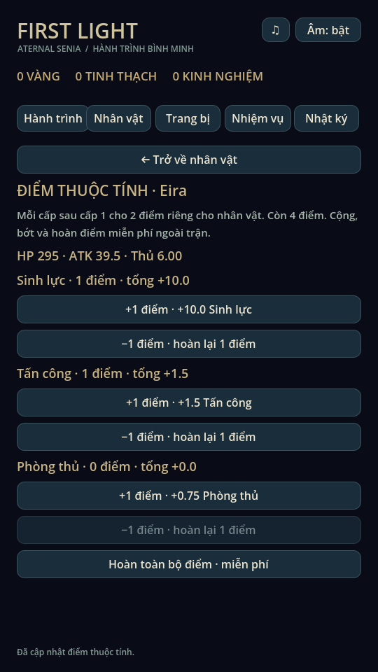
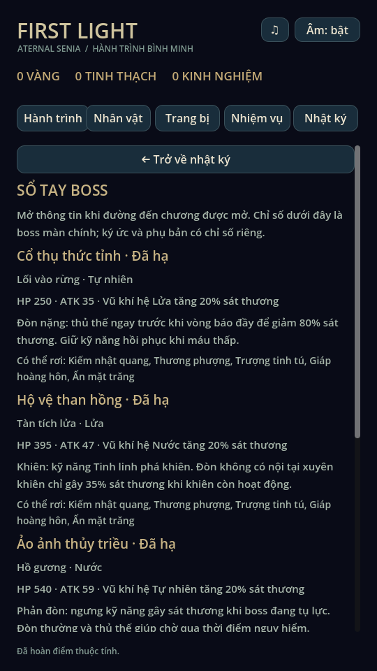

# Rèn luyện & Sổ tay boss · 0.8

## Tham khảo và quyết định

Đã đọc repo [Tham-kh-o-game](https://github.com/tai23082004l02-svg/Tham-kh-o-game)
tại commit `2c7af38c4c208656703814f64b05dfe0bd54844e`.
`research/eternal-senia-2/catalogs/table_schemas.json` có bảng `statspoint`
(99 dòng: `lv`, `statspoint`, `stats_req`) và bảng `mob` có chỉ số, nguyên tố,
nhóm loot. Đây là bằng chứng cấu trúc dữ liệu; không có thuật toán phân bổ điểm
hoặc bằng chứng UI sổ tay gốc. Hai tính năng dưới đây là thiết kế mới cho First
Light, không sao chép công thức, chuỗi hội thoại hay tài nguyên gốc.

## Điểm thuộc tính

Vào **Nhân vật → Điểm thuộc tính**. Ngân sách = `(cấp − 1) × 2`, tối đa 198 điểm
ở cấp 100. Mỗi hero sở hữu phân bổ riêng, không cần mua điểm. Các cấp đã đạt
trước bản 0.8 vẫn có đủ ngân sách. Không nhận điểm từ đồng hành hoặc cấp kỹ năng.

| Thuộc tính | Mỗi điểm |
|---|---|
| Sinh lực | +10 HP |
| Tấn công | +1,5 ATK |
| Phòng thủ | +0,75 phòng thủ |

Điểm cộng sau các chỉ số hero/trang bị. Giá trị lẻ được giữ trong tính toán chiến
đấu; một số nhãn HUD cũ vẫn hiển thị số nguyên. Cộng, bớt một điểm hoặc hoàn toàn
bộ đều miễn phí. Không trừ vàng, XP, tinh thạch. Không đổi build khi còn pending
run, kể cả pending sau khởi động lại. Reset chỉ tác động hero đang chọn.

`AttributeTraining` quản lý ngân sách, validation và giao dịch. `GameCatalog.stats`
cộng bonus trước khi tạo snapshot. `BattleModel` tiếp tục sở hữu sát thương và
marker, không đọc lại phân bổ giữa trận. Không thay âm thanh hoặc RNG.

## Save

Giữ schema v3, đường dẫn và cơ chế atomic commit/backup hiện có. Đây là trường
`training` bổ sung tùy chọn: save v1/v2/v3 chưa có trường này được coi là chưa
phân bổ, không sửa dữ liệu trong lúc đọc. Lần chỉnh điểm đầu tiên tạo đầy đủ phân
bổ cho ba hero rồi commit. Backup giữ nguyên file trước đó. Không tự bổ sung hay
tính lại stats trong pending snapshot cũ. Các giao dịch khác giữ trường mới.

Nếu đã có `training`, phải đủ ba hero và đúng ba thuộc tính; chỉ nhận số nguyên
không âm, tổng không vượt ngân sách theo cấp. Dữ liệu có trường mới sai không
được âm thầm reset; giữ cơ chế phục hồi/khóa ghi của ProgressStore. Khi ghi lỗi,
RAM, điểm và ví không đổi, có thể thử lại. Chạy lại phiên bản game trước 0.8 sẽ
không áp dụng bonus thuộc tính vào trận mới vì chưa có logic này.

## Sổ tay boss

Vào **Nhật ký → Sổ tay boss**. Chỉ hiện tên/thông tin boss khi `can_enter` chương
chính tương ứng; chương chưa mở có dòng khóa. Dấu đã hạ lấy từ clear hiện có.
Trang đọc catalogue thực: HP, ATK, nguyên tố và danh sách loot; gợi ý cơ chế dựa
luật BattleModel hiện tại. Không tạo phần thưởng mới hoặc ghi save khi đọc.
Nhánh ký ức và phụ bản có chỉ số riêng, không dùng chỉ số của sổ tay làm cam kết.

## Kiểm chứng

Godot 4.6.3 Linux:

- `tests/attribute_training.gd`: 62 kiểm tra gồm save cũ, backup, phân bổ/ngân
  sách, tách hero, reset, lỗi ghi/retry, số lẻ, dữ liệu sai, pending/reload và
  sát thương thực tại marker/phòng thủ trước đòn quái.
- `tests/training_ui.gd`: thao tác nút cộng/bớt/hoàn, mở sổ tay, điều hướng giữa
  trận tự pause và khóa build; render X11/Mesa và xem ảnh thật.
- Regression 81 checks, mechanics 54 tổ hợp, campaign 5 màn, expansion 60 checks,
  expansion_campaign 18 địa điểm, audio 93 checks, painted_art và combat_presentation.
- Chạy lại ui_flow và animation_gallery. Dùng profile riêng trong mọi test.

Chưa thử touch hoặc hiệu năng trên điện thoại thật. Mỹ thuật Ryn/Mira và một số
vùng/quái vẫn là hình mẫu như trước.

