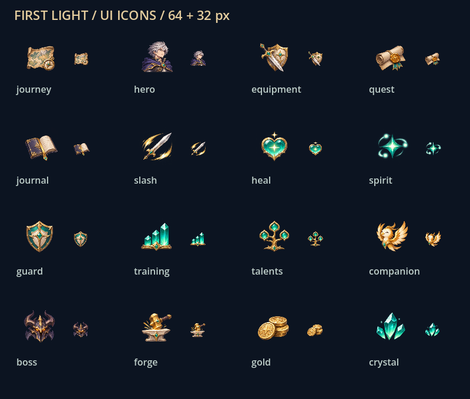
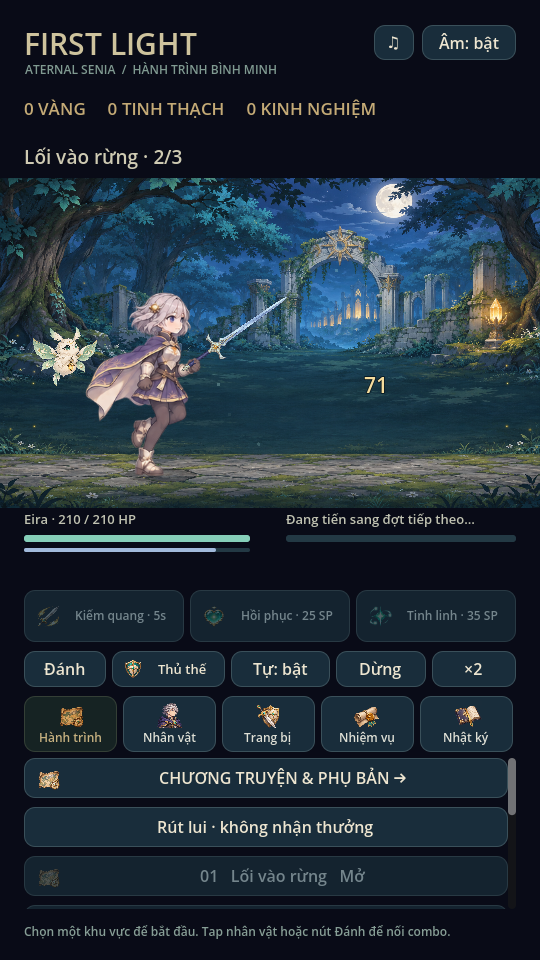
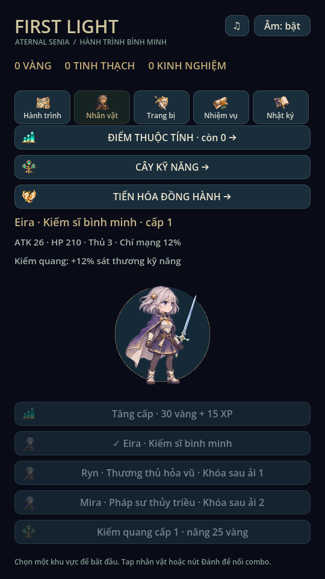

# Icon giao diện · 0.8.1

Bộ 16 icon tạo riêng bằng image generation, PNG alpha tại `art/ui/icons.png`.
Giữ nguyên ảnh nguồn 1254×1254; không nhập icon từ game tham khảo, không chỉnh
pixel/cắt alpha bằng code. SHA256 và danh sách cell trong `art/ui/provenance.json`.

| Nhóm | Icon |
|---|---|
| Điều hướng | Hành trình, Nhân vật, Trang bị, Nhiệm vụ, Nhật ký |
| Chiến đấu | Kiếm quang, Hồi phục, Tinh linh, Thủ thế |
| Phát triển | Thuộc tính, Cây kỹ năng, Đồng hành, Boss, Rèn |
| Tài nguyên | Vàng, Tinh thạch |

`UIIcons` giữ một texture nguồn và 16 AtlasTexture, `filter_clip` tránh sampling
sang cell khác. Biên nguồn được xem trực quan: 0 / 314 / 627 / 940 / 1254.
Icon ở tab 31px, kỹ năng/nút quản lý tối đa 28px, thủ thế 22px. Có nhãn chữ đi
kèm; hai lớp con ở tab bỏ qua chuột để nhấn vẫn vào Button. Nút khóa giữ màu
icon mờ. Năm tab cao 56px; vị trí trong trận 696–752, dưới hàng điều khiển và
trên panel 758. Trang quản lý dùng tab 150–206, panel từ 208.

Ảnh source giữ nguyên, gallery xem icon ở 32px/64px trên nền game; không có
background matte. Đây là icon UI, chưa thay hình minh họa từng mẫu loot hoặc
thêm bộ icon ứng dụng Android/iOS. Không đổi save, stats, âm thanh hay BattleModel.

Đã kiểm Godot 4.6.3 Linux X11/Mesa: `ui_flow.gd` (thêm kiểm kích thước tab/icon,
không tràn nút kỹ năng), `training_ui.gd`, `animation_gallery.gd`,
`icon_gallery.gd`. Đã xem ảnh gameplay, trang nhân vật và contact sheet icon.
Chưa thử cảm ứng hoặc độ rõ trên màn hình điện thoại thật.

