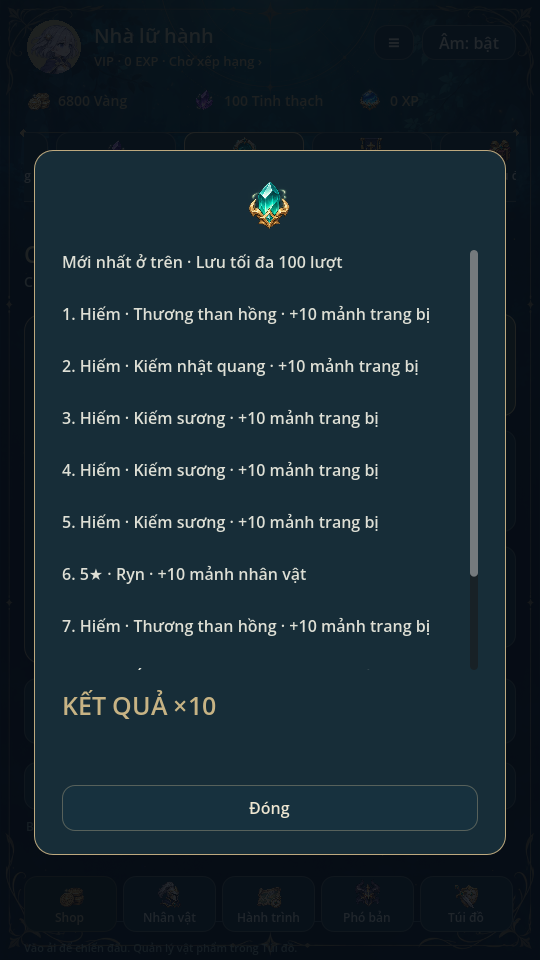
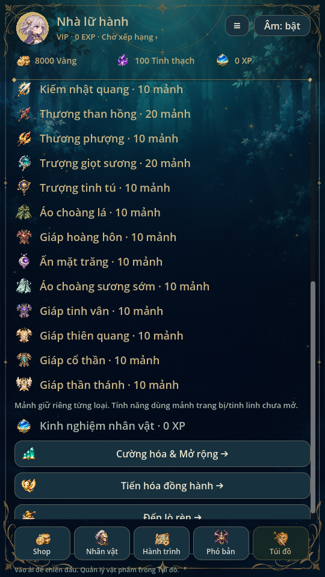

# Sở hữu duy nhất, mảnh đúng loại và năm độ hiếm · 0.23

> Quy tắc một bản/10 mảnh và năm độ hiếm tiếp tục áp dụng. [Bản0.27](EQUIPMENT_SETS.md) thêm bốn ô, bộ trang bị, cap+15 và save v9 đọc v2–v8; các mô tả v7/14 item dưới đây là lịch sử0.23.

Mỗi **ID trang bị** chỉ có một bản trong kho. Kiếm sương và Kiếm nhật quang
là hai món khác nhau; không gộp tất cả kiếm thành một món. Nhân vật và tinh
linh cũng chỉ mở khóa một lần. Nhận lại món/nhân vật/tinh linh đã sở hữu sẽ
thành **10 mảnh đúng ID**, không sinh thêm bản sao.

## Quy tắc nhận thưởng

| Loại | Lần đầu, chưa sở hữu | Nhận trùng |
| --- | --- | --- |
| Trang bị | Một item với UID và nâng cấp riêng | +10 mảnh đúng trang bị đó, không cấp UID mới |
| Nhân vật | Mở khóa hero | +10 mảnh đúng hero |
| Tinh linh | Mở khóa tinh linh | +10 mảnh đúng tinh linh, không đổi thành lõi chung |

Hero/tinh linh đã mở qua hành trình cũng được tính là đã sở hữu. Hero đạt sao
tối đa vẫn nhận mảnh đúng hero. Quy tắc áp dụng cho đồ rơi khi thắng, rèn và
triệu hồi x1/x10. Không thay chi phí rèn, triệu hồi, pity, trọng số, seed/count
hoặc thưởng tiền/XP/tinh thạch cơ bản của ải.

Kho Nguyên liệu liệt kê mảnh hero, tinh linh và từng trang bị. Chi tiết trang
bị/tinh linh hiển thị số mảnh tương ứng. Kết quả trận và lịch sử triệu hồi nói
rõ món trùng và số mảnh. Mảnh hero tiếp tục dùng cho Mở rộng; **chưa đặt công
thức tiêu mảnh trang bị/tinh linh mới**. Không tự đổi mảnh sang lõi chung.

Phân giải vẫn là hành động chủ động cho món không được hero nào sử dụng.
Sau phân giải, nếu nhận lại món không còn trong kho thì sẽ có một bản item
mới; mảnh đã tích lũy vẫn giữ. Không tự khóa vĩnh viễn một món đã phân giải.

## Đúng năm cấp độ trang bị

**Hiếm → Sử thi → Huyền thoại → Thần thoại → Thần thánh**.

Các món Thường/Không phổ biến cũ chuyển thành Hiếm. Không xóa món, đổi ID,
hình, ATK/HP/thủ hoặc mức nâng cấp vì đổi nhãn. `armor_uncommon` vẫn là ID
tương thích của Áo choàng sương sớm, độ hiếm hiện là Hiếm.

| Nhãn hiện hành | Mã dữ liệu ổn định | Màu |
| --- | --- | --- |
| Hiếm | 3 | Xanh dương |
| Sử thi | 4 | Tím |
| Huyền thoại | 5 | Cam |
| Thần thoại | 6 | Đỏ |
| Thần thánh | 7 | Vàng |

Mã3–7 được giữ để tương thích; đây là **năm cấp**, không còn cấp1/2 trang bị
trong catalogue/registry/bộ lọc. Bộ lọc chỉ hiện tên năm cấp, cộng Mọi độ hiếm.
Đừng đưa lại1/2 từ tài liệu0.12 cũ hoặc suy ra cấp từ hậu tố ID item.

`summon_group` tách nhóm xác suất khỏi độ hiếm. Giữ các món ở nhóm quay cũ
nên việc gộp nhãn không thay pool/trọng số. `cooldown_scale` được khai báo rõ
trong catalogue: vũ khí khởi đầu vẫn1.0, mẫu thứ hai vẫn0.92; không tự buff vũ
khí chỉ vì đã chuyển từ Thường sang Hiếm. Hero1–5★, đối thủ1–4★ và tinh linh
SR/SSR/UR là các hệ độc lập, không bị gộp theo năm cấp trang bị.

## Một item, nhiều cấu hình hero

Các hero hợp lớp có thể tham chiếu cùng UID
trong cấu hình riêng. Không nhân bản item. Ryn/Lyra dùng chung thương khởi đầu
trên profile mới; nâng món chung áp dụng cho các cấu hình dùng món đó.
Mỗi hero vẫn chọn/tháo trang bị riêng, không tự tháo món của hero khác. Kiểm
tra loại vũ khí/lớp vẫn giữ. Phân giải bị khóa khi bất kỳ hero nào đang dùng.
Pending run giữ snapshot cũ, không nhận thay đổi build giữa trận.

## Save v7 và chuyển đổi dữ liệu cũ

Giữ đường dẫn `first_light_v2.json`, đọc v2–v6. Bản cũ chưa hiểu v7 sẽ khóa ghi.

- Hero fragments giữ tại `recruitment.fragments[hero_id]`.
- Mảnh gear tại `collection_fragments.items[item_id]`.
- Mảnh tinh linh tại `collection_fragments.spirits[spirit_id]`.
- Hai map mới đầy đủ ID catalogue, số nguyên không âm; dữ liệu thiếu/sai ở
  save v7 không được tự sửa hoặc tự phát mảnh.

Đọc và kiểm hợp lệ save cũ trước khi chuyển đổi. Với item cùng base, giữ UID
đầu tiên trong thứ tự kho, lấy **enhance lớn nhất và rank lớn nhất** của các
bản cùng món. Mỗi bản dư thành10 mảnh món đó; ánh xạ mọi tham chiếu equipment
cũ về UID giữ lại. Giữ next_uid, ví, level, kỹ năng, sở hữu, điểm nhiệm vụ,
claimed/settled, lịch sử và toàn bộ pending snapshot. Chuyển đổi chỉ chạy từ
schema cũ, không cộng lại khi nạp save v7.

Lịch sử v5/v6 có item rarity1/2 chỉ được đổi nhãn nếu cặp ID/rarity đúng với
dữ liệu cũ đã biết; giữ `legacy_rarity` để đối chiếu. Migration lịch sử v3/v4
vẫn hoạt động. Tinh linh trùng đã trả2 lõi ở phiên bản cũ giữ nguyên lịch sử
và số dư; không truy hồi hoặc tự cộng thêm mảnh cho lượt đã nhận. Lượt mới ghi
`fragment_amount=10` cùng ID gốc trong lịch sử.

Migration ở RAM; lần ghi thành công đầu tạo `.bak` nguyên byte save cũ rồi
mới thay file. Lỗi ghi giữ candidate chưa áp dụng, không trừ ví hoặc cộng mảnh.
Settle cùng run ID không phát lại thưởng. Triệu hồi x10 là một transaction và
cho kết quả giống10 lượt đơn theo đúng thứ tự, kể cả món lặp trong cùng batch.

## Nguồn và kiểm tra

`game/core/collection_fragments.gd` giữ map mới, migration gộp và nhãn lịch sử.
`ProgressStore._add_item` là đường nhận gear chung cho forge/loot/summon.
`Recruitment._draw` xử lý trùng hero/tinh linh và lịch sử, không dùng RNG trận.
`tools/build_catalog.py` phải giữ năm cấp, summon_group và cooldown_scale khi
tái tạo `game/data/catalog.json`.

Godot4.6.3 Linux: unique_collection kiểm ba loại nhận trùng, đúng ID, nhận mới,
forge/loot, lỗi ghi/retry/idempotency, v2–v6 migration, nâng cấp cao nhất,
equipment reference, snapshot/backup và từ chối save sai. summon_batch so x10
với10 lần đơn. rarity_system kiểm đúng năm nhãn, phân loại hero/tinh linh,
cooldown/pool và lịch sử cũ. Các suite regression, recruitment, mechanics,
campaign, expansion_campaign, hero_management, Lyra, thuộc tính, wardrobe,
missions và complete_art đạt. Test dùng save riêng.

UI: unique_collection_ui kiểm đúng sáu lựa chọn bộ lọc (Tất cả +5 cấp), năm
nhóm hiện đúng, kho mảnh theo ID, thương dùng chung và bảng trùng x10.
Chạy thêm mobile_inventory, character_ui, summon_ui, shop_ui, ui_flow,
animation_gallery cùng UI liên quan. Xem ảnh render thật; chưa thử điện thoại.

Từ0.24: save v8 đọc v2–v7, trận mới3vN. Quy tắc cùng UID dùng trong nhiều build được giữ khi các hero cùng vào đội, không tạo item mới. Pending team giữ build từng hero. Xem TEAM_COMBAT.md.
