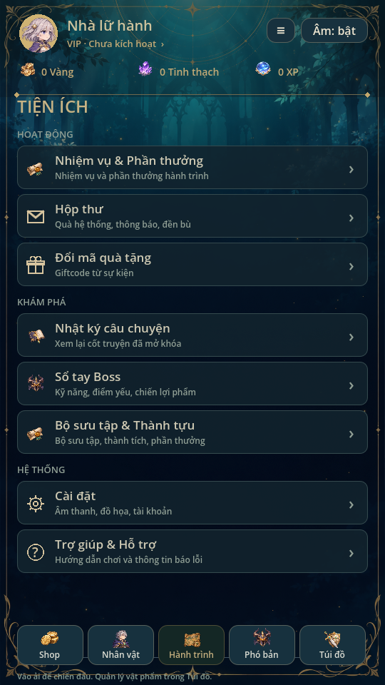
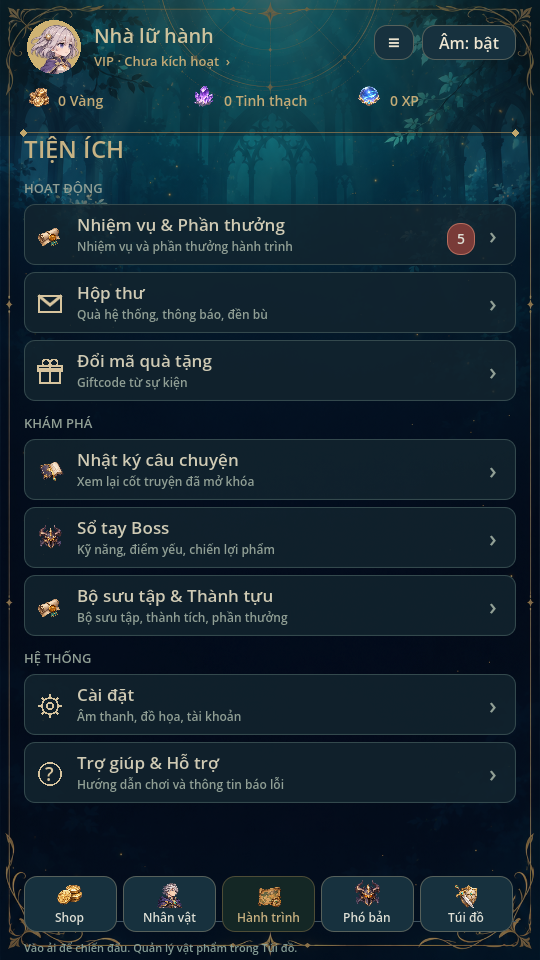
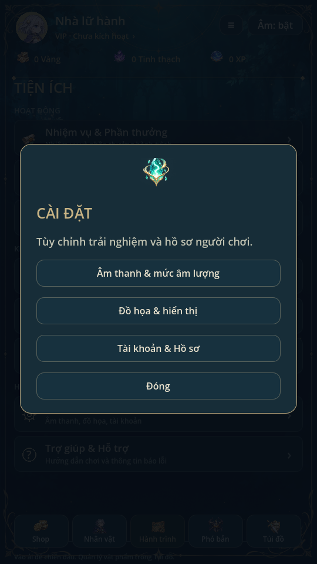

# Tiện ích · 0.18

Giữ nền xanh/vàng của game, thay danh sách nút đơn bằng ba nhóm theo mẫu:

- Hoạt động: Nhiệm vụ & Phần thưởng; Hộp thư; Đổi mã quà tặng.
- Khám phá: Nhật ký câu chuyện; Sổ tay Boss; Bộ sưu tập & Thành tựu.
- Hệ thống: Cài đặt; Trợ giúp & Hỗ trợ.

Mỗi dòng có icon, tiêu đề, mô tả và mũi tên, cao61px trên viewport540×960.
Tám mục nằm trong vùng cuộn hiện có, không đè thanh điều hướng dưới. Huy hiệu
Nhiệm vụ đếm quest đủ target chưa claimed; không dùng số mẫu2/3 từ ảnh. Chưa
thêm nhiệm vụ ngày/tuần, danh hiệu hoặc thành tựu mới.

Nhiệm vụ, Nhật ký, Boss và Bộ sưu tập mở màn chức năng cũ. Hộp thư hiển thị
trống/chờ dịch vụ, không có thư hoặc quà giả. Giftcode có ô nhập và nút đổi mã
khóa, chưa cấu hình sự kiện/backend. Chưa thêm mạng, server hoặc SDK.

Cài đặt mở Âm thanh & mức âm lượng hiện có, thông tin đồ họa/hiển thị và Hồ sơ.
Chưa thêm lựa chọn chất lượng/FPS hoặc đăng nhập mạng. Trợ giúp có hướng dẫn
chơi, thông tin cần kèm khi báo lỗi và phiên bản; kênh gửi lỗi/liên hệ chưa cấu
hình. Không tự gửi bất kỳ dữ liệu hoặc thông báo nào.

Không đổi schema/save/ví/stats; duyệt menu không thay tiến trình. utilities_ui
kiểm ba nhóm/tám đích, badge đúng theo thưởng chưa nhận và không thay dữ liệu.
ui_flow, animation_gallery, regression87, mechanics72, campaign5 đạt. Đã xem ảnh
render Godot Linux; chưa thử màn hình/touch điện thoại thật.

